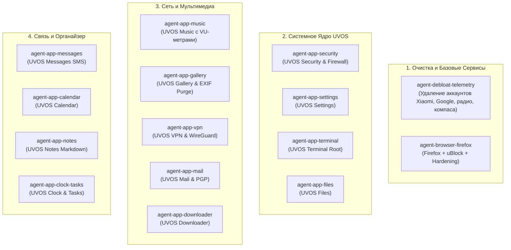

# Архитектурный план и документация пакета приложений UnderVoltOS (UVOS Suite)

> **Статус**: Архитектурная спецификация и пошаговый план разработки (ТОЛЬКО ДОКУМЕНТАЦИЯ)  
> **Целевая платформа**: UnderVoltOS (Xiaomi Redmi Note 13 4G NFC `sapphire/sapphiren` / HyperOS / AOSP / LineageOS)  
> **Принцип**: 0% рекламы, 0% телеметрии, 0% сторонних облаков, изоляция приложений («закрытая территория»), единый ретро-приборный дизайн.

---

## 1. Общие архитектурные требования и дизайн-код UVOS

Все собственные приложения разрабатываются как независимые легковесные модули в едином дизайн-коде и с едиными правилами безопасности.

### 1.1 Дизайн-система (Retro-Instrument / M4200 UI)
* **Фон (`uvos_background`)**: `#0E0E12` (глубокий матовый чёрный).
* **Плитки/Контейнеры (`uvos_tile`)**: `#1C1E26` со скруглением 24–28dp.
* **Циферблат (`uvos_dial`)**: `#E8E4D8` (винтажная слоновая кость приборной шкалы).
* **Маркировка циферблата (`uvos_dial_text`)**: `#1A1A1A`.
* **Акцентный красный (`uvos_red`)**: `#E02020` (критические зоны, стрелки, индикаторы тревоги).
* **Индикаторные лампочки (`LampView`)**: зелёный (норма/активно), жёлтый (ожидание), красный (ошибка/изоляция).
* **Типографика**: Моноширинный индустриальный шрифт (JetBrains Mono / Roboto Mono) для числовых значений, метрик, хэшей и консолей; чистый гротеск для списков.

### 1.2 Политика «Zero Telemetry & Ad-Free Invariant»
1. Полный запрет на включение SDK сторонней аналитики: никаких Firebase Analytics, Crashlytics, Adjust, AppsFlyer, Unity, Meta SDK.
2. Отсутствие внешних рекламных баннеров и API монетизации.
3. Сетевая изоляция: приложения, которым не требуется сеть (Заметки, Галерея, Часы, Калькулятор, Файлы), собираются **БЕЗ** разрешения `android.permission.INTERNET` в манифесте.
4. Локальное хранение: все базы данных хранятся строго в изолированном каталоге приложения (`Room` SQLite / SQLCipher) без облачной синхронизации.

---

## 2. Матрица компонентов: Разработка, Замена и Полная Очистка (Purge)

| # | Компонент | Статус в плане | Пакет / Реализация | Ключевая концепция |
|---|---|---|---|---|
| 1 | **Файловый менеджер** | Разработка | `com.uvos.files` | Двухоконный менеджер, индикаторы занятости дисков, Root-проводник |
| 2 | **Настройки** | Разработка | `com.uvos.settings` | Приборный пульт UVOS: профили («Стерильно» / «Связь»), регулятор сети |
| 3 | **Фотографии / Галерея**| Разработка | `com.uvos.gallery` | Оффлайн-галерея, мгновенная очистка EXIF, шифрованный сейф |
| 4 | **Безопасность** | Разработка | `com.uvos.security` | Главный щит изоляции: фальсификация метрик, iptables-файрвол, AppOps |
| 5 | **Терминал (Root)** | Разработка | `com.uvos.terminal` | Индустриальный su/sh шелл со стрелочным амперметром нагрузки CPU |
| 6 | **Встроенный браузер** | Замена + Настройка| Mozilla Firefox / Mull | Скрипт предустановки: uBlock Origin, отключение телеметрии Mozilla, системный дефолт |
| 7 | **Музыка** | Разработка | `com.uvos.music` | Hi-Res аудиоплеер со стрелочными стерео VU-метрами (L/R) |
| 8 | **Почта** | Разработка | `com.uvos.mail` | Чистый IMAP/SMTP клиент, OpenKeychain PGP, блокировка трекинг-пикселей |
| 9 | **Радио** | **УДАЛИТЬ** | Пакетный деблоат | Полное удаление `com.miui.fm`, `com.android.fmradio`, `com.caf.fmradio` |
| 10| **ВПН** | Разработка | `com.uvos.vpn` | WireGuard / VLESS клиент со стрелочным амперметром сетевого потока |
| 11| **Сообщения (SMS)** | Разработка | `com.uvos.messages` | Локальный SMS/MMS клиент со встроенным regex-антиспамом |
| 12| **Компас** | **УДАЛИТЬ** | Пакетный деблоат | Полное удаление `com.miui.compass` |
| 13| **Диктофон** | **УДАЛИТЬ** | Пакетный деблоат | Полное удаление `com.miui.soundrecorder`, `com.android.soundrecorder` |
| 14| **Сервисы Google** | **Очистка (Debloat)** | Пакетный деблоат | Удаление Chrome, YouTube, Gmail, Maps, Wellbeing, ОСТАВЛЯЯ только Play Store (`vending`) + GmsCore |
| 15| **Аккаунты Xiaomi / HyperOS / MIUI** | **ПОЛНОЕ УДАЛЕНИЕ** | Пакетный деблоат | Полная ликвидация Mi Account (`com.xiaomi.account`), Mi Cloud, FindDevice, Mi Push, Mi Pay |
| 16| **Сбор данных / Телеметрия**| **Очистка + Блок** | Пакетный деблоат + DNS | Удаление MIUI MSA, Joyose, Daemon, Analytics + Private DNS AdGuard |
| 17| **Менеджер загрузок** | Разработка | `com.uvos.downloader` | Многопоточный оффлайн-загрузчик со стрелочным спидометром скорости |
| 18| **Календарь** | Разработка | `com.uvos.calendar` | Локальный календарь / CalDAV, циферблат даты, 0 трекинга Google |
| 19| **Заметки** | Разработка | `com.uvos.notes` | Markdown-блокнот, хранение в открытых `.md` файлах, AES-шифрование |
| 20| **Часы** | Разработка | `com.uvos.clock` | Хронограф, будильники со шкалами UVOS Gauge, аналоговый звук |
| 21| **Напоминания** | Разработка | `com.uvos.tasks` | Матрица задач, приоритеты, локальные пуш-уведомления без облака |

---

## 3. Протокол ликвидации аккаунтов HyperOS / Xiaomi / MIUI и телеметрии

### 3.1. Полное удаление экосистемы Mi Account
> [!IMPORTANT]
> **Важное правило безопасности**: Перед физическим удалением пакетов аккаунтов необходимо выполнить ручной выход (Sign Out) из Mi Account в настройках телефона (если вход был выполнен ранее). Это предотвратит срабатывание механизма защиты от кражи (FRP / Xiaomi Cloud Lock) при возможной полной перезагрузке или сбросе.

**Список пакетов аккаунтов и облачных сервисов Xiaomi подлежащих удалению:**
* `com.xiaomi.account` — Ядро Mi Account (авторизация, фоновая синхронизация учетной записи).
* `com.xiaomi.finddevice` — Служба поиска устройства (постоянный маяк геолокации и удаленной блокировки).
* `com.miui.cloudservice` — Служба облака Mi Cloud (выгрузка контактов, фото, настроек).
* `com.miui.cloudservice.sysbase` — Системная база Mi Cloud.
* `com.miui.cloudbackup` — Фоновое резервное копирование в облако Xiaomi.
* `com.miui.micloudsync` — Синхронизация данных с серверами Xiaomi.
* `com.xiaomi.xmsf` — Xiaomi Mobile Services Framework (Push-уведомления и телеметрия аккаунта).
* `com.xiaomi.payment` — Mi Pay / Платежные профили Xiaomi.
* `com.mipay.wallet.id` — Идентификатор кошелька Xiaomi.
* `com.xiaomi.pass` — Mi Credit / Финансовые службы.
* `com.miui.userguide` — Принудительные подсказки входа в аккаунт Xiaomi.
* `com.miui.vipservice` — Сообщество и телеметрия пользователей Xiaomi.

### 3.2. Ликвидация рекламных и телеметрических демонов
* `com.miui.analytics` — Основной сборщик аналитики и кликов интерфейса.
* `com.miui.msa.global` — MIUI System Ads (доставка рекламных баннеров в системные приложения).
* `com.xiaomi.joyose` — Демон сбора статистики использования приложений и троттлинга.
* `com.miui.daemon` — Системный демон отправки отчетов производительности в Китай.
* `com.miui.hybrid` / `com.miui.hybrid.accessory` — Quick Apps платформы показа рекламы.
* `com.miui.yellowpage` — Желтые страницы и перехват номеров телефонов.
* `com.miui.bugreport` — Автоматическая отправка дампов и логов.
* `com.miui.miservice` — Служба обратной связи и телеметрии.

### 3.3. Выборочный деблоат Google (Сохранение только Google Play)
* **Сохраняемые компоненты (Core)**:
  * `com.android.vending` — Google Play Store (Магазин приложений).
  * `com.google.android.gms` — Google Play Services (Только ядро авторизации и API покупок).
* **Удаляемые компоненты**:
  * `com.android.chrome` — Google Chrome (заменяется на Firefox).
  * `com.google.android.youtube` / `com.google.android.apps.youtube.music` — YouTube / YT Music.
  * `com.google.android.gm` — Gmail (заменяется на UVOS Mail).
  * `com.google.android.apps.photos` — Google Photos (заменяется на UVOS Gallery).
  * `com.google.android.apps.docs` — Google Drive.
  * `com.google.android.apps.maps` — Google Maps.
  * `com.google.android.googlequicksearchbox` — Google Search / Discover.
  * `com.google.android.apps.googleassistant` — Google Assistant.
  * `com.google.android.apps.wellbeing` — Цифровое благополучие (фоновый трекер экранного времени).
  * `com.google.android.apps.turbo` — Device Health Services (сбор логов батареи).
  * `com.google.android.feedback` — Google Feedback.

---

## 4. Спецификация разрабатываемых приложений UVOS

### 4.1. UVOS Files (`com.uvos.files`)
* **Назначение**: Полный контроль файловой системы без облаков.
* **Архитектура**: MVVM, Jetpack Compose, Kotlin Coroutines, DocumentFile API + libsu для режима Root.
* **Ключевые фичи**:
  * В верхней части экрана — стрелочные индикаторы свободного места (GaugeView) для `/data`, `/sdcard` и подключённых USB-OTG накопителей.
  * Двухпанельный режим в ландшафте, быстрые вкладки (Документы, Загрузки, Архивы, Root-FS).
  * Встроенный легковесный просмотрщик текстовых файлов и шестнадцатеричный редактор (Hex Viewer).
  * Вычисление контрольных сумм файлов (MD5, SHA-256) в один тап.
  * Без сетевых разрешений (отсутствует `INTERNET`).

### 4.2. UVOS Settings (`com.uvos.settings`)
* **Назначение**: Пульт управления всей системой UnderVoltOS.
* **Архитектура**: MVI, системные скрытые API (`android.provider.Settings`), доступ к `/sys/devices/system/cpu/`.
* **Ключевые фичи**:
  * Переключение профилей UVOS: **«СТЕРИЛЬНО»** (выключены радиомодули, сенсоры заблокированы), **«СВЯЗЬ»** (только нужные мессенджеры), **«СВОЙ»**.
  * Управление изоляцией приложений и ревизия разрешений AppOps.
  * Мониторинг вольтажа и температуры батареи в реальном времени.

### 4.3. UVOS Gallery (`com.uvos.gallery`)
* **Назначение**: Локальный медиа-браузер без автозагрузок и распознавания лиц на серверах.
* **Архитектура**: Coil (локальный кэш картинок), MediaStore API, ExifSubsystem.
* **Ключевые фичи**:
  * Кнопка «Очистить EXIF»: удаляет GPS-координаты, модель камеры и серийный номер из заголовков фото перед отправкой.
  * Встроенный сейф: локальное шифрование папки с фото (AES-GCM).
  * Приложение не имеет доступа в Интернет (`android.permission.INTERNET` исключён).

### 4.4. UVOS Security & Isolation Shield (`com.uvos.security`)
* **Назначение**: Центральный защитный узел UnderVoltOS.
* **Архитектура**: Интеграция с Linux iptables/nftables, Root libsu, AppOpsManager.
* **Ключевые фичи**:
  * **Регулятор сети (Network Firewall)**: принудительная блокировка входящих/исходящих пакетов для выбранных приложений через iptables (`-m owner --uid-owner`).
  * **Маскировка сенсоров**: подмена точного времени, фейковый заряд батареи и блокировка чтения серийных номеров (IMEI/Android ID) для стороннего софта.
  * Журнал подозрительной активности: стрелочный вольтметр «Уровень фоновой тревоги».

### 4.5. UVOS Terminal (`com.uvos.terminal`)
* **Назначение**: Профессиональный шелл с Root-доступом и приборным оформлением.
* **Архитектура**: Native PTY (Android NDK terminal backend), libsu wrapper, моноширинный движок отрисовки.
* **Ключевые фичи**:
  * В шапке консоли — два аналоговых прибора: вольтметр частоты CPU и амперметр расхода ОЗУ.
  * Готовые быстрые макросы: `debloat-check`, `kill-background`, `flush-dns`, `sysctl-harden`.
  * Цветовая схема: винтажный янтарный/зелёный люминофор или фирменный чёрно-красный стиль UVOS.

### 4.6. UVOS Music (`com.uvos.music`)
* **Назначение**: Плеер для локальной аудиоколлекции (FLAC, ALAC, MP3, OGG, WAV).
* **Архитектура**: AndroidX Media3 (ExoPlayer локальный режим), Visualizer API для аудио-спектра.
* **Ключевые фичи**:
  * **Живые стрелочные VU-метры**: два синхронных прибора UVOS GaugeView для левого и правого аудиоканала, реагирующие на реальную амплитуду трека.
  * Полностью оффлайн: никаких рекомендаций, рекламных подборок и подписок.
  * Встроенный 10-полосный эквалайзер с ретро-тумблерами.

### 4.7. UVOS Mail (`com.uvos.mail`)
* **Назначение**: Защищённый почтовый клиент.
* **Архитектура**: Jakarta Mail / JavaMail Android Port, интеграция с OpenKeychain (OpenPGP).
* **Ключевые фичи**:
  * Автоматическая блокировка удалённых веб-маяков (tracking pixels) и отключение автозагрузки изображений.
  * Поддержка шифрования PGP (GnuPG).
  * Локальная база писем без проксирования через сторонние серверы разработчика.

### 4.8. UVOS VPN (`com.uvos.vpn`)
* **Назначение**: Шифрованный туннель для сетевого трафика.
* **Архитектура**: Android VpnService, WireGuard Go Backend / Xray core.
* **Ключевые фичи**:
  * Стрелочный амперметр пропускной способности (скорость передачи/приёма).
  * Постоянный выключатель Kill-Switch (запрет утечки DNS и незашифрованного трафика при обрыве).
  * Раздельное туннелирование (Split-Tunneling) по списку установленных пакетов.

### 4.9. UVOS Messages (`com.uvos.messages`)
* **Назначение**: Традиционные SMS/MMS.
* **Архитектура**: Telephony Provider, SMS Receiver, Jetpack Compose.
* **Ключевые фичи**:
  * Встроенный оффлайн-фильтр спама по маскам номеров и ключевым словам без отправки SMS в облако.
  * Режим чистого текста (отключение автозагрузки фишинговых превью ссылок).

### 4.10. UVOS Downloader (`com.uvos.downloader`)
* **Назначение**: Менеджер сетевых загрузок файлов.
* **Архитектура**: Kotlin Coroutines Flow, RandomAccessFile, OkHttp multi-part download engine.
* **Ключевые фичи**:
  * Разрезание файла на 4–8 потоков для ускорения скачивания.
  * Пауза и докачка при нестабильной связи.
  * Стрелочный спидометр килобайт/мегабайт в секунду в стиле M4200.

### 4.11. UVOS Calendar (`com.uvos.calendar`)
* **Назначение**: Планировщик событий без синхронизации с Google.
* **Архитектура**: Room Database, локальные будильники AlarmManager.
* **Ключевые фичи**:
  * Винтажный календарный циферблат даты.
  * Поддержка CalDAV для собственного сервера (Nextcloud) без Google Calendar.

### 4.12. UVOS Notes (`com.uvos.notes`)
* **Назначение**: Быстрые заметки и документы.
* **Архитектура**: Room + файловое хранилище (plain Markdown), Markwon render.
* **Ключевые фичи**:
  * Заметки сохраняются как стандартные `.md` файлы в выбранную папку.
  * Возможность шифрования отдельных заметок локальным паролем.

### 4.13. UVOS Clock (`com.uvos.clock`)
* **Назначение**: Часы, секундомер, таймер, будильник.
* **Архитектура**: Custom Canvas GaugeView, AlarmManager + Foreground Service.
* **Ключевые фичи**:
  * Стрелочный циферблат секундомера и таймера с физической стрелкой.
  * Плавное аналоговое нарастание звука сигнала.

### 4.14. UVOS Tasks / Reminders (`com.uvos.tasks`)
* **Назначение**: Задачи и списки дел.
* **Архитектура**: Room DB, WorkManager для фоновых напоминаний.
* **Ключевые фичи**:
  * Сортировка по приоритетам (Срочно / Важно).
  * Привязка к геолокации отключена для приватности — срабатывание строго по таймерам.

---

## 5. План распределения 15 специализированных субагентов

### Карточка каждого субагента:
1. **`agent-debloat-telemetry`**: Пакетная очистка через ADB/Shell. Удаление всех аккаунтов Xiaomi/HyperOS, сервисов слежки, радио, компаса, диктофона, лишних приложений Google, активация DNS AdGuard.
2. **`agent-browser-firefox`**: Интеграция сборки Firefox/Mull с uBlock Origin, отключение телеметрии Mozilla в `user.js`, установка системным браузером.
3. **`agent-app-files`**: Проектирование и кодогенерация проводника `com.uvos.files` со шкалами свободного места.
4. **`agent-app-settings`**: Разработка панели настроек `com.uvos.settings` и переключателя системных профилей.
5. **`agent-app-gallery`**: Разработка галереи `com.uvos.gallery` с авто-стриппером метаданных.
6. **`agent-app-security`**: Разработка центра изоляции `com.uvos.security` с iptables-модулем.
7. **`agent-app-terminal`**: Разработка root-консоли `com.uvos.terminal` со стрелочным амперметром CPU.
8. **`agent-app-music`**: Разработка плеера `com.uvos.music` со стерео VU-метрами.
9. **`agent-app-mail`**: Разработка почтового клиента `com.uvos.mail` с PGP и защитой от маяков.
10. **`agent-app-vpn`**: Разработка WireGuard-модуля `com.uvos.vpn` с Kill-Switch.
11. **`agent-app-messages`**: Разработка SMS/MMS менеджера `com.uvos.messages` с regex-фильтром.
12. **`agent-app-downloader`**: Разработка параллельного загрузчика `com.uvos.downloader`.
13. **`agent-app-calendar`**: Разработка автономного календаря `com.uvos.calendar`.
14. **`agent-app-notes`**: Разработка Markdown-блокнота `com.uvos.notes` с AES-сейфом.
15. **`agent-app-clock-tasks`**: Разработка аналоговых часов и менеджера задач `com.uvos.clock` / `com.uvos.tasks`.

---

## 6. Каталог технической документации компонентов (Сгенерировано субагентами)

- **Главный индекс**: [docs/apps/README.md](file:///c:/Users/barab/Desktop/UVOC/docs/apps/README.md)
- [01_DEBLOAT_AND_PURGE.md](file:///c:/Users/barab/Desktop/UVOC/docs/apps/01_DEBLOAT_AND_PURGE.md) — Протокол полной ликвидации аккаунтов Xiaomi/HyperOS, удаления радио, компаса, диктофона, аналитики и приложений Google.
- [02_BROWSER_FIREFOX.md](file:///c:/Users/barab/Desktop/UVOC/docs/apps/02_BROWSER_FIREFOX.md) — Спецификация защищённого Firefox/Mull с uBlock Origin и `user.js`.
- [03_APP_SECURITY.md](file:///c:/Users/barab/Desktop/UVOC/docs/apps/03_APP_SECURITY.md) — `com.uvos.security`: брандмауэр iptables, изоляция AppOps и стрелочный индикатор тревоги.
- [04_APP_FILES.md](file:///c:/Users/barab/Desktop/UVOC/docs/apps/04_APP_FILES.md) — `com.uvos.files`: двухпанельный менеджер файлов, шкалы дисков M4200 и Root-режим.
- [05_APP_SETTINGS.md](file:///c:/Users/barab/Desktop/UVOC/docs/apps/05_APP_SETTINGS.md) — `com.uvos.settings`: приборная панель настроек и профилей ОС.
- [06_APP_TERMINAL.md](file:///c:/Users/barab/Desktop/UVOC/docs/apps/06_APP_TERMINAL.md) — `com.uvos.terminal`: PTY-терминал с root (`su`) и приборами CPU/RAM.
- [07_APP_MUSIC.md](file:///c:/Users/barab/Desktop/UVOC/docs/apps/07_APP_MUSIC.md) — `com.uvos.music`: Hi-Res аудиоплеер с живыми стрелочными VU-метрами.
- [08_APP_GALLERY.md](file:///c:/Users/barab/Desktop/UVOC/docs/apps/08_APP_GALLERY.md) — `com.uvos.gallery`: локальная оффлайн-галерея, авто-очистка EXIF и шифрованный сейф.
- [09_APP_VPN.md](file:///c:/Users/barab/Desktop/UVOC/docs/apps/09_APP_VPN.md) — `com.uvos.vpn`: WireGuard-клиент со спидометром скорости и Kill-Switch.
- [10_APP_MAIL.md](file:///c:/Users/barab/Desktop/UVOC/docs/apps/10_APP_MAIL.md) — `com.uvos.mail`: почтовый клиент с шифрованием PGP и защитой от трекеров.
- [11_APP_MESSAGES.md](file:///c:/Users/barab/Desktop/UVOC/docs/apps/11_APP_MESSAGES.md) — `com.uvos.messages`: SMS-клиент со встроенным оффлайн-фильтром спама по regex.
- [12_APP_DOWNLOADER.md](file:///c:/Users/barab/Desktop/UVOC/docs/apps/12_APP_DOWNLOADER.md) — `com.uvos.downloader`: многопоточный менеджер загрузок со спидометром.
- [13_APP_CALENDAR.md](file:///c:/Users/barab/Desktop/UVOC/docs/apps/13_APP_CALENDAR.md) — `com.uvos.calendar`: локальный календарь / CalDAV без Google-слежки.
- [14_APP_NOTES.md](file:///c:/Users/barab/Desktop/UVOC/docs/apps/14_APP_NOTES.md) — `com.uvos.notes`: Markdown-заметки в открытых файлах с AES-сейфом.
- [15_APP_CLOCK_TASKS.md](file:///c:/Users/barab/Desktop/UVOC/docs/apps/15_APP_CLOCK_TASKS.md) — `com.uvos.clock` & `com.uvos.tasks`: аналоговый хронометр, таймер со шкалами M4200 и задачи.
- Скрипт очистки для Linux / macOS / WSL: [scripts/debloat_purge_telemetry.sh](file:///c:/Users/barab/Desktop/UVOC/scripts/debloat_purge_telemetry.sh)
- Скрипт очистки для Windows PowerShell: [scripts/debloat_purge_telemetry.ps1](file:///c:/Users/barab/Desktop/UVOC/scripts/debloat_purge_telemetry.ps1)
