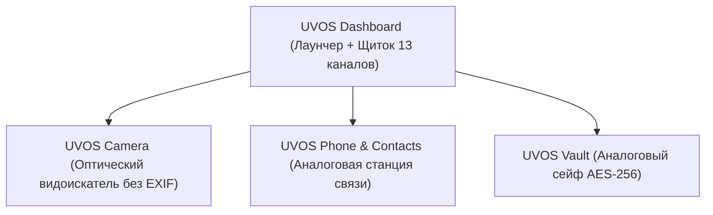

# Спецификация будущих модификаций прошивки UVOS (Firmware Modification Spec)

> **Статус документа:** Зафиксирован к реализации (Frozen / Deferred).  
> **Текущий этап проекта:** Активная разработка приложений (Application Layer). Образы прошивки временно заморожены до готовности фирменных сервисов и модулей перехвата.

---

## 1. Архитектурная цель модификаций

Превратить стандартную сборку LineageOS 22.2 (Android 15) для Xiaomi Redmi Note 13 4G (`sapphire` / `sapphiren`, SM6225) в защищённую специализированную систему **UnderVoltOS**:
1. Полное исключение внешних каналов утечки данных и фонового профилирования.
2. Принудительное ограничение приложений по принципу **Zero Trust** («закрытая территория» по умолчанию).
3. Безопасная эмуляция ответов системы (`MODE_IGNORED` / mock data), исключающая падение непривилегированных приложений при запретах.
4. Интеграция фирменного визуального стиля приборной панели (M4200, моноширинные шрифты, индикаторные тумблеры) на уровень **SystemUI**, статус-бара и экрана блокировки.

---

## 2. Модификации уровня ядра Linux (Kernel 5.15)

```
+-------------------------------------------------------+
|                    Ядро Linux 5.15                    |
+-------------------------------------------------------+
|  [+] CONFIG_NETFILTER_XT_MATCH_OWNER                  | -> UID-фильтрация сетевых пакетов
|  [+] Mount Namespaces Isolation                       | -> Скрытие /sys/class/power_supply
|  [+] /dev/uvos_sensor_state                           | -> Аппаратный статус сенсоров
+-------------------------------------------------------+
```

### 2.1. Сетевая фильтрация UID (Netfilter)
- **Конфигурация ядра:**
  - `CONFIG_NETFILTER_XT_MATCH_OWNER=y`
  - `CONFIG_IP_NF_TARGET_REJECT=y`
  - `CONFIG_IP6_NF_TARGET_REJECT=y`
- **Назначение:** Возможность мгновенного отбрасывания пакетов с флагом `TCP RST` для конкретных UID приложений без задержек и без зависания сетевых сокетов при блокировке канала `NETWORK`.

### 2.2. Защита от профилирования через сенсоры питания (Side-Channel Mitigation)
- **Проблема:** Вредоносные приложения могут определять устройство, местоположение и действия пользователя по микроколебаниям тока и напряжения в `/sys/class/power_supply` и `/proc/net`.
- **Модификация:**
  - В скриптах инициализации `init.rc` монтировать пустые виртуальные файловые системы `tmpfs` с правами `0000` поверх узлов питания для всех непривилегированных процессов (`UID >= 10000`).
  - Доступ к реальным вольтам и миллиамперам сохраняется **только** для системной службы батареи и привилегированного приложения `com.uvos.dashboard`.

---

## 3. Модификации системного раздела (`system.img` / EROFS)

### 3.1. Зачистка Bloatware, телеметрии и трекеров (Debloating)
При финальной сборке из образа `/system` и `/system_ext` удаляются:
- **Все звукозаписывающие приложения (Sound Recorders):**
  - Полное вырезание любых предустановленных диктофонов (`Recorder`, `SoundRecorder`, `org.lineageos.recorder`). В UVOS аудиозапись исключена из состава базовой системы в целях безопасности и защиты от скрытой фиксации звука.
- **Google Play Services / GMS Core** (замена на изолированный локальный MicroG при необходимости, либо работа в полностью автономном режиме).
- **Пакеты телеметрии LineageOS:**
  - `LineageStats` (`org.lineageos.lineagestats`)
  - `Updater` (`org.lineageos.updater`)
  - `CaptivePortalLogin` (замена проверки подключения к Google на локальный DNS-прокси)
- **Фоновые сборщики метрик:**
  - `AdServices` / `SdkSandbox` APEX модули
  - `DeviceLock`, `OemConfiguration`

### 3.2. Системный демон перехвата `uvosd`
Создание легковесного native-демона на C++ или Rust (`/system/bin/uvosd`), запускаемого через `init.rc`:
- **Полномочия:** UID `system` / `root`, SELinux контекст `u:r:uvosd:s0`.
- **IPC интерфейс:** UNIX Domain Socket `/dev/socket/uvosd`.
- **Задачи демона:**
  1. Приём команд от `RuleRepository` из приложения `UVOS Dashboard`.
  2. Применение правил `iptables -A OUTPUT -m owner --uid-owner <UID> -j REJECT --reject-with tcp-reset`.
  3. Прямое управление AOSP AppOps через C++ Binder IPC:
     ```sh
     cmd appops set <packageName> CAMERA ignore
     cmd appops set <packageName> RECORD_AUDIO ignore
     cmd appops set <packageName> FINE_LOCATION ignore
     cmd appops set <packageName> READ_CLIPBOARD ignore
     ```

### 3.3. Привилегии и манифесты
- В `/system/etc/permissions/privapp-permissions-com.uvos.dashboard.xml` добавляются расширенные права:
  - `android.permission.MANAGE_APP_OPS_MODES`
  - `android.permission.NETWORK_STACK`
  - `android.permission.STATUS_BAR_SERVICE`
  - `android.permission.INTERACT_ACROSS_USERS`

---

## 4. Модификации SystemUI и экрана блокировки

### 4.1. Быстрые тумблеры в шторке (Quick Settings Tiles)
Добавить в системную шторку 4 специализированных тумблера UVOS:
1. **«Режим бункера» (Bunker Toggle):**
   - Мгновенный аппаратный разрыв всех радиоканалов (Авиарежим + выключение Wi-Fi/BT/NFC + запрет сенсоров через AppOps).
2. **«Глушилка микрофона» (Mic Mute / Dummy):**
   - Перевод входящего аудиопотока в генерацию белого шума низкого уровня или абсолютную тишину.
3. **«Изоляция буфера» (Clipboard Guard):**
   - Очистка буфера обмена через 20 секунд после помещения текста или при смене фокусного окна приложения.
4. **«Сетевой ограничитель» (Traffic Throttle):**
   - Переключение шейпера трафика (эмуляция узкого канала EDGE/2G для пресечения фоновой выгрузки медиа).

### 4.2. Графическая стилизация статус-бара
- Замена системных значков Android Material на стилизованные элементы:
  - Батарея: миниатюрный круглый стрелочный вольтметр.
  - Сотовая связь: индикатор в децибел-милливаттах (`-85 dBm`) вместо палочек.
  - Индикатор активности сенсоров: неоновая янтарная точка при чтении микрофона/камеры.

---

## 5. Пакет фирменных приложений (UVOS Native Suite)

Вместо сторонних или стандартных AOSP приложений в системе будут работать специализированные приложения в ретро-стиле (диктофоны и средства аудиозаписи полностью исключены):



1. **UVOS Dashboard (Главная приборная панель):**
   - Лаунчер, приборы батареи и температуры M4200, каталог приложений, контрольный щиток изоляции 13 каналов.
2. **UVOS Camera (Оптический регистратор):**
   - Видоискатель плёночной лаборатории. Автоматический стриппинг всех EXIF-метаданных (геопозиция, модель, серийные номера) на лету.
3. **UVOS Phone & Contacts (Аналоговая станция связи):**
   - Интерфейс полевой радиостанции/дискового телефона, режим Push-to-Talk (PTT), аппаратное отключение микрофона вне активного вызова.
4. **UVOS Vault (Аналоговый сейф):**
   - Кодовый замок с тактильным лимбом, защита заметок, файлов и ключей в аппаратном хранилище Android Keystore.

---

## 6. Пайплайн сборки прошивки (Когда возобновится этап ROM)

После завершения разработки приложений процедура инжекции в прошивку выполняется через разработанный скрипт:

```powershell
# 1. Сборка всех APK через Gradle
gradle assembleRelease

# 2. Инжекция в EROFS дерево и сборка готового system.img
powershell -ExecutionPolicy Bypass -File C:\Users\barab\UVOS\uvos\tools\scripts\repack-step.ps1
```

*Документ утверждён и зафиксирован в репозитории проекта.*
