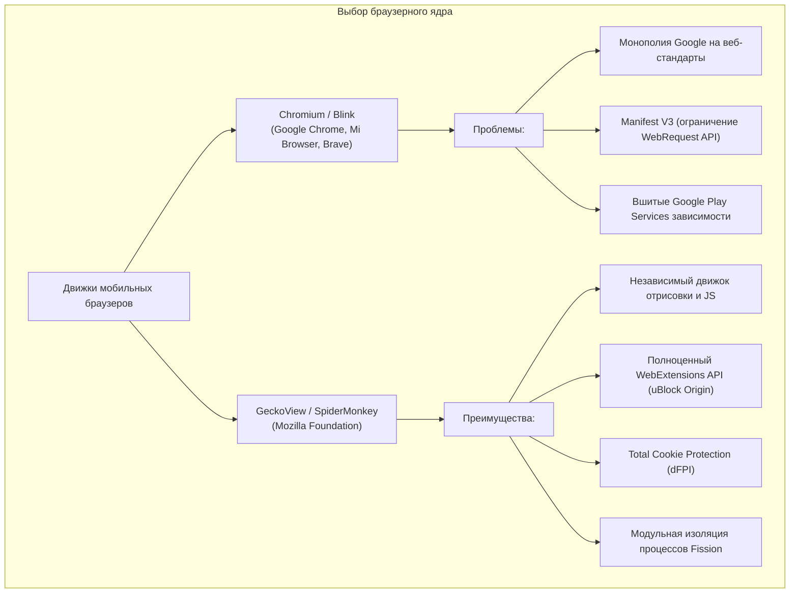
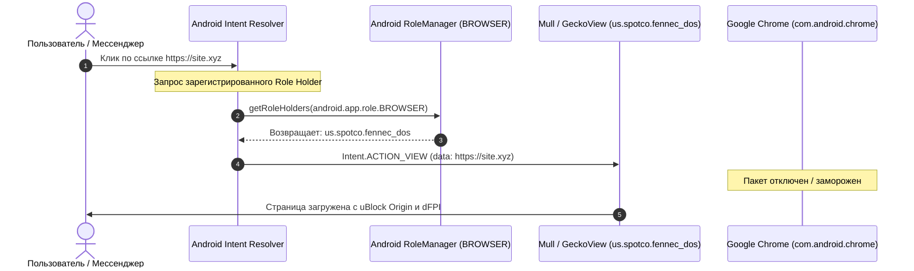

# Интеграция приватного веб-браузера GeckoView в UnderVoltOS (UVOS)

> **Статус**: Архитектурная спецификация и руководство по системному развёртыванию  
> **Компонент**: Встроенный веб-браузер UnderVoltOS (Замена Google Chrome и стокового браузера Xiaomi)  
> **Целевая платформа**: UnderVoltOS (Xiaomi Redmi Note 13 4G NFC `sapphire/sapphiren` / HyperOS / AOSP)  
> **Принцип**: 0% телеметрии, 0% рекламы, изоляция сессий, движок GeckoView с поддержкой расширений WebExtensions v2/v3  

---

## 1. Обоснование выбора: Firefox vs Mull vs Fennec F-Droid

В современных мобильных операционных системах доминирует браузерный движок **Chromium (Blink)**. Подавляющее большинство мобильных браузеров (Google Chrome, Xiaomi Mi Browser, Opera, Brave, Edge, Vivaldi) являются надстройками над движком Google Blink.

Для UnderVoltOS принят стратегический инвариант: **полный отказ от монополии Google Blink** в пользу независимого открытого движка **Mozilla GeckoView**.



### 1.1. Сравнительный анализ браузеров на движке GeckoView

| Критерий | Mozilla Firefox (Fenix)<br>`org.mozilla.firefox` | Fennec F-Droid<br>`org.mozilla.fennec_fdroid` | Mull (DivestOS)<br>`us.spotco.fennec_dos` |
| :--- | :--- | :--- | :--- |
| **Репозиторий распространения** | Google Play / Mozilla APK | F-Droid | F-Droid / DivestOS Repo |
| **Бинарные блобы и трекеры** | Присутствуют (Adjust, Leanplum, Glean, Google Play Services) | Вырезаны полностью | Вырезаны полностью |
| **Телеметрия по умолчанию** | Включена (Telemetry, Crash Reports, Nimbus studies) | Частично отключена | **Полностью отключена и заблокирована** |
| **Профиль безопасности (`user.js`)** | Стандартный потребительский | Стандартный upstream | **Харденинг-база Arkenfox** |
| **Изоляция куки (dFPI)** | Включена базово | Включена базово | **Strict Total Cookie Protection** |
| **Защита от WebRTC Leaks** | Выключена (возможна утечка IP) | Выключена | **Включена (ICE host кандидаты скрыты)** |
| **Фингерпринтинг** | Базовый | Базовый | **Fingerprinting Protection (RFP/FPP)** |
| **Поддержка расширений** | Ограниченный список (Addon Collection) | Полная поддержка AMO | Полная поддержка AMO |
| **Рекомендация для UnderVoltOS** | Альтернатива (с UVOS Hardening) | Допустимо | **Основной выбор (Primary Default)** |

### 1.2. Архитектурное решение UnderVoltOS

1. **Основной системный браузер (Primary)**: **Mull** (`us.spotco.fennec_dos`).
   * Полностью открытая компиляция F-Droid без бинарных блобов.
   * Интегрированные патчи безопасности от команды DivestOS.
   * Настройки `arkenfox user.js`, адаптированные для мобильных экранов (без нарушения масштабирования и верстки).
2. **Резервный сценарий (Fallback / Enterprise)**: **Mozilla Firefox** (`org.mozilla.firefox`) с инъекцией системного конфигуратора `policies.json` и `user.js` UnderVoltOS. Подходит пользователям, которым критически необходима облачная синхронизация Firefox Sync и аккаунт Mozilla.

---

## 2. Профиль приватности UnderVoltOS: Спецификация `user.js`

Конфигурационный файл `user.js` загружается ядром GeckoView при каждом старте браузера и переопределяет любые настройки `prefs.js`, гарантируя сохранение жесткого профиля безопасности даже после обновлений приложения.

### 2.1. Полный листинг конфигурации `user.js` (UVOS Hardened Profile)

```javascript
// =============================================================================
// UnderVoltOS (UVOS) - GeckoView Hardening Profile (user.js)
// Платформа: Xiaomi Redmi Note 13 4G (sapphire) / AOSP / HyperOS
// Цель: 0% телеметрии, изоляция сессий, защита от утечек IP и фингерпринтинга
// =============================================================================

// -----------------------------------------------------------------------------
// РАЗДЕЛ 1: ПОЛНАЯ ЛИКВИДАЦИЯ ТЕЛЕМЕТРИИ И ОТЧЕТОВ MOZILLA
// -----------------------------------------------------------------------------
user_pref("toolkit.telemetry.enabled", false);
user_pref("toolkit.telemetry.unified", false);
user_pref("toolkit.telemetry.archive.enabled", false);
user_pref("toolkit.telemetry.bhrPing.enabled", false);
user_pref("toolkit.telemetry.firstShutdownPing.enabled", false);
user_pref("toolkit.telemetry.newProfilePing.enabled", false);
user_pref("toolkit.telemetry.shutdownPingSender.enabled", false);
user_pref("toolkit.telemetry.updatePing.enabled", false);
user_pref("toolkit.telemetry.server", "data:,");
user_pref("toolkit.telemetry.coverage.opt-out", true);
user_pref("toolkit.coverage.opt-out", true);
user_pref("toolkit.coverage.endpoint.base", "");

// Отключение отчетов о сбоях (Crash Reporter)
user_pref("breakpad.reportURL", "");
user_pref("browser.tabs.crashReporting.sendReport", false);
user_pref("browser.crashReports.unsubmittedCheck.enabled", false);
user_pref("browser.crashReports.unsubmittedCheck.autoSubmit2", false);

// Отключение отправки статистики использования (Health Report)
user_pref("datareporting.healthreport.uploadEnabled", false);
user_pref("datareporting.healthreport.service.enabled", false);
user_pref("datareporting.policy.dataSubmissionEnabled", false);

// Отключение экспериментов и исследований (Shield / Normandy / Nimbus)
user_pref("app.shield.optoutstudy.enabled", false);
user_pref("app.normandy.enabled", false);
user_pref("app.normandy.api_url", "");
user_pref("experiments.enabled", false);
user_pref("experiments.manifest.uri", "");
user_pref("experiments.supported", false);
user_pref("experiments.activeExperiment", false);

// Отключение телеметрии сетевого пинга и активности вкладки
user_pref("browser.ping-centre.telemetry", false);
user_pref("browser.newtabpage.activity-stream.feeds.telemetry", false);
user_pref("browser.newtabpage.activity-stream.telemetry", false);

// -----------------------------------------------------------------------------
// РАЗДЕЛ 2: ОТКЛЮЧЕНИЕ POCKET, СПОНСОРСКОГО КОНТЕНТА И РЕКЛАМЫ
// -----------------------------------------------------------------------------
user_pref("extensions.pocket.enabled", false);
user_pref("extensions.pocket.api", "");
user_pref("extensions.pocket.site", "");
user_pref("browser.newtabpage.activity-stream.feeds.section.topstories", false);
user_pref("browser.newtabpage.activity-stream.feeds.snippets", false);
user_pref("browser.newtabpage.activity-stream.showSponsored", false);
user_pref("browser.newtabpage.activity-stream.showSponsoredTopSites", false);
user_pref("browser.newtabpage.activity-stream.default.sites", "");

// -----------------------------------------------------------------------------
// РАЗДЕЛ 3: ЗАЩИТА ОТ УТЕЧЕК WEBRTC И РЕАЛЬНОГО IP
// -----------------------------------------------------------------------------
// Предотвращение раскрытия локальных LAN IP-адресов и реального внешнего IP при VPN
user_pref("media.peerconnection.ice.no_host", true);
user_pref("media.peerconnection.ice.default_address_only", true);
user_pref("media.peerconnection.ice.proxy_only_if_behind_proxy", true);

// -----------------------------------------------------------------------------
// РАЗДЕЛ 4: СТРОГАЯ ИЗОЛЯЦИЯ ДАННЫХ И КУКИ (TOTAL COOKIE PROTECTION)
// -----------------------------------------------------------------------------
// Режим cookieBehavior = 5: Dynamic First-Party Isolation (dFPI / State Partitioning)
// Каждый сайт видит только свои куки и локальные хранилища; трекинг между вкладками невозможен
user_pref("network.cookie.cookieBehavior", 5);
user_pref("privacy.partition.network_state.ocsp_cache", true);
user_pref("privacy.partition.serviceWorkers", true);
user_pref("privacy.partition.always_partition_third_party_non_cookie_storage", true);

// Автоматическая очистка трекинговых параметров URL (UTM-метки, fbclid, gclid)
user_pref("privacy.query_stripping.enabled", true);
user_pref("privacy.query_stripping.enabled.pbmode", true);
user_pref("privacy.query_stripping.strip_list", "__hsfp __hssc __hstc _hsenc _openstat dclid fbclid gbraid gclid igshid mc_eid msclkid sc_customer som_click_id s_kwcid utm_campaign utm_content utm_medium utm_name utm_source utm_term wbraid yclid");

// -----------------------------------------------------------------------------
// РАЗДЕЛ 5: ЗАЩИТА ОТ ФИНГЕРПРИНТИНГА И АНАЛИЗА УСТРОЙСТВА
// -----------------------------------------------------------------------------
// Используется FPP (Fingerprinting Protection) вместо тяжелого RFP, ломающего мобильную верстку
user_pref("privacy.fingerprintingProtection", true);
user_pref("privacy.fingerprintingProtection.pbmode", true);
user_pref("dom.battery.enabled", false); // Блокировка чтения уровня заряда батареи
user_pref("dom.gamepad.enabled", false);
user_pref("dom.netinfo.enabled", false); // Блокировка чтения типа сети (WiFi/LTE)
user_pref("media.navigator.enabled", false); // Скрытие списка аудио/видео устройств до запроса прав

// -----------------------------------------------------------------------------
// РАЗДЕЛ 6: БЕЗОПАСНОСТЬ СОЕДИНЕНИЙ И СЕТИ
// -----------------------------------------------------------------------------
// Принудительный режим HTTPS-Only
user_pref("dom.security.https_only_mode", true);
user_pref("dom.security.https_only_mode_pbm", true);
user_pref("dom.security.https_only_mode_error_page_user_suggestions", false);

// Отключение предзагрузки ссылок и упреждающего DNS (исключает скрытые фоновые запросы)
user_pref("network.prefetch-next", false);
user_pref("network.dns.disablePrefetch", true);
user_pref("network.http.speculative-parallel-limit", 0);

// Защита OCSP: отключение отправки посещаемых доменов в центры сертификации
user_pref("security.OCSP.enabled", 0);
user_pref("security.OCSP.require", false);

// Отключение встроенного браузерного DoH (TRR mode 0), так как в UnderVoltOS
// шифрованное DoT/DoH разрешение работает на системном уровне через Private DNS
user_pref("network.trr.mode", 0);

// -----------------------------------------------------------------------------
// РАЗДЕЛ 7: БЕЗОПАСНОСТЬ БУФЕРА ОБМЕНА И ГЕОЛОКАЦИИ
// -----------------------------------------------------------------------------
user_pref("dom.event.clipboardevents.enabled", false); // Блокировка перехвата копирования сайтами
user_pref("geo.enabled", false); // Отключение запросов геолокации по умолчанию
user_pref("geo.provider.network.url", "");
user_pref("permissions.default.geo", 2); // 2 = Блокировать всегда
```

---

## 3. Интеграция блокировщика рекламы uBlock Origin

Для полной ликвидации баннеров, всплывающих окон, фишинговых скриптов и криптомайнеров в браузер интегрируется расширение **uBlock Origin** (`uBlock0@raymondhill.net`).

### 3.1. Архитектура интеграции через Enterprise Policies (`policies.json`)

GeckoView поддерживает политику администрирования через файл `policies.json`. Это позволяет принудительно устанавливать расширения, задавать домашнюю страницу и блокировать опасные функции без вмешательства пользователя.

Путь размещения политики в структуре приложения:
```text
/data/data/us.spotco.fennec_dos/distribution/policies.json
или
/data/data/org.mozilla.firefox/distribution/policies.json
```

```json
{
  "policies": {
    "DisableTelemetry": true,
    "DisableFirefoxStudies": true,
    "DisablePocket": true,
    "DisableFeedbackCommands": true,
    "OverrideFirstRunPage": "",
    "OverridePostUpdatePage": "",
    "DontCheckDefaultBrowser": true,
    "ExtensionSettings": {
      "uBlock0@raymondhill.net": {
        "installation_mode": "force_installed",
        "install_url": "https://addons.mozilla.org/firefox/downloads/latest/ublock-origin/latest.xpi"
      }
    },
    "3rdparty": {
      "Extensions": {
        "uBlock0@raymondhill.net": {
          "adminSettings": {
            "userSettings": {
              "advancedUserEnabled": true,
              "autoUpdate": true,
              "cloudStorageEnabled": false,
              "hyperlinkAuditingDisabled": true,
              "prefetchingDisabled": true,
              "webrtcIPAddressHidden": true
            },
            "selectedFilterLists": [
              "user-filters",
              "ublock-filters",
              "ublock-badware",
              "ublock-privacy",
              "ublock-quick-fixes",
              "ublock-unbreak",
              "easylist",
              "easyprivacy",
              "adguard-generic",
              "adguard-mobile",
              "adguard-spyware",
              "adguard-cookies",
              "adguard-social",
              "rus-0",
              "urlhaus-1",
              "plowe-0"
            ]
          }
        }
      }
    }
  }
}
```

### 3.2. Локальная оффлайн-установка расширения XPI

В сценарии чистой сборки OS без активного интернета XPI-пакет размещается локально:
* Файл: `/system/etc/firefox/extensions/uBlock0@raymondhill.net.xpi`
* Параметр `install_url` в политике заменяется на: `file:///system/etc/firefox/extensions/uBlock0@raymondhill.net.xpi`

---

## 4. Системная интеграция в ОС UnderVoltOS

Для того чтобы сторонние приложения открывали внешние ссылки исключительно через защищенный браузер GeckoView, требуется комплексная системная регистрация Intent-фильтров, назначения системной роли и замены встроенного WebView.



### 4.1. Intent-фильтры браузера

В манифесте целевого пакета (`AndroidManifest.xml`) регистрируются фильтры перехвата протоколов `http` и `https`:

```xml
<intent-filter>
    <action android:name="android.intent.action.VIEW" />
    <category android:name="android.intent.category.DEFAULT" />
    <category android:name="android.intent.category.BROWSABLE" />
    <data android:scheme="http" />
    <data android:scheme="https" />
</intent-filter>

<intent-filter>
    <action android:name="android.intent.action.VIEW" />
    <category android:name="android.intent.category.DEFAULT" />
    <category android:name="android.intent.category.BROWSABLE" />
    <data android:scheme="http" />
    <data android:scheme="https" />
    <data android:mimeType="text/html" />
    <data android:mimeType="text/plain" />
    <data android:mimeType="application/xhtml+xml" />
</intent-filter>
```

### 4.2. Назначение дефолтным браузером через Android RoleManager

В Android 10+ (API 29+) управление стандартными приложениями осуществляется через `RoleManager` (`android.app.role.BROWSER`).

Команды шелла для назначения браузера:

```bash
# 1. Добавление пакета Mull в качестве держателя роли браузера
cmd role add-role-holder android.app.role.BROWSER us.spotco.fennec_dos

# 2. Удаление Google Chrome и стокового браузера из держателей роли
cmd role remove-role-holder android.app.role.BROWSER com.android.chrome 2>/dev/null || true
cmd role remove-role-holder android.app.role.BROWSER com.android.browser 2>/dev/null || true
cmd role remove-role-holder android.app.role.BROWSER com.miui.browser 2>/dev/null || true

# 3. Принудительная привязка предпочтительной активности (Fallback)
pm set-home-activity us.spotco.fennec_dos/.App 2>/dev/null || true
```

### 4.3. Замена дефолтного WebViewProvider на независимый

> [!IMPORTANT]
> **Архитектурное различие GeckoView и Android WebView**:  
> Движок GeckoView предназначен исключительно для браузеров и кастомных приложений, использующих библиотеки Mozilla. Внутренние компоненты Android (`android.webkit.WebView`), используемые банковскими клиентами и мессенджерами для встроенного отображения веб-страниц, требуют совместимого Chromium API.  
> 
> Попытка подставить GeckoView в качестве системного `WebViewProvider` вызовет крах системного сервера `ActivityManagerService`, так как провайдер обязан реализовывать внутренние скрытые интерфейсы `WebViewFactoryProvider`.

**Стратегия UnderVoltOS для WebView**:
1. Ликвидация проприетарного **Google Chrome WebView** (`com.google.android.webview`) и компонентов Xiaomi.
2. Установка независимого свободного провайдера **Bromite SystemWebView** (`org.bromite.webview`) или **Cromite SystemWebView** (`org.cromite.webview`) / **AOSP WebView** (`com.android.webview`), очищенных от телеметрии Google.
3. Системное переключение активного поставщика WebView:

```bash
# Проверка доступных поставщиков WebView в системе
cmd webviewupdate list-packages

# Назначение свободного системного WebView
cmd webviewupdate set-webview-implementation org.bromite.webview 2>/dev/null || \
cmd webviewupdate set-webview-implementation com.android.webview

# Фиксация в системных настройках Global Settings
settings put global webview_provider org.bromite.webview 2>/dev/null || \
settings put global webview_provider com.android.webview
```

---

## 5. Автоматизированные скрипты развёртывания

### 5.1. POSIX Bash Скрипт (`deploy_browser.sh`) для ADB / Root

```bash
#!/usr/bin/env bash
# ==============================================================================
# UnderVoltOS (UVOS) - Automated Browser Deployment & Hardening Script
# Target: Redmi Note 13 4G (sapphire) / HyperOS / AOSP
# ==============================================================================

set -euo pipefail

TARGET_PKG="us.spotco.fennec_dos"   # Mull (DivestOS)
FALLBACK_PKG="org.mozilla.firefox"  # Mozilla Firefox upstream
ACTIVE_PKG=""

echo "=========================================================="
echo " [UVOS] Развёртывание защищенного браузера GeckoView"
echo "=========================================================="

# 1. Проверка подключения устройства ADB
if ! adb get-state 1>/dev/null 2>&1; then
    echo "[-] Ошибка: ADB-устройство не найдено или не авторизовано."
    exit 1
fi

echo "[+] Устройство подключено: $(adb shell getprop ro.product.model)"

# 2. Определение целевого установленного пакета
if adb shell pm list packages | grep -q "${TARGET_PKG}"; then
    ACTIVE_PKG="${TARGET_PKG}"
    echo "[+] Обнаружен целевой браузер: Mull (${ACTIVE_PKG})"
elif adb shell pm list packages | grep -q "${FALLBACK_PKG}"; then
    ACTIVE_PKG="${FALLBACK_PKG}"
    echo "[!] Mull не найден. Используется Mozilla Firefox (${ACTIVE_PKG})"
else
    echo "[-] Браузер GeckoView не установлен на устройстве!"
    echo "[*] Рекомендуется установить Mull: 'adb install Mull.apk'"
    exit 1
fi

# 3. Деактивация стоковых браузеров и Google Chrome
echo "[*] Деактивация коммерческих браузеров..."
adb shell pm disable-user --user 0 com.android.chrome 2>/dev/null || true
adb shell pm disable-user --user 0 com.android.browser 2>/dev/null || true
adb shell pm disable-user --user 0 com.miui.browser 2>/dev/null || true

# 4. Назначение системным браузером по умолчанию через RoleManager
echo "[*] Назначение ${ACTIVE_PKG} держателем роли BROWSER..."
adb shell cmd role add-role-holder android.app.role.BROWSER "${ACTIVE_PKG}"
adb shell cmd role remove-role-holder android.app.role.BROWSER com.android.chrome 2>/dev/null || true
adb shell cmd role remove-role-holder android.app.role.BROWSER com.android.browser 2>/dev/null || true

# 5. Развёртывание Enterprise Policies (policies.json)
echo "[*] Генерация и передача policies.json..."
TMP_DIR=$(mktemp -d)
cat << 'EOF' > "${TMP_DIR}/policies.json"
{
  "policies": {
    "DisableTelemetry": true,
    "DisableFirefoxStudies": true,
    "DisablePocket": true,
    "ExtensionSettings": {
      "uBlock0@raymondhill.net": {
        "installation_mode": "force_installed",
        "install_url": "https://addons.mozilla.org/firefox/downloads/latest/ublock-origin/latest.xpi"
      }
    }
  }
}
EOF

# Копирование через Root во внутренний каталог пакета
adb push "${TMP_DIR}/policies.json" /data/local/tmp/policies.json
adb shell "su -c '
    APP_DIR=\"/data/data/${ACTIVE_PKG}\"
    if [ -d \"\$APP_DIR\" ]; then
        mkdir -p \"\$APP_DIR/distribution\"
        cp /data/local/tmp/policies.json \"\$APP_DIR/distribution/policies.json\"
        APP_UID=\$(stat -c %u \"\$APP_DIR\")
        APP_GID=\$(stat -c %g \"\$APP_DIR\")
        chown -R \$APP_UID:\$APP_GID \"\$APP_DIR/distribution\"
        chmod 755 \"\$APP_DIR/distribution\"
        chmod 644 \"\$APP_DIR/distribution/policies.json\"
        echo \"[+] policies.json успешно развернут с правами UID=\$APP_UID\"
    else
        echo \"[-] Директория \$APP_DIR еще не инициализирована. Запустите браузер один раз.\"
    fi
    rm -f /data/local/tmp/policies.json
'"

# 6. Очистка временных файлов на хосте
rm -rf "${TMP_DIR}"

# 7. Настройка WebView
echo "[*] Конфигурация независимого провайдера WebView..."
adb shell "cmd webviewupdate set-webview-implementation org.bromite.webview 2>/dev/null || \
           cmd webviewupdate set-webview-implementation com.android.webview 2>/dev/null || true"

echo "=========================================================="
echo " [OK] Браузерная подсистема UnderVoltOS успешно развернута!"
echo "=========================================================="
```

---

### 5.2. PowerShell Скрипт (`Deploy-Browser.ps1`) для Windows

```powershell
<#
.SYNOPSIS
    UnderVoltOS (UVOS) - Развёртывание и харденинг браузера GeckoView через Windows ADB
.DESCRIPTION
    Назначает браузер Mull/Firefox по умолчанию, отключает Chrome, настраивает политики и uBlock Origin.
#>

[CmdletBinding()]
param(
    [string]$TargetPackage = "us.spotco.fennec_dos",
    [string]$FallbackPackage = "org.mozilla.firefox"
)

Write-Host "==========================================================" -ForegroundColor Cyan
Write-Host " [UVOS] GeckoView Browser Deployment Engine (Windows)" -ForegroundColor Cyan
Write-Host "==========================================================" -ForegroundColor Cyan

# 1. Проверка ADB
$adbDevices = adb devices
if ($adbDevices -notmatch "\tdevice") {
    Write-Error "[-] Ошибка: Авторизованное ADB устройство не обнаружено."
    exit 1
}

$deviceModel = (adb shell getprop ro.product.model).Trim()
Write-Host "[+] Целевое устройство: $deviceModel" -ForegroundColor Green

# 2. Проверка установленного пакета
$packages = adb shell pm list packages
$activePackage = $null

if ($packages -match $TargetPackage) {
    $activePackage = $TargetPackage
    Write-Host "[+] Выбран первичный защищенный браузер: Mull ($activePackage)" -ForegroundColor Green
} elseif ($packages -match $FallbackPackage) {
    $activePackage = $FallbackPackage
    Write-Host "[!] Обнаружен Firefox upstream: ($activePackage)" -ForegroundColor Yellow
} else {
    Write-Error "[-] Браузер GeckoView не обнаружен! Установите Mull APK перед запуском."
    exit 1
}

# 3. Деблоат и отключение коммерческих браузеров
Write-Host "[*] Деактивация стоковых браузеров..." -ForegroundColor Gray
$debloatList = @("com.android.chrome", "com.android.browser", "com.miui.browser")
foreach ($pkg in $debloatList) {
    adb shell pm disable-user --user 0 $pkg 2>$null | Out-Null
}

# 4. Назначение держателя роли BROWSER
Write-Host "[*] Назначение роли android.app.role.BROWSER -> $activePackage..." -ForegroundColor Cyan
adb shell cmd role add-role-holder android.app.role.BROWSER $activePackage
adb shell cmd role remove-role-holder android.app.role.BROWSER com.android.chrome 2>$null | Out-Null
adb shell cmd role remove-role-holder android.app.role.BROWSER com.android.browser 2>$null | Out-Null

# 5. Развертывание policies.json
$policiesJson = @"
{
  "policies": {
    "DisableTelemetry": true,
    "DisableFirefoxStudies": true,
    "DisablePocket": true,
    "ExtensionSettings": {
      "uBlock0@raymondhill.net": {
        "installation_mode": "force_installed",
        "install_url": "https://addons.mozilla.org/firefox/downloads/latest/ublock-origin/latest.xpi"
      }
    }
  }
}
"@

$tempFile = [System.IO.Path]::GetTempFileName()
Set-Content -Path $tempFile -Value $policiesJson -Encoding UTF8

Write-Host "[*] Передача конфигурации Enterprise Policies..." -ForegroundColor Gray
adb push $tempFile /data/local/tmp/policies.json | Out-Null
Remove-Item -Path $tempFile -Force

adb shell "su -c '
    APP_DIR=\"/data/data/$activePackage\"
    if [ -d \"`$APP_DIR\" ]; then
        mkdir -p \"`$APP_DIR/distribution\"
        cp /data/local/tmp/policies.json \"`$APP_DIR/distribution/policies.json\"
        APP_UID=`$(stat -c %u \"`$APP_DIR\")
        APP_GID=`$(stat -c %g \"`$APP_DIR\")
        chown -R `$APP_UID:`$APP_GID \"`$APP_DIR/distribution\"
        chmod 755 \"`$APP_DIR/distribution\"
        chmod 644 \"`$APP_DIR/distribution/policies.json\"
        echo \"[+] Конфигурация успешно инжектирована.\"
    fi
    rm -f /data/local/tmp/policies.json
'"

# 6. Конфигурация независимого WebView
Write-Host "[*] Проверка и переключение WebViewProvider..." -ForegroundColor Gray
adb shell "cmd webviewupdate set-webview-implementation org.bromite.webview 2>/dev/null || cmd webviewupdate set-webview-implementation com.android.webview 2>/dev/null || true"

Write-Host "==========================================================" -ForegroundColor Green
Write-Host " [ГОТОВО] Развёртывание приватного браузера завершено!" -ForegroundColor Green
Write-Host "==========================================================" -ForegroundColor Green
```

---

## 6. Верификация и чек-лист приемки

После завершения развёртывания инженер UnderVoltOS проводит обязательный аудит по контрольным точкам:

* [ ] **Проверка роли по умолчанию**:
  ```bash
  adb shell cmd role get-role-holders android.app.role.BROWSER
  # Ожидаемый вывод: us.spotco.fennec_dos
  ```
* [ ] **Проверка отключения Google Chrome**:
  ```bash
  adb shell pm list packages -d | grep chrome
  # Ожидаемый вывод: package:com.android.chrome
  ```
* [ ] **Тестирование перехвата Intent**:
  ```bash
  adb shell am start -a android.intent.action.VIEW -d "https://check.torproject.org"
  # Ссылка должна мгновенно открыться в Mull без диалогового окна выбора браузера
  ```
* [ ] **Аудит блокировки рекламы и телеметрии**:
  * Посещение тестовых стендов: `d3ward.github.io/toolz/adblock.html` (ожидаемый скор блокировки: **98–100%**).
  * Посещение `browserleaks.com/webrtc`: реальный внешний IP адрес за VPN и LAN-адреса не должны детектироваться (`No WebRTC leak`).
* [ ] **Проверка активности расширений**:
  * В меню «Дополнения» отображается активный uBlock Origin с загруженными оффлайн-фильтрами.
