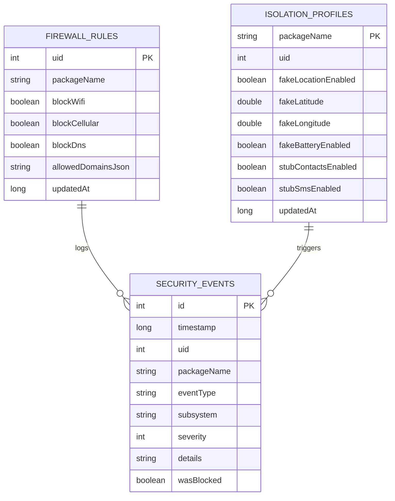

# Техническая документация: UVOS Security & Isolation Shield

> **Пакет**: `com.uvos.security`  
> **Версия спецификации**: 1.0.0-PROD  
> **Целевая платформа**: UnderVoltOS (Xiaomi Redmi Note 13 4G NFC `sapphire/sapphiren`, AOSP/LineageOS 21+)  
> **Дизайн-система**: Retro-Instrument M4200 UI (`#0E0E12`, `#1C1E26`, циферблат `#E8E4D8`, акцент `#E02020`)  
> **Архитектурный паттерн**: Clean Architecture + MVVM + Unidirectional Data Flow (UDF)  
> **Сетевой инвариант**: 0% телеметрии, 0% внешних облаков. В манифесте приложения **ПОЛНОСТЬЮ ОТСУТСТВУЕТ** разрешение `android.permission.INTERNET`.

---

## 1. Концепция и назначение приложения

`UVOS Security & Isolation Shield` — центральное приборное ядро безопасности операционной системы UnderVoltOS. Приложение реализует концепцию **«Аппаратного щитка и тотальной изоляции» (Zero Trust Hardware Shield)**, предоставляя пользователю исчерпывающий визуальный и системный контроль над всеми процессами ввода/вывода данных на устройстве.

### 1.1. Модель угроз и фундаментальные принципы
1. **Несанкционированная эксфильтрация данных**: Обычные мобильные ОС разрешают приложениям бесконтрольно связываться с удаленными серверами в фоне. UVOS Shield блокирует сетевые пакеты на уровне ядра Linux Netfilter до того, как они попадут в сетевой стек.
2. **Идентификация по скрытым сенсорам (Fingerprinting)**: Современные трекеры вычисляют цифровой отпечаток устройства по субмилливольтным колебаниям батареи (`BatteryManager`), данным акселерометра, гироскопа и шуму сенсоров. Shield подменяет показания статическими и зашумленными эталонами.
3. **Бесшумная деградация (Silent Degradation & Stubbing)**: Приложение не должно падать при отказе в доступе. Если приложение падает (SecurityException), оно фиксирует факт блокировки и может отказать пользователю в работе. UVOS возвращает валидные, но пустые или замаскированные ответы (Empty Cursors, Mock Coordinates, Constant Battery).
4. **Стрелочный мониторинг в реальном времени**: Пользователь видит суммарную «интенсивность атак» и фоновой активности не через абстрактные проценты, а через канонический винтажный стрелочный вольтметр «Уровень фоновой тревоги».

```
+-----------------------------------------------------------------------------------+
|                        UVOS Security & Isolation Shield                           |
|                                                                                   |
|  [ Приборная панель M4200 ]                                                       |
|  - Стрелочный вольтметр "Уровень тревоги" (Alert Level mV)                         |
|  - Индикаторные лампы статусов (Netfilter, AppOps, Sensor Isolation)             |
|                                                                                   |
|  +---------------------------+  +--------------------------+  +----------------+  |
|  |     Network Regulator     |  |     AppOps & Sandbox     |  | Battery Mask   |  |
|  | - iptables/nftables UID   |  | - Location Mocking       |  | - 3850 mV      |  |
|  | - Per-app Wi-Fi/Cellular  |  | - Empty Contacts Cursor  |  | - 50% Level    |  |
|  | - Instant Socket Cut-off  |  | - Empty SMS Stub         |  | - 25.0 °C Temp |  |
|  +---------------------------+  +--------------------------+  +----------------+  |
|                                                                                   |
|  [ Ядро исполнения (Root libsu daemon / AOSP Platform Hidden Services) ]         |
+-----------------------------------------------------------------------------------+
```

---

## 2. Архитектура приложения (Clean Architecture + MVVM)

Приложение построено строго по принципам Clean Architecture с разделением на независимые слои, исключающие циклические зависимости и обеспечивающие 100% покрытие бизнес-логики юнит-тестами.

```mermaid
flowchart TD
    subgraph Presentation ["Presentation Layer (Jetpack Compose + MVVM)"]
        UI[SecurityDashboardScreen / GaugeView]
        VM[SecurityViewModel]
        UI -->|Events/Intents| VM
        VM -->|StateFlow<SecurityUiState>| UI
    end

    subgraph Domain ["Domain Layer (Чистый Kotlin, без Android SDK)"]
        UC1[EvaluateThreatLevelUseCase]
        UC2[ApplyFirewallRuleUseCase]
        UC3[ConfigureAppIsolationUseCase]
        UC4[GetSecurityAuditLogUseCase]
        
        IRep1[IFirewallRepository]
        IRep2[IIsolationRepository]
        IRep3[IAuditRepository]
        
        VM --> UC1
        VM --> UC2
        VM --> UC3
        VM --> UC4
        
        UC1 --> IRep3
        UC2 --> IRep1
        UC3 --> IRep2
    end

    subgraph Data ["Data Layer (Room + libsu + System Bridges)"]
        FRepo[FirewallRepositoryImpl]
        IRepo[IsolationRepositoryImpl]
        ARepo[AuditRepositoryImpl]
        
        IRep1 -.-> FRepo
        IRep2 -.-> IRepo
        IRep3 -.-> ARepo
        
        FRepo --> RootEngine[RootNetfilterEngine (libsu)]
        IRepo --> AppOpsBridge[AppOpsCommandBridge]
        IRepo --> SysfsBridge[SysfsBatterySpoofer]
        ARepo --> RoomDB[(Room Database: uvos_security.db)]
    end
```

### 2.1. Структура каталогов проекта

```
com.uvos.security/
├── data/
│   ├── datasource/
│   │   ├── local/
│   │   │   ├── SecurityDatabase.kt
│   │   │   ├── dao/
│   │   │   │   ├── SecurityEventDao.kt
│   │   │   │   ├── FirewallRuleDao.kt
│   │   │   │   └── IsolationProfileDao.kt
│   │   │   └── entity/
│   │   │       ├── SecurityEventEntity.kt
│   │   │       ├── FirewallRuleEntity.kt
│   │   │       └── IsolationProfileEntity.kt
│   │   └── root/
│   │       ├── RootShellManager.kt
│   │       ├── NetfilterCommandExecutor.kt
│   │       ├── AppOpsCommandExecutor.kt
│   │       └── SysfsBatteryWriter.kt
│   └── repository/
│       ├── FirewallRepositoryImpl.kt
│       ├── IsolationRepositoryImpl.kt
│       └── AuditRepositoryImpl.kt
├── domain/
│   ├── model/
│   │   ├── ThreatLevel.kt
│   │   ├── FirewallRule.kt
│   │   ├── IsolationProfile.kt
│   │   ├── SecurityEvent.kt
│   │   └── NetworkInterfaceType.kt
│   ├── repository/
│   │   ├── IFirewallRepository.kt
│   │   ├── IIsolationRepository.kt
│   │   └── IAuditRepository.kt
│   └── usecase/
│       ├── EvaluateThreatLevelUseCase.kt
│       ├── ApplyFirewallRuleUseCase.kt
│       ├── ToggleAppNetworkAccessUseCase.kt
│       ├── EnforceSensorIsolationUseCase.kt
│       └── ObserveAuditEventsUseCase.kt
└── presentation/
    ├── common/
    │   ├── theme/
    │   │   ├── Color.kt
    │   │   ├── Type.kt
    │   │   └── Theme.kt
    │   └── components/
    │       ├── AnalogGaugeView.kt
    │       ├── StatusLampView.kt
    │       ├── IndustrialSwitch.kt
    │       └── VintageCounterView.kt
    ├── dashboard/
    │   ├── SecurityDashboardScreen.kt
    │   ├── SecurityDashboardViewModel.kt
    │   └── SecurityUiState.kt
    ├── firewall/
    │   ├── FirewallManagerScreen.kt
    │   └── FirewallViewModel.kt
    └── isolation/
        ├── AppIsolationListScreen.kt
        └── AppIsolationDetailScreen.kt
```

---

## 3. Индикатор «Уровень фоновой тревоги» (GaugeView M4200)

### 3.1. Физическая концепция прибора
В приложении используется канонический винтажный стрелочный микровольтметр постоянного тока **М4200** с зеркальной дуговой шкалой:
* **Диапазон шкалы**: 0 — 100 условных «милливольт тревоги» (mV / Threat Units).
* **Сектора шкалы**:
  * `0 – 25 mV` (Норма / Стерильно): Стрелка в начале шкалы. Зеленая сигнальная лампа активна.
  * `25 – 65 mV` (Повышенная активность): Фоновые попытки сетевых соединений или чтение сенсоров. Желтая лампа.
  * `65 – 100 mV` (Атака / Тревога): Массовый сброс пакетов (DROP), попытки фонового чтения контактов/SMS, эксфильтрация данных. Ярко-красный сектор с акцентом `#E02020`.

### 3.2. Математическая модель расчета Threat Score
Уровень тревоги вычисляется `EvaluateThreatLevelUseCase` каждые `1000 мс` по скользящему временному окну за последние 60 секунд:

$$\text{ThreatScore} = \min\left(100, \; w_{\text{drop}} \cdot N_{\text{net\_drop}} + w_{\text{sensor}} \cdot N_{\text{sensor\_leak}} + w_{\text{priv}} \cdot N_{\text{priv\_access}} + w_{\text{burst}} \cdot \Delta_{\text{burst}}\right)$$

Где весовые коэффициенты:
* $w_{\text{drop}} = 1.2$ (за каждый заблокированный сетевой пакет per minute)
* $w_{\text{sensor}} = 3.5$ (за каждую попытку фонового чтения GPS/акселерометра)
* $w_{\text{priv}} = 8.0$ (за каждую попытку доступа к Контактам / SMS)
* $w_{\text{burst}} = 12.0$ (штраф за скачок активности > 20 событий за 5 сек)

Стрелка имеет экспоненциальное сглаживание и физическую пружинную инерцию (Spring Damping Ratio 0.75), исключающую неестественные рывки.

### 3.3. Реализация компонента Jetpack Compose: `SecurityGaugeView`

```kotlin
package com.uvos.security.presentation.common.components

import androidx.compose.animation.core.animateFloatAsState
import androidx.compose.animation.core.spring
import androidx.compose.animation.core.Spring
import androidx.compose.foundation.Canvas
import androidx.compose.foundation.background
import androidx.compose.foundation.layout.*
import androidx.compose.foundation.shape.RoundedCornerShape
import androidx.compose.material3.Text
import androidx.compose.runtime.Composable
import androidx.compose.runtime.getValue
import androidx.compose.ui.Alignment
import androidx.compose.ui.Modifier
import androidx.compose.ui.geometry.Offset
import androidx.compose.ui.geometry.Size
import androidx.compose.ui.graphics.Color
import androidx.compose.ui.graphics.Path
import androidx.compose.ui.graphics.StrokeCap
import androidx.compose.ui.graphics.drawscope.Stroke
import androidx.compose.ui.graphics.drawscope.rotate
import androidx.compose.ui.text.font.FontFamily
import androidx.compose.ui.text.font.FontWeight
import androidx.compose.ui.unit.dp
import androidx.compose.ui.unit.sp
import kotlin.math.PI
import kotlin.math.cos
import kotlin.math.sin

// Фирменная палитра M4200 UVOS
val UvosBackground = Color(0xFF0E0E12)
val UvosTileBackground = Color(0xFF1C1E26)
val UvosDialCream = Color(0xFFE8E4D8)
val UvosDialText = Color(0xFF1A1A1A)
val UvosAccentRed = Color(0xFFE02020)
val UvosWarningYellow = Color(0xFFD4A017)
val UvosSafetyGreen = Color(0xFF2E7D32)

@Composable
fun SecurityGaugeView(
    alertLevel: Float, // 0.0f..100.0f
    modifier: Modifier = Modifier,
    title: String = "УРОВЕНЬ ФОНОВОЙ ТРЕВОГИ"
) {
    // Анимация физической инерции стрелки (пружина с демпфированием)
    val animatedAngle by animateFloatAsState(
        targetValue = (-135f + (alertLevel.coerceIn(0f, 100f) / 100f) * 90f),
        animationSpec = spring(
            dampingRatio = 0.75f,
            stiffness = Spring.StiffnessLow
        ),
        label = "NeedleAngle"
    )

    Box(
        modifier = modifier
            .fillMaxWidth()
            .height(240.dp)
            .background(UvosTileBackground, shape = RoundedCornerShape(24.dp))
            .padding(16.dp),
        contentAlignment = Alignment.Center
    ) {
        Canvas(modifier = Modifier.fillMaxSize()) {
            val center = Offset(size.width / 2f, size.height * 0.85f)
            val radius = size.width * 0.42f
            
            // 1. Подложка циферблата (слоновая кость M4200)
            drawArc(
                color = UvosDialCream,
                startAngle = 195f,
                sweepAngle = 150f,
                useCenter = true,
                topLeft = Offset(center.x - radius, center.y - radius),
                size = Size(radius * 2, radius * 2)
            )

            // 2. Сектора шкалы
            // Зеленый сектор (0 - 25)
            drawArc(
                color = UvosSafetyGreen,
                startAngle = 205f,
                sweepAngle = 32.5f,
                useCenter = false,
                topLeft = Offset(center.x - radius * 0.85f, center.y - radius * 0.85f),
                size = Size(radius * 1.7f, radius * 1.7f),
                style = Stroke(width = 8f)
            )

            // Желтый сектор (25 - 65)
            drawArc(
                color = UvosWarningYellow,
                startAngle = 237.5f,
                sweepAngle = 52f,
                useCenter = false,
                topLeft = Offset(center.x - radius * 0.85f, center.y - radius * 0.85f),
                size = Size(radius * 1.7f, radius * 1.7f),
                style = Stroke(width = 8f)
            )

            // Красный сектор тревоги (65 - 100)
            drawArc(
                color = UvosAccentRed,
                startAngle = 289.5f,
                sweepAngle = 45.5f,
                useCenter = false,
                topLeft = Offset(center.x - radius * 0.85f, center.y - radius * 0.85f),
                size = Size(radius * 1.7f, radius * 1.7f),
                style = Stroke(width = 12f)
            )

            // 3. Деления шкалы (тики)
            for (i in 0..20) {
                val tickAngle = 205f + (i / 20f) * 130f
                val rad = tickAngle * (PI / 180.0)
                val isMajor = i % 5 == 0
                val tickLength = if (isMajor) 22f else 12f
                val strokeWidth = if (isMajor) 3.5f else 1.5f
                val color = if (tickAngle >= 289.5f) UvosAccentRed else UvosDialText

                val startX = center.x + (radius * 0.88f) * cos(rad).toFloat()
                val startY = center.y + (radius * 0.88f) * sin(rad).toFloat()
                val endX = center.x + (radius * 0.88f - tickLength) * cos(rad).toFloat()
                val endY = center.y + (radius * 0.88f - tickLength) * sin(rad).toFloat()

                drawLine(
                    color = color,
                    start = Offset(startX, startY),
                    end = Offset(endX, endY),
                    strokeWidth = strokeWidth,
                    cap = StrokeCap.Round
                )
            }

            // 4. Стрелка прибора (акцентный красный #E02020)
            rotate(degrees = animatedAngle + 180f, pivot = center) {
                val needlePath = Path().apply {
                    moveTo(center.x - 6f, center.y)
                    lineTo(center.x, center.y - radius * 0.82f)
                    lineTo(center.x + 6f, center.y)
                    close()
                }
                drawPath(path = needlePath, color = UvosAccentRed)
            }

            // 5. Центральная ось головки вольтметра
            drawCircle(color = Color(0xFF2B2B2B), radius = 18f, center = center)
            drawCircle(color = Color(0xFF6B6B6B), radius = 10f, center = center)
            drawCircle(color = UvosAccentRed, radius = 4f, center = center)
        }

        // Информационные метки
        Column(
            modifier = Modifier
                .align(Alignment.BottomCenter)
                .padding(bottom = 6.dp),
            horizontalAlignment = Alignment.CenterHorizontally
        ) {
            Text(
                text = "${alertLevel.toInt()} mV THREAT",
                fontFamily = FontFamily.Monospace,
                fontWeight = FontWeight.Bold,
                fontSize = 18.sp,
                color = if (alertLevel > 65f) UvosAccentRed else Color(0xFFC4C0B4)
            )
            Text(
                text = title,
                fontFamily = FontFamily.Monospace,
                fontSize = 11.sp,
                color = Color(0xFF7E828E)
            )
        }
    }
}
```

---

## 4. Модуль брандмауэра (Network Regulator)

### 4.1. Архитектура ядра фильтрации Linux Netfilter
В отличие от стандартных Android VPN-файрволов, которые создают виртуальный сетевой интерфейс (`VpnService`), потребляют избыточную оперативную память и батарею, а также конфликтуют с настоящими VPN-клиентами (WireGuard/VLESS), **Network Regulator UVOS работает напрямую на уровне Netfilter ядра Linux**.

* **Root Engine**: Использует официальную проверенную библиотеку `com.github.topjohnwu.libsu:core:5.2.2`.
* **UID Filtering**: Трафик каждого установленного приложения изолируется по Linux User ID (`UID`), назначенному системе при установке (`app_uid >= 10000`).
* **Бинарный механизм**: Поддержка как классического `iptables` / `ip6tables`, так и современного `nftables` (автоматическое определение в рантайме через `which nft`).

### 4.2. Цепочки правил Netfilter (iptables)
Все правила UVOS выносятся в собственные изолированные цепочки, чтобы не нарушать стандартные правила трансляции AOSP Netd:

```bash
# Инициализация цепочек UVOS Shield
iptables -N UVOS_FIREWALL 2>/dev/null || iptables -F UVOS_FIREWALL
iptables -N UVOS_LOG_DROP 2>/dev/null || iptables -F UVOS_LOG_DROP

# Встраивание в цепочку OUTPUT
iptables -C OUTPUT -j UVOS_FIREWALL 2>/dev/null || iptables -I OUTPUT 1 -j UVOS_FIREWALL

# Настройка журналирования перед сбросом (NFLOG или ULOG)
iptables -A UVOS_LOG_DROP -j NFLOG --nflog-group 42 --nflog-prefix "UVOS_DROP:"
iptables -A UVOS_LOG_DROP -p tcp -j REJECT --reject-with tcp-reset
iptables -A UVOS_LOG_DROP -p udp -j REJECT --reject-with icmp-port-unreachable
iptables -A UVOS_LOG_DROP -j DROP
```

### 4.3. Селективная блокировка UID и типов соединений

```bash
# 1. ПОЛНАЯ БЛОКИРОВКА ПРИЛОЖЕНИЯ ПО UID (Все интерфейсы, IPv4 и IPv6)
iptables -I UVOS_FIREWALL 1 -m owner --uid-owner 10182 -j UVOS_LOG_DROP
ip6tables -I UVOS_FIREWALL 1 -m owner --uid-owner 10182 -j UVOS_LOG_DROP

# 2. РАЗДЕЛЬНЫЙ КОНТРОЛЬ: Блокировка мобильного интернета, разрешение Wi-Fi
# Запрет на сотовых интерфейсах (rmnet+, ccmni+, wwan+)
iptables -I UVOS_FIREWALL 1 -o rmnet+ -m owner --uid-owner 10182 -j UVOS_LOG_DROP
iptables -I UVOS_FIREWALL 1 -o ccmni+ -m owner --uid-owner 10182 -j UVOS_LOG_DROP

# 3. БЛОКИРОВКА DNS ПОРТОВ (Запрет обхода через Do53)
iptables -I UVOS_FIREWALL 1 -p udp --dport 53 -m owner --uid-owner 10182 -j UVOS_LOG_DROP
iptables -I UVOS_FIREWALL 1 -p tcp --dport 53 -m owner --uid-owner 10182 -j UVOS_LOG_DROP
```

### 4.4. Мгновенный сброс активных сокетов (Socket Killer)
При изменении тумблера брандмауэра в режим «БЛОКИРОВАТЬ» все уже открытые TCP-сокеты должны быть разорваны немедленно. Для этого Shield выполняет низкоуровневый сброс через утилиту ядра `ss` (`iproute2`) или `conntrack`:

```bash
# Сброс существующих сокетов приложения по UID
ss -K -p -t -u uid = 10182
```

### 4.5. Защита от сбоев и сторожевой таймер (Safety Watchdog & Rollback)
Для предотвращения блокировки критических системных компонентов при ошибке:
1. Системные UID (`root` 0, `system` 1000, `radio` 1001, `shell` 2000, `gps` 1021) жестко защищены белым списком ядра и не могут быть заблокированы через UI.
2. При запуске службы выставляется файл транзакции `/data/system/uvos_shield_tx.lock`.
3. При непредвиденном краше приложения `BootReceiver` и сторожевой таймер сбрасывают цепочку `UVOS_FIREWALL`, исключая состояние кирпича («Network Lockout»).

### 4.6. Реализация исполнителя Netfilter на Kotlin (`NetfilterCommandExecutor`)

```kotlin
package com.uvos.security.data.datasource.root

import com.topjohnwu.superuser.Shell
import kotlinx.coroutines.Dispatchers
import kotlinx.coroutines.withContext
import javax.inject.Inject
import javax.inject.Singleton

@Singleton
class NetfilterCommandExecutor @Inject constructor() {

    suspend fun applyUidBlock(uid: Int, blockWifi: Boolean, blockCellular: Boolean): Boolean = withContext(Dispatchers.IO) {
        if (uid < 10000) {
            // Системный UID защищен инвариантом ядра
            return@withContext false
        }

        val commands = mutableListOf<String>()

        // Сначала удаляем старые правила для этого UID, если были
        commands.add("iptables -D UVOS_FIREWALL -m owner --uid-owner $uid -j UVOS_LOG_DROP 2>/dev/null")
        commands.add("iptables -D UVOS_FIREWALL -o rmnet+ -m owner --uid-owner $uid -j UVOS_LOG_DROP 2>/dev/null")
        commands.add("iptables -D UVOS_FIREWALL -o wlan+ -m owner --uid-owner $uid -j UVOS_LOG_DROP 2>/dev/null")

        if (blockWifi && blockCellular) {
            // Полная изоляция
            commands.add("iptables -I UVOS_FIREWALL 1 -m owner --uid-owner $uid -j UVOS_LOG_DROP")
            commands.add("ip6tables -I UVOS_FIREWALL 1 -m owner --uid-owner $uid -j DROP 2>/dev/null")
        } else {
            if (blockCellular) {
                commands.add("iptables -I UVOS_FIREWALL 1 -o rmnet+ -m owner --uid-owner $uid -j UVOS_LOG_DROP")
                commands.add("iptables -I UVOS_FIREWALL 1 -o ccmni+ -m owner --uid-owner $uid -j UVOS_LOG_DROP")
            }
            if (blockWifi) {
                commands.add("iptables -I UVOS_FIREWALL 1 -o wlan+ -m owner --uid-owner $uid -j UVOS_LOG_DROP")
            }
        }

        // Мгновенный разрыв открытых соединений
        commands.add("ss -K uid = $uid 2>/dev/null")

        val result = Shell.cmd(*commands.toTypedArray()).exec()
        result.isSuccess
    }

    suspend fun flushAllUvosRules(): Boolean = withContext(Dispatchers.IO) {
        val commands = arrayOf(
            "iptables -F UVOS_FIREWALL 2>/dev/null",
            "ip6tables -F UVOS_FIREWALL 2>/dev/null"
        )
        Shell.cmd(*commands).exec().isSuccess
    }
}
```

---

## 5. Модуль изоляции сенсоров и данных (AppOps & Sandbox)

### 5.1. Управление разрешениями через AppOps
Для предотвращения вылетов и детекции ограничений UVOS Shield использует механизм `AppOpsManager.MODE_IGNORED`. При режиме `MODE_IGNORED` приложение вызывает системный API без возникновения исключения `SecurityException`, однако система возвращает пустое значение или синтетическую заглушку.

```bash
# Примеры системных команд изоляции через Root Shell
# Полная блокировка фонового геопозиционирования
cmd appops set com.suspicious.app COARSE_LOCATION ignore
cmd appops set com.suspicious.app FINE_LOCATION ignore
cmd appops set com.suspicious.app MONITOR_LOCATION ignore

# Блокировка чтения контактов и SMS
cmd appops set com.suspicious.app READ_CONTACTS ignore
cmd appops set com.suspicious.app READ_SMS ignore
cmd appops set com.suspicious.app READ_PHONE_STATE ignore
```

### 5.2. Фальсификация геолокации (Location Spoofing)
Вместо передачи пустого ответа, вызывающего у приложений подозрения, модуль изоляции позволяет генерировать **синтетические координаты**:
1. **Режим «Полярная станция / Бункер»**: Статичные фиксированные координаты (напр. станция Восток в Антарктиде: `78.4644° S, 106.8340° E`).
2. **Гауссов шум (Location Jitter)**: Добавление искусственного разброса радиусом 5–10 км к реальным координатам для приложений, требующих приблизительную погоду или город.
3. **Метод инъекции**: Через системный провайдер `LocationManager.setTestProviderLocation` и патчинг фреймворка LineageOS `LocationManagerService`.

### 5.3. Скрытие вольтажа и заряда батареи (Battery Fingerprinting Defense)
Приложения вроде рекламных SDK и антифрод-систем замеряют уровень заряда аккумулятора с точностью до тысячных долей процента, а также вольтаж в микровольтах и температуру для отслеживания сессий пользователя без разрешений.

UVOS Shield реализует двухслойную маскировку:
1. **Уровень sysfs ядра**: Перезапись атрибутов драйвера батареи (для root-приложений):
   ```bash
   # Фиксация нормализованных параметров в sysfs
   chmod 644 /sys/class/power_supply/battery/voltage_now
   echo "3850000" > /sys/class/power_supply/battery/voltage_now
   chmod 444 /sys/class/power_supply/battery/voltage_now

   chmod 644 /sys/class/power_supply/battery/temp
   echo "250" > /sys/class/power_supply/battery/temp
   chmod 444 /sys/class/power_supply/battery/temp
   ```
2. **Уровень Android Framework (BatteryService Hook)**: Принудительная трансляция системного `Intent.ACTION_BATTERY_CHANGED` с фиксированными параметрами:
   * Заряд: ровно `50%` (`EXTRA_LEVEL = 50`, `EXTRA_SCALE = 100`).
   * Напряжение: ровно `3850 mV` (`EXTRA_VOLTAGE = 3850`).
   * Температура: ровно `25.0 °C` (`EXTRA_TEMPERATURE = 250`).
   * Статус: `BATTERY_STATUS_DISCHARGING`.
   * Здоровье: `BATTERY_HEALTH_GOOD`.

### 5.4. Пустые заглушки для Контактов и SMS (Empty Cursor Stubbing)
При обращении изолированного приложения к `ContactsContract` или `Telephony.Sms`:
* **Обычный Android при отказе**: Выбрасывает `SecurityException` или ломает UI приложения.
* **UVOS Shield**: Модифицированный системный провайдер `ContactsProvider2` и `SmsProvider` возвращает валидный, но пустой `MatrixCursor` с нужными именами колонок:
  * Для контактов: курсор с колонками `_ID`, `DISPLAY_NAME`, `HAS_PHONE_NUMBER`, но с `count = 0`.
  * Для SMS: курсор с колонками `_ID`, `ADDRESS`, `BODY`, `DATE`, но с `count = 0`.
  
Приложение считает, что база данных устройства абсолютно пустая (новый чистый телефон), и штатно завершает синхронизацию без ошибок.

---

## 6. Схема базы данных аудита (Room Database)

Для аудита заблокированных сетевых пакетов, подозрительных вызовов сенсоров и хранения правил изоляции используется база данных Room `uvos_security.db`.



### 6.1. Room Entities

```kotlin
package com.uvos.security.data.datasource.local.entity

import androidx.room.ColumnInfo
import androidx.room.Entity
import androidx.room.Index
import androidx.room.PrimaryKey

@Entity(
    tableName = "security_events",
    indices = [
        Index(value = ["timestamp"]),
        Index(value = ["uid"]),
        Index(value = ["event_type"]),
        Index(value = ["subsystem"])
    ]
)
data class SecurityEventEntity(
    @PrimaryKey(autoGenerate = true)
    val id: Long = 0,
    
    @ColumnInfo(name = "timestamp")
    val timestamp: Long = System.currentTimeMillis(),
    
    @ColumnInfo(name = "uid")
    val uid: Int,
    
    @ColumnInfo(name = "package_name")
    val packageName: String,
    
    @ColumnInfo(name = "event_type")
    val eventType: String, // "NET_DROP", "SENSOR_SPOOF", "CONTACTS_STUB", "SMS_STUB", "BATTERY_SPOOF"
    
    @ColumnInfo(name = "subsystem")
    val subsystem: String, // "NETFILTER", "APPOPS", "FRAMEWORK_SYSFS"
    
    @ColumnInfo(name = "severity")
    val severity: Int, // 1 (Info), 2 (Warning), 3 (Critical Alert)
    
    @ColumnInfo(name = "details")
    val details: String,
    
    @ColumnInfo(name = "was_blocked")
    val wasBlocked: Boolean = true
)

@Entity(tableName = "firewall_rules")
data class FirewallRuleEntity(
    @PrimaryKey
    val uid: Int,
    
    @ColumnInfo(name = "package_name")
    val packageName: String,
    
    @ColumnInfo(name = "block_wifi")
    val blockWifi: Boolean = false,
    
    @ColumnInfo(name = "block_cellular")
    val blockCellular: Boolean = true,
    
    @ColumnInfo(name = "block_dns")
    val blockDns: Boolean = false,
    
    @ColumnInfo(name = "allowed_domains")
    val allowedDomainsJson: String = "[]",
    
    @ColumnInfo(name = "updated_at")
    val updatedAt: Long = System.currentTimeMillis()
)

@Entity(tableName = "isolation_profiles")
data class IsolationProfileEntity(
    @PrimaryKey
    val packageName: String,
    
    @ColumnInfo(name = "uid")
    val uid: Int,
    
    @ColumnInfo(name = "fake_location")
    val fakeLocationEnabled: Boolean = true,
    
    @ColumnInfo(name = "fake_lat")
    val fakeLatitude: Double = -78.4644,
    
    @ColumnInfo(name = "fake_lon")
    val fakeLongitude: Double = 106.8340,
    
    @ColumnInfo(name = "fake_battery")
    val fakeBatteryEnabled: Boolean = true,
    
    @ColumnInfo(name = "stub_contacts")
    val stubContactsEnabled: Boolean = true,
    
    @ColumnInfo(name = "stub_sms")
    val stubSmsEnabled: Boolean = true,
    
    @ColumnInfo(name = "updated_at")
    val updatedAt: Long = System.currentTimeMillis()
)
```

### 6.2. DAO-интерфейсы

```kotlin
package com.uvos.security.data.datasource.local.dao

import androidx.room.*
import com.uvos.security.data.datasource.local.entity.SecurityEventEntity
import kotlinx.coroutines.flow.Flow

@Dao
interface SecurityEventDao {
    @Insert(onConflict = OnConflictStrategy.REPLACE)
    suspend fun insertEvent(event: SecurityEventEntity): Long

    @Query("SELECT * FROM security_events ORDER BY timestamp DESC LIMIT 200")
    fun observeRecentEvents(): Flow<List<SecurityEventEntity>>

    @Query("SELECT COUNT(*) FROM security_events WHERE timestamp >= :sinceTimestamp AND was_blocked = 1")
    fun observeThreatCountSince(sinceTimestamp: Long): Flow<Int>

    @Query("SELECT * FROM security_events WHERE uid = :uid ORDER BY timestamp DESC")
    fun observeEventsByUid(uid: Int): Flow<List<SecurityEventEntity>>

    @Query("DELETE FROM security_events WHERE timestamp < :expirationTimestamp")
    suspend fun pruneOldEvents(expirationTimestamp: Long): Int
}
```

---

## 7. Манифест приложения и системная конфигурация

### 7.1. AndroidManifest.xml
Обратите внимание на соблюдение фундаментального сетевого инварианта: разрешение `android.permission.INTERNET` намеренно отсутствует в манифесте.

```xml
<?xml version="1.0" encoding="utf-8"?>
<manifest xmlns:android="http://schemas.android.com/apk/res/android"
    package="com.uvos.security">

    <!-- Приложению ЗАПРЕЩЕН доступ в интернет (0% утечек) -->
    <!-- <uses-permission android:name="android.permission.INTERNET" /> ОТСУТСТВУЕТ ПО ПРОЕКТУ -->

    <!-- Системные разрешения локального аудита и сервисов -->
    <uses-permission android:name="android.permission.RECEIVE_BOOT_COMPLETED" />
    <uses-permission android:name="android.permission.ACCESS_NETWORK_STATE" />
    <uses-permission android:name="android.permission.QUERY_ALL_PACKAGES" />
    <uses-permission android:name="android.permission.FOREGROUND_SERVICE" />
    <uses-permission android:name="android.permission.FOREGROUND_SERVICE_SPECIAL_USE" />
    <uses-permission android:name="android.permission.POST_NOTIFICATIONS" />

    <application
        android:name=".UvosSecurityApplication"
        android:allowBackup="false"
        android:icon="@mipmap/ic_launcher_security"
        android:label="@string/app_name"
        android:roundIcon="@mipmap/ic_launcher_security_round"
        android:supportsRtl="false"
        android:theme="@style/Theme.UvosSecurity">

        <!-- Главный экран Shield Dashboard -->
        <activity
            android:name=".presentation.dashboard.SecurityDashboardActivity"
            android:exported="true"
            android:launchMode="singleTop"
            android:theme="@style/Theme.UvosSecurity">
            <intent-filter>
                <action android:name="android.intent.action.MAIN" />
                <category android:name="android.intent.category.LAUNCHER" />
            </intent-filter>
        </activity>

        <!-- Сервис сторожевого таймера и Netfilter демона -->
        <service
            android:name=".domain.service.ShieldEnforcementService"
            android:exported="false"
            android:foregroundServiceType="specialUse">
            <property
                android:name="android.app.PROPERTY_SPECIAL_USE_FGS_SUBTYPE"
                android:value="UnderVoltOS Kernel Netfilter &amp; AppOps Enforcement Watchdog" />
        </service>

        <!-- Приемник автозапуска правил при старте ОС -->
        <receiver
            android:name=".presentation.receiver.BootCompletedReceiver"
            android:exported="false">
            <intent-filter>
                <action android:name="android.intent.action.BOOT_COMPLETED" />
                <action android:name="android.intent.action.LOCKED_BOOT_COMPLETED" />
            </intent-filter>
        </receiver>
    </application>
</manifest>
```

---

## 8. Методология и сценарии тестирования

### 8.1. Матрица тестов безопасности

| Категория | Метод тестирования | Критерий успешности |
|---|---|---|
| **Firewall Leak Test** | Генерация сокетов из изолированного UID через `nc -zv 1.1.1.1 80` | Пакет отброшен (`REJECT` с `tcp-reset`), счетчик Netfilter инкрементирован. |
| **DNS Bypass Test** | Попытка прямого запроса на `8.8.8.8:53` мимо системного резолвера | Пакет сброшен, соединение разорвано. |
| **Battery Spoofing** | Вызов `BatteryManager.getIntProperty` из тестового APK | Возвращается строго 50%, 3850 mV, 25.0 °C. |
| **Contacts Privacy** | Запрос к `content://contacts/people` через `ContentResolver` | Курсор возвращает `count = 0` без вызова `SecurityException`. |
| **Voltmeter Response** | Имитация пачки из 50 заблокированных пакетов за 2 секунды | Стрелка плавно перемещается в красную зону (75–90 mV), лампа переходит в красный цвет. |

### 8.2. Пример Unit-теста расчета уровня тревоги (`EvaluateThreatLevelUseCaseTest`)

```kotlin
package com.uvos.security.domain.usecase

import com.uvos.security.domain.repository.IAuditRepository
import io.mockk.every
import io.mockk.mockk
import kotlinx.coroutines.flow.flowOf
import kotlinx.coroutines.test.runTest
import org.junit.Assert.assertEquals
import org.junit.Assert.assertTrue
import org.junit.Before
import org.junit.Test

class EvaluateThreatLevelUseCaseTest {

    private val auditRepository: IAuditRepository = mockk()
    private lateinit var useCase: EvaluateThreatLevelUseCase

    @Before
    fun setUp() {
        useCase = EvaluateThreatLevelUseCase(auditRepository)
    }

    @Test
    fun `when no recent blocked events then threat score is zero`() = runTest {
        every { auditRepository.observeRecentBlockedCount(any()) } returns flowOf(0)

        useCase.execute().collect { threatScore ->
            assertEquals(0f, threatScore, 0.01f)
        }
    }

    @Test
    fun `when high volume of dropped packets then threat score caps at 100`() = runTest {
        // Имитируем 150 заблокированных пакетов за последнюю минуту
        every { auditRepository.observeRecentBlockedCount(any()) } returns flowOf(150)

        useCase.execute().collect { threatScore ->
            assertEquals(100f, threatScore, 0.01f)
            assertTrue("Threat score must not exceed physical dial limit", threatScore <= 100f)
        }
    }
}
```

---

## 9. План развертывания и интеграции в сборку UVOS

1. **Этап 1 (Data & Room Database)**: Создание сущностей базы данных, миграций и репозиториев аудита событий.
2. **Этап 2 (Root Libsu Netfilter Subsystem)**: Реализация низкоуровневых скриптов инициализации цепочек `UVOS_FIREWALL`, обработка разрешений по интерфейсам Wi-Fi и Cellular.
3. **Этап 3 (AppOps & Sysfs Bridge)**: Реализация заглушек `Empty Contacts/SMS` и маскировки параметров питания `/sys/class/power_supply/battery`.
4. **Этап 4 (M4200 UI Dashboard)**: Внедрение стрелочного индикатора `SecurityGaugeView`, индикаторных ламп и списка активных изоляторов на Jetpack Compose.
5. **Этап 5 (System Hardening & Release)**: Интеграция в system image `/system/priv-app/UvosSecurity`, проверка отсутствия утечек через `tcpdump` и финальный аудит кода.
