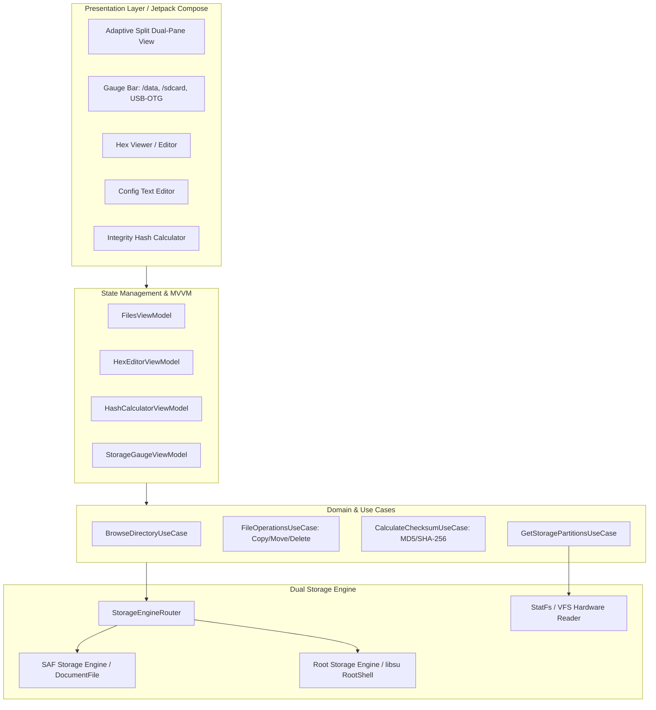
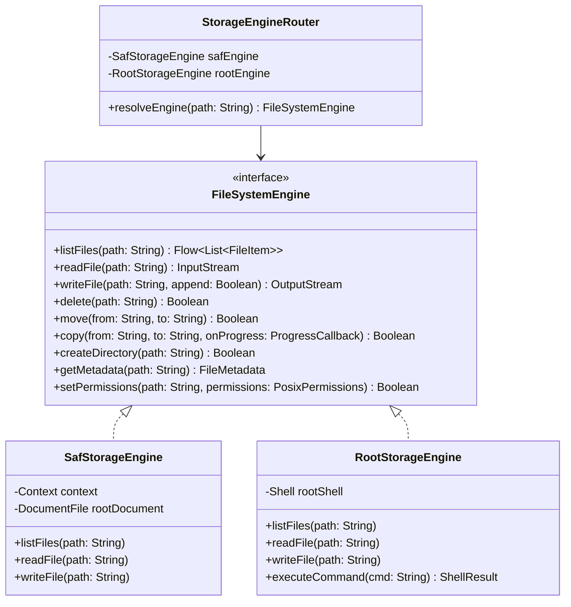
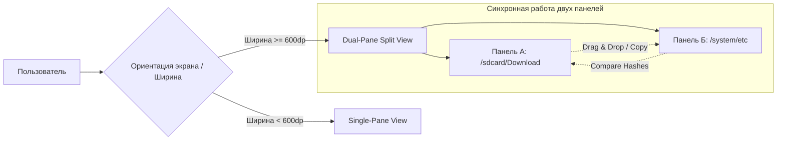

# UVOS Files (`com.uvos.files`): Техническая спецификация и руководство по разработке

> **Статус**: Архитектурная и инженерная спецификация модуля файловой системы UnderVoltOS  
> **Идентификатор пакета**: `com.uvos.files`  
> **Платформа**: Android 14 / LineageOS 21 / UnderVoltOS (Snapdragon 685 `sapphire/sapphiren`)  
> **Принцип безопасности**: 0% телеметрии, 0% рекламы, полное отсутствие сетевых разрешений (`INTERNET` запрещен), изоляция среды, двойной движок доступа (SAF + libsu Root).

---

## 1. Архитектурный обзор и фундаментальные принципы

Приложение **UVOS Files** спроектировано как системная утилита глубокого управления файловыми хранилищами и системными разделами UnderVoltOS. Программа построена в соответствии с парадигмой чистого офлайна: приложение полностью лишено возможности выходить в сеть, собирать телеметрию или использовать внешние облачные SDK.

### 1.1 Инварианты безопасности
1. **Zero-Network Invariant**: В `AndroidManifest.xml` отсутствует объявление `android.permission.INTERNET`. Ни один байт файловой информации не может покинуть пределы устройства.
2. **Deterministic File Access**: Доступ к пользовательским файлам осуществляется через официальный Android Storage Access Framework (SAF / DocumentFile API), исключая прямое несанкционированное сканирование чужих изолированных песочниц без явного гранта пользователя.
3. **Privileged System Access (libsu Root)**: Для системного аудита, настройки ядра, изменения файлов конфигурации `/system`, `/vendor`, `/data/adb` и `/data/data` задействуется безопасный движок `libsu` с изоляцией сессий суперпользователя и контролем монтирования `ro/rw`.
4. **M4200 Visual Feedback**: Вся ключевая телеметрия файловых разделов транслируется через аналоговые шкалы `GaugeView` и ламповые индикаторы `LampView` в ретро-индустриальном стиле измерительного прибора М4200.

### 1.2 Архитектурный стек
* **UI Layer**: Jetpack Compose, Material 3 (адаптированный под индустриальную палитру M4200), Compose Canvas для аппаратного рендеринга аналоговых шкал.
* **Architecture Pattern**: Clean Architecture + MVVM (Model-View-ViewModel) + MVI-эффекты для файловых транзакций.
* **Async & Concurrency**: Kotlin Coroutines & Flow (декларативные потоки данных, `Dispatchers.IO` для блочного чтения, `StateFlow` для реактивного UI).
* **Root Backend**: `com.github.topjohnwu.libsu:core` + `libsu:io` (сессионное взаимодействие с бинарником `su`, безопасное перенаправление потоков ввода-вывода).



---

## 2. Дизайн-система M4200: Приборная панель хранилища

Интерфейс UVOS Files опирается на визуальные каноны советского щитового электроизмерительного прибора М4200: матовый графитовый корпус, шкалы цвета винтажной слоновой кости, тонкая чёрная градуировка и кроваво-красная индикаторная стрелка с механическим демпфированием.

### 2.1 Цветовая палитра подсистемы
* **Фон рабочего пространства (`uvos_bg`)**: `#0E0E12` (глубокий матовый чёрный).
* **Файловые контейнеры и панели (`uvos_panel`)**: `#1C1E26` (индустриальный тёмно-серый со скруглением 24dp).
* **Циферблат шкал (`gauge_dial_bg`)**: `#E8E4D8` (винтажная слоновая кость).
* **Маркировка и засечки циферблата (`gauge_dial_markings`)**: `#1A1A1A`.
* **Стрелка прибора (`gauge_needle_red`)**: `#E02020` с круглой центральной осью цвета полированного карболита `#111111`.
* **Индикаторы статуса (`LampView`)**:
  * Зелёный (`#2ECC71`): Нормальное заполнение раздела (<80%), файловая система примонтирована в `ro`.
  * Жёлтый (`#F39C12`): Предупреждение (80%–95%), раздел примонтирован в `rw`.
  * Красный (`#E74C3C`): Критическая нехватка места (>95%), ошибка ввода-вывода или отказ в доступе.

### 2.2 Верхняя приборная панель (Triple Gauge Bar)
В верхней части экрана (как в портретной, так и в ландшафтной ориентации) размещен блок из трех стрелочных приборов `GaugeView`:
1. **Раздел `/data` (Системные данные и приложения)**: отображает процент занятого пространства во внутреннем системном пуле.
2. **Раздел `/sdcard` (Пользовательский раздел памяти)**: динамический учет пользовательских мультимедиа, загрузок и документов.
3. **Раздел `USB-OTG` (Внешние Flash/SSD-накопители)**: активен только при подключении внешнего носителя. В отключенном состоянии стрелка покоится на механическом нуле (`0%`), а контрольная лампа `LampView` погашена.

### 2.3 Реализация стрелочного компонента `DiskGaugeView`

```kotlin
package com.uvos.files.ui.components

import androidx.compose.animation.core.Animatable
import androidx.compose.animation.core.FastOutSlowInEasing
import androidx.compose.animation.core.tween
import androidx.compose.foundation.Canvas
import androidx.compose.foundation.background
import androidx.compose.foundation.layout.*
import androidx.compose.foundation.shape.RoundedCornerShape
import androidx.compose.material3.Text
import androidx.compose.runtime.*
import androidx.compose.ui.Alignment
import androidx.compose.ui.Modifier
import androidx.compose.ui.geometry.Offset
import androidx.compose.ui.geometry.Size
import androidx.compose.ui.graphics.Color
import androidx.compose.ui.graphics.StrokeCap
import androidx.compose.ui.graphics.drawscope.DrawScope
import androidx.compose.ui.graphics.drawscope.Stroke
import androidx.compose.ui.graphics.nativeCanvas
import androidx.compose.ui.text.font.FontFamily
import androidx.compose.ui.text.font.FontWeight
import androidx.compose.ui.unit.dp
import androidx.compose.ui.unit.sp
import kotlin.math.cos
import kotlin.math.sin

val UvosBg = Color(0xFF0E0E12)
val UvosPanel = Color(0xFF1C1E26)
val GaugeDialBg = Color(0xFFE8E4D8)
val GaugeDialText = Color(0xFF1A1A1A)
val GaugeNeedleRed = Color(0xFFE02020)
val LampGreen = Color(0xFF2ECC71)
val LampYellow = Color(0xFFF39C12)
val LampRed = Color(0xFFE74C3C)
val LampOff = Color(0xFF333333)

@Composable
fun DiskStorageGaugeView(
    title: String,
    usedPercentage: Float, // 0.0f..1.0f
    freeSpaceText: String,
    totalSpaceText: String,
    isMounted: Boolean,
    modifier: Modifier = Modifier
) {
    val animatedProgress = remember { Animatable(0f) }

    LaunchedEffect(usedPercentage, isMounted) {
        val target = if (isMounted) usedPercentage.coerceIn(0f, 1f) else 0f
        animatedProgress.animateTo(
            targetValue = target,
            animationSpec = tween(durationMillis = 850, easing = FastOutSlowInEasing)
        )
    }

    Column(
        modifier = modifier
            .background(UvosPanel, RoundedCornerShape(20.dp))
            .padding(12.dp),
        horizontalAlignment = Alignment.CenterHorizontally
    ) {
        // Заголовок и контрольная лампа состояния
        Row(
            modifier = Modifier.fillMaxWidth(),
            horizontalArrangement = Arrangement.SpaceBetween,
            verticalAlignment = Alignment.CenterVertically
        ) {
            Text(
                text = title.uppercase(),
                color = Color.LightGray,
                fontSize = 11.sp,
                fontWeight = FontWeight.Bold,
                fontFamily = FontFamily.Monospace
            )
            LampIndicator(
                status = when {
                    !isMounted -> LampStatus.OFF
                    usedPercentage > 0.95f -> LampStatus.CRITICAL
                    usedPercentage > 0.80f -> LampStatus.WARNING
                    else -> LampStatus.NORMAL
                }
            )
        }

        Spacer(modifier = Modifier.height(6.dp))

        // Аналоговый циферблат М4200
        Box(
            modifier = Modifier
                .size(width = 110.dp, height = 75.dp)
                .background(GaugeDialBg, RoundedCornerShape(8.dp)),
            contentAlignment = Alignment.Center
        ) {
            Canvas(modifier = Modifier.fillMaxSize()) {
                drawM4200Dial(animatedProgress.value, isMounted)
            }
        }

        Spacer(modifier = Modifier.height(6.dp))

        // Текстовая метрика объема в моноширинном стиле
        Text(
            text = if (isMounted) "$freeSpaceText free" else "OFFLINE",
            color = if (isMounted) Color.White else Color.Gray,
            fontSize = 10.sp,
            fontFamily = FontFamily.Monospace,
            fontWeight = FontWeight.SemiBold
        )
        Text(
            text = if (isMounted) "of $totalSpaceText" else "---",
            color = Color.DarkGray,
            fontSize = 9.sp,
            fontFamily = FontFamily.Monospace
        )
    }
}

private fun DrawScope.drawM4200Dial(progress: Float, isMounted: Boolean) {
    val w = size.width
    val h = size.height
    val pivot = Offset(w / 2f, h * 0.95f)
    val radius = w * 0.42f

    // Зоны шкалы: нормальная (белая/серая), предупреждение (желтая), переполнение (красная)
    val startAngle = 180f + 25f
    val sweepAngle = 130f

    // Фоновая дуга прибора
    drawArc(
        color = Color(0xFFD0CCC0),
        startAngle = startAngle,
        sweepAngle = sweepAngle,
        useCenter = false,
        topLeft = Offset(pivot.x - radius, pivot.y - radius),
        size = Size(radius * 2, radius * 2),
        style = Stroke(width = 4.dp.toPx(), cap = StrokeCap.Round)
    )

    // Критическая зона (последние 15% шкалы - красный сектор)
    drawArc(
        color = GaugeNeedleRed,
        startAngle = startAngle + sweepAngle * 0.85f,
        sweepAngle = sweepAngle * 0.15f,
        useCenter = false,
        topLeft = Offset(pivot.x - radius, pivot.y - radius),
        size = Size(radius * 2, radius * 2),
        style = Stroke(width = 4.dp.toPx(), cap = StrokeCap.Round)
    )

    // Нанесение меток 0, 50, 100%
    val tickCount = 10
    for (i in 0..tickCount) {
        val angleDeg = startAngle + (sweepAngle / tickCount) * i
        val angleRad = Math.toRadians(angleDeg.toDouble())
        val isMajor = i % 5 == 0
        val tickLen = if (isMajor) 7.dp.toPx() else 4.dp.toPx()

        val p1 = Offset(
            (pivot.x + (radius - 2.dp.toPx()) * cos(angleRad)).toFloat(),
            (pivot.y + (radius - 2.dp.toPx()) * sin(angleRad)).toFloat()
        )
        val p2 = Offset(
            (pivot.x + (radius - 2.dp.toPx() - tickLen) * cos(angleRad)).toFloat(),
            (pivot.y + (radius - 2.dp.toPx() - tickLen) * sin(angleRad)).toFloat()
        )
        drawLine(
            color = GaugeDialText,
            start = p1,
            end = p2,
            strokeWidth = if (isMajor) 1.5.dp.toPx() else 1.dp.toPx()
        )
    }

    // Отрисовка стрелки прибора
    val currentAngleDeg = startAngle + (sweepAngle * progress)
    val currentAngleRad = Math.toRadians(currentAngleDeg.toDouble())
    val needleLength = radius * 0.90f

    val needleTip = Offset(
        (pivot.x + needleLength * cos(currentAngleRad)).toFloat(),
        (pivot.y + needleLength * sin(currentAngleRad)).toFloat()
    )

    // Тень стрелки
    drawLine(
        color = Color(0x33000000),
        start = Offset(pivot.x + 1f, pivot.y + 1f),
        end = Offset(needleTip.x + 1f, needleTip.y + 1f),
        strokeWidth = 2.dp.toPx(),
        cap = StrokeCap.Round
    )

    // Тело стрелки
    drawLine(
        color = if (isMounted) GaugeNeedleRed else Color.Gray,
        start = pivot,
        end = needleTip,
        strokeWidth = 2.dp.toPx(),
        cap = StrokeCap.Round
    )

    // Центральная карболитовая головка оси
    drawCircle(
        color = Color(0xFF111111),
        radius = 4.5.dp.toPx(),
        center = pivot
    )
}

enum class LampStatus { OFF, NORMAL, WARNING, CRITICAL }

@Composable
fun LampIndicator(status: LampStatus, modifier: Modifier = Modifier) {
    val color = when (status) {
        LampStatus.OFF -> LampOff
        LampStatus.NORMAL -> LampGreen
        LampStatus.WARNING -> LampYellow
        LampStatus.CRITICAL -> LampRed
    }
    Box(
        modifier = modifier
            .size(8.dp)
            .background(color, RoundedCornerShape(4.dp))
    )
}
```

---

## 3. Двойной движок доступа к файлам (Dual Storage Engine)

UVOS Files реализует единую программную абстракцию `FileSystemEngine`, объединяющую два принципиально разных уровня доступа: стандартный изолированный API Android и прямой POSIX-доступ суперпользователя.



### 3.1 SAF Engine (`SafStorageEngine`)
* **Сфера применения**: Внутреннее хранилище `/sdcard`, папки `Documents`, `Download`, `DCIM`, внешние SD-карты без рут-доступа.
* **Принцип работы**: Использование `DocumentFile.fromTreeUri()`, `ContentResolver` и дескрипторов `ParcelFileDescriptor`. 
* **Безопасность**: Полное соблюдение Scoped Storage, исключающее сбои совместимости с подсистемами MediaStore Android 14.

### 3.2 Root Engine (`RootStorageEngine` через `libsu`)
* **Сфера применения**: Корневой раздел `/`, системные каталоги `/system`, `/vendor`, `/apex`, защищенные базы данных `/data/data/`, файлы конфигурации загрузчика `/data/adb`.
* **Принцип работы**: Пакетная библиотека `com.github.topjohnwu.libsu:core`. Прямое исполнение оптимизированных команд через постоянный шелл-процесс `su`.
* **Парсинг вывода**: Выполнение кастомного бинарного запроса `stat -c "%s|%Y|%a|%u|%g|%F" <file>` или структурированного `ls -la` с распознаванием симлинков, блочных устройств и сокетов.

### 3.3 Код маршрутизатора `StorageEngineRouter`

```kotlin
package com.uvos.files.data.engine

import android.content.Context
import com.topjohnwu.superuser.Shell
import com.uvos.files.domain.model.FileItem
import com.uvos.files.domain.model.FileMetadata
import kotlinx.coroutines.flow.Flow
import java.io.InputStream
import java.io.OutputStream

class StorageEngineRouter(
    private val context: Context,
    private val safEngine: SafStorageEngine,
    private val rootEngine: RootStorageEngine
) : FileSystemEngine {

    private fun isRootPath(path: String): Boolean {
        return path.startsWith("/system") ||
               path.startsWith("/data") && !path.startsWith("/data/media") ||
               path.startsWith("/vendor") ||
               path.startsWith("/apex") ||
               path.startsWith("/dev") ||
               path.startsWith("/proc") ||
               path.startsWith("/sys") ||
               path == "/"
    }

    fun isRootAvailable(): Boolean {
        return Shell.isAppGrantedRoot() == true
    }

    override fun listFiles(path: String): Flow<List<FileItem>> {
        return if (isRootPath(path) && isRootAvailable()) {
            rootEngine.listFiles(path)
        } else {
            safEngine.listFiles(path)
        }
    }

    override suspend fun readFile(path: String): InputStream {
        return if (isRootPath(path) && isRootAvailable()) {
            rootEngine.readFile(path)
        } else {
            safEngine.readFile(path)
        }
    }

    override suspend fun writeFile(path: String, append: Boolean): OutputStream {
        return if (isRootPath(path) && isRootAvailable()) {
            rootEngine.writeFile(path, append)
        } else {
            safEngine.writeFile(path, append)
        }
    }

    override suspend fun delete(path: String): Boolean {
        return if (isRootPath(path) && isRootAvailable()) {
            rootEngine.delete(path)
        } else {
            safEngine.delete(path)
        }
    }

    override suspend fun move(from: String, to: String): Boolean {
        return if ((isRootPath(from) || isRootPath(to)) && isRootAvailable()) {
            rootEngine.move(from, to)
        } else {
            safEngine.move(from, to)
        }
    }

    override suspend fun copy(from: String, to: String, onProgress: (Float) -> Unit): Boolean {
        return if ((isRootPath(from) || isRootPath(to)) && isRootAvailable()) {
            rootEngine.copy(from, to, onProgress)
        } else {
            safEngine.copy(from, to, onProgress)
        }
    }

    override suspend fun createDirectory(path: String): Boolean {
        return if (isRootPath(path) && isRootAvailable()) {
            rootEngine.createDirectory(path)
        } else {
            safEngine.createDirectory(path)
        }
    }

    override suspend fun getMetadata(path: String): FileMetadata {
        return if (isRootPath(path) && isRootAvailable()) {
            rootEngine.getMetadata(path)
        } else {
            safEngine.getMetadata(path)
        }
    }
}
```

---

## 4. Двухпанельный режим и навигационная система

UVOS Files обеспечивает производительность настольного класса на планшетах, складных устройствах и в горизонтальной ориентации смартфона.

### 4.1 Режимы отображения (Adaptive Layout)
* **Single-Pane Mode (Портретный режим телефона)**:
  * Верхняя панель со стрелочными индикаторами.
  * Панель быстрых закладок (Карусель или выдвижная боковая шторка).
  * Навигационная панель пути (Breadcrumbs с быстрым переходом к родительским узлам).
  * Единый список/сетка файлов с индикацией метаданных (разрешения, владелец, размер).
* **Dual-Pane Mode (Планшет / Ландшафт)**:
  * Полноценная раздельная рабочая среда (Левая панель `Source` и Правая панель `Destination`).
  * Независимое управление каталогами, независимые курсоры и режимы сортировки.
  * Прямое перетаскивание (Drag & Drop) и горячие операции копирования/перемещения между панелями в один клик.

### 4.2 Панель быстрых закладок (Instrument Mount Points)
Закладки фиксируют стандартные точки монтирования и часто используемые каталоги:
* `ROOT (/)`: Корень файловой системы (требует активного libsu Root).
* `STORAGE (/sdcard)`: Пользовательский внутренний накопитель.
* `DOWNLOADS (/sdcard/Download)`: Загруженные файлы.
* `DATA-APPS (/data/app)`: Каталог установленных APK.
* `SYS-CONFIG (/system/etc)`: Системные конфигурационные скрипты и хосты.
* `EXT-SD / USB`: Автоматически монтируемые сменные накопители.



---

## 5. Встроенные системные утилиты (Built-in Tooling)

Для полной автономности и исключения необходимости установки сторонних непроверенных редакторов, в состав UVOS Files интегрированы три оптимизированных модуля.

### 5.1 Hex Viewer / Editor (Шестнадцатеричный редактор)
Предназначен для низкоуровневого анализа бинарных файлов, прошивок, дампов разделов и ELF-библиотек.
* **Архитектура**: Виртуализированный `LazyColumn` со строгой постраничной загрузкой чанками по 256 байт через `RandomAccessFile` или потоковый вызов `su dd bs=256`. Приложение не загружает весь многомегабайтный файл в память, предотвращая `OutOfMemoryError`.
* **Формат сетки**:
  1. `Offset` (8 hex символов, например `000000A0`).
  2. `Hex Data` (16 байт, разделенных на две группы по 8 байт).
  3. `ASCII Representation` (печать ASCII символов либо точки `.` для непечатных кодов).
* **Режим редактирования**: Побайтовая замена с подсветкой измененных байтов красным цветом (`#E02020`) и подтверждением записи с сохранением контрольной суммы.

### 5.2 Text Config Editor (Редактор системных конфигураций)
Специализированный текстовый редактор для редактирования файлов инициализации, скриптов и системных свойств:
* **Поддерживаемые типы**: `.conf`, `.prop`, `.rc`, `.xml`, `.sh`, `.json`, `hosts`.
* **Особенности**:
  * Моноширинный индустриальный шрифт (JetBrains Mono).
  * Индикация номеров строк.
  * Сохранение POSIX-атрибутов: при сохранении через `RootStorageEngine` файл не перезаписывается «начисто» с правами процесса UI, а сохраняет оригинальные права (`chmod 0644`), владельца (`chown root:root`) и метку безопасности SELinux Context (`chcon u:object_r:...`).

### 5.3 File Integrity & Hash Calculator (Калькулятор хэшей)
Утилита валидации подлинности файлов прошивок, OTA-обновлений и системных библиотек.
* **Алгоритмы**: MD5, SHA-1, SHA-256.
* **Потоковая обработка**: Чтение блоками по 64 КБ с вычислением контрольной суммы в корутине на `Dispatchers.Default`.
* **Индикация процесса**: Анимированная полоса прогресса с расчетом скорости чтения (МБ/с) и возможностью мгновенного сравнения с контрольным хэшем из буфера обмена.

```kotlin
package com.uvos.files.domain.usecase

import kotlinx.coroutines.Dispatchers
import kotlinx.coroutines.flow.Flow
import kotlinx.coroutines.flow.flow
import kotlinx.coroutines.flow.flowOn
import java.io.InputStream
import java.security.MessageDigest

data class HashCalculationProgress(
    val bytesProcessed: Long,
    val totalBytes: Long,
    val percentage: Float,
    val intermediateHash: String? = null
)

class CalculateChecksumUseCase {

    operator fun invoke(
        inputStream: InputStream,
        totalBytes: Long,
        algorithm: String = "SHA-256"
    ): Flow<HashCalculationProgress> = flow {
        val digest = MessageDigest.getInstance(algorithm)
        val buffer = ByteArray(64 * 1024)
        var bytesRead: Int
        var totalRead: Long = 0

        inputStream.use { stream ->
            while (stream.read(buffer).also { bytesRead = it } != -1) {
                digest.update(buffer, 0, bytesRead)
                totalRead += bytesRead
                val progress = if (totalBytes > 0) totalRead.toFloat() / totalBytes else 0f
                emit(HashCalculationProgress(totalRead, totalBytes, progress, null))
            }
        }

        val finalHash = digest.digest().joinToString("") { "%02x".format(it) }
        emit(HashCalculationProgress(totalRead, totalBytes, 1.0f, finalHash))
    }.flowOn(Dispatchers.IO)
}
```

---

## 6. Спецификация классов, моделей и ViewModel

### 6.1 Доменные модели
```kotlin
package com.uvos.files.domain.model

enum class FileType {
    DIRECTORY, FILE, SYMLINK, BLOCK_DEVICE, CHARACTER_DEVICE, SOCKET, UNKNOWN
}

data class PosixPermissions(
    val userRead: Boolean, val userWrite: Boolean, val userExecute: Boolean,
    val groupRead: Boolean, val groupWrite: Boolean, val groupExecute: Boolean,
    val otherRead: Boolean, val otherWrite: Boolean, val otherExecute: Boolean,
    val octalString: String
)

data class FileItem(
    val name: String,
    val absolutePath: String,
    val isDirectory: Boolean,
    val sizeBytes: Long,
    val lastModifiedEpochMs: Long,
    val fileType: FileType,
    val permissions: PosixPermissions?,
    val owner: String = "root",
    val group: String = "root",
    val isHidden: Boolean = name.startsWith(".")
)

data class StoragePartitionInfo(
    val mountPoint: String,
    val label: String,
    val totalBytes: Long,
    val freeBytes: Long,
    val isMounted: Boolean
) {
    val usedBytes: Long get() = totalBytes - freeBytes
    val usedPercentage: Float get() = if (totalBytes > 0) usedBytes.toFloat() / totalBytes else 0f
}
```

### 6.2 `FilesViewModel` и состояние рабочей панели
```kotlin
package com.uvos.files.ui.viewmodel

import androidx.lifecycle.ViewModel
import androidx.lifecycle.viewModelScope
import com.uvos.files.data.engine.StorageEngineRouter
import com.uvos.files.data.repository.StoragePartitionRepository
import com.uvos.files.domain.model.FileItem
import com.uvos.files.domain.model.StoragePartitionInfo
import kotlinx.coroutines.flow.*
import kotlinx.coroutines.launch

data class FileBrowserState(
    val currentPath: String = "/sdcard",
    val files: List<FileItem> = emptyList(),
    val selectedFiles: Set<FileItem> = emptySet(),
    val isLoading: Boolean = false,
    val errorMessage: String? = null,
    val sortBy: SortField = SortField.NAME,
    val sortAscending: Boolean = true
)

enum class SortField { NAME, SIZE, DATE, TYPE }

class FilesViewModel(
    private val engineRouter: StorageEngineRouter,
    private val partitionRepo: StoragePartitionRepository
) : ViewModel() {

    // Состояние левой и правой панели для двухпанельного режима
    private val _leftPaneState = MutableStateFlow(FileBrowserState(currentPath = "/sdcard"))
    val leftPaneState: StateFlow<FileBrowserState> = _leftPaneState.asStateFlow()

    private val _rightPaneState = MutableStateFlow(FileBrowserState(currentPath = "/system"))
    val rightPaneState: StateFlow<FileBrowserState> = _rightPaneState.asStateFlow()

    // Данные дисковых индикаторов M4200 Gauge
    val storagePartitions: StateFlow<List<StoragePartitionInfo>> = partitionRepo
        .observePartitions()
        .stateIn(viewModelScope, SharingStarted.WhileSubscribed(5000), emptyList())

    init {
        loadDirectory(isLeftPane = true, path = "/sdcard")
        loadDirectory(isLeftPane = false, path = "/system")
    }

    fun navigateTo(isLeftPane: Boolean, path: String) {
        loadDirectory(isLeftPane, path)
    }

    fun navigateUp(isLeftPane: Boolean) {
        val currentState = if (isLeftPane) _leftPaneState.value else _rightPaneState.value
        val parent = currentState.currentPath.substringBeforeLast('/', "")
        val targetPath = if (parent.isEmpty()) "/" else parent
        loadDirectory(isLeftPane, targetPath)
    }

    private fun loadDirectory(isLeftPane: Boolean, path: String) {
        val targetFlow = if (isLeftPane) _leftPaneState else _rightPaneState
        targetFlow.update { it.copy(isLoading = true, errorMessage = null) }

        viewModelScope.launch {
            try {
                engineRouter.listFiles(path).collect { fileList ->
                    targetFlow.update {
                        it.copy(
                            currentPath = path,
                            files = sortFiles(fileList, it.sortBy, it.sortAscending),
                            isLoading = false
                        )
                    }
                }
            } catch (e: Exception) {
                targetFlow.update { it.copy(isLoading = false, errorMessage = e.localizedMessage) }
            }
        }
    }

    private fun sortFiles(list: List<FileItem>, sortField: SortField, ascending: Boolean): List<FileItem> {
        val comparator = when (sortField) {
            SortField.NAME -> compareBy<FileItem> { !it.isDirectory }.thenBy { it.name.lowercase() }
            SortField.SIZE -> compareBy<FileItem> { !it.isDirectory }.thenBy { it.sizeBytes }
            SortField.DATE -> compareBy<FileItem> { !it.isDirectory }.thenBy { it.lastModifiedEpochMs }
            SortField.TYPE -> compareBy<FileItem> { !it.isDirectory }.thenBy { it.fileType.name }
        }
        return if (ascending) list.sortedWith(comparator) else list.sortedWith(comparator.reversed())
    }
}
```

---

## 7. Сборка, Манифест и Отсутствие INTERNET

### 7.1 Манифест приложения (`AndroidManifest.xml`)
> [!IMPORTANT]
> Обратите внимание: разрешение `android.permission.INTERNET` принципиально отсутствует в манифесте. Включены только необходимые разрешения для работы с хранилищем и монтированием.

```xml
<?xml version="1.0" encoding="utf-8"?>
<manifest xmlns:android="http://schemas.android.com/apk/res/android"
    package="com.uvos.files">

    <!-- Разрешения на доступ к хранилищу (Legacy и MANAGE для AOSP/LineageOS) -->
    <uses-permission android:name="android.permission.READ_EXTERNAL_STORAGE" android:maxSdkVersion="32" />
    <uses-permission android:name="android.permission.WRITE_EXTERNAL_STORAGE" android:maxSdkVersion="29" />
    <uses-permission android:name="android.permission.MANAGE_EXTERNAL_STORAGE" />

    <!-- Доступ к уведомлениям для длительных файловых операций (копирование/хэши) -->
    <uses-permission android:name="android.permission.POST_NOTIFICATIONS" />

    <application
        android:name=".UvosFilesApplication"
        android:allowBackup="false"
        android:icon="@mipmap/ic_launcher"
        android:label="@string/app_name"
        android:roundIcon="@mipmap/ic_launcher_round"
        android:supportsRtl="true"
        android:theme="@style/Theme.UvosFiles.Industrial"
        android:requestLegacyExternalStorage="true">

        <activity
            android:name=".ui.MainActivity"
            android:exported="true"
            android:configChanges="orientation|screenSize|screenLayout|smallestScreenSize">
            <intent-filter>
                <action android:name="android.intent.action.MAIN" />
                <category android:name="android.intent.category.LAUNCHER" />
            </intent-filter>

            <!-- Регистрация в качестве системного проводника -->
            <intent-filter>
                <action android:name="android.intent.action.VIEW" />
                <category android:name="android.intent.category.DEFAULT" />
                <data android:mimeType="*/*" />
            </intent-filter>
        </activity>

        <!-- Встроенный сервис асинхронных операций (копирование крупных файлов, вычисление хэшей) -->
        <service
            android:name=".service.FileOperationForegroundService"
            android:exported="false"
            android:foregroundServiceType="dataSync" />

    </application>
</manifest>
```

### 7.2 Файл сборки `build.gradle.kts`

```kotlin
plugins {
    alias(libs.plugins.android.application)
    alias(libs.plugins.kotlin.android)
    alias(libs.plugins.compose.compiler)
}

android {
    namespace = "com.uvos.files"
    compileSdk = 35

    defaultConfig {
        applicationId = "com.uvos.files"
        minSdk = 26
        targetSdk = 35
        versionCode = 10001
        versionName = "1.0.0-ind"

        testInstrumentationRunner = "androidx.test.runner.AndroidJUnitRunner"
        vectorDrawables {
            useSupportLibrary = true
        }
    }

    buildTypes {
        release {
            isMinifyEnabled = true
            isShrinkResources = true
            proguardFiles(
                getDefaultProguardFile("proguard-android-optimize.txt"),
                "proguard-rules.pro"
            )
        }
    }

    compileOptions {
        sourceCompatibility = JavaVersion.VERSION_17
        targetCompatibility = JavaVersion.VERSION_17
    }

    kotlinOptions {
        jvmTarget = "17"
    }

    buildFeatures {
        compose = true
    }
}

dependencies {
    // Jetpack Compose & UI
    implementation(platform(libs.androidx.compose.bom))
    implementation(libs.androidx.compose.ui)
    implementation(libs.androidx.compose.ui.graphics)
    implementation(libs.androidx.compose.ui.tooling.preview)
    implementation(libs.androidx.compose.material3)
    implementation(libs.androidx.compose.material.icons.extended)

    // AndroidX & Architecture
    implementation(libs.androidx.core.ktx)
    implementation(libs.androidx.lifecycle.runtime.ktx)
    implementation(libs.androidx.lifecycle.viewmodel.compose)
    implementation(libs.androidx.navigation.compose)
    implementation(libs.androidx.documentfile)

    // Coroutines
    implementation(libs.kotlinx.coroutines.android)

    // Libsu Root Access Engine (TopJohnWu)
    implementation("com.github.topjohnwu.libsu:core:6.0.0")
    implementation("com.github.topjohnwu.libsu:io:6.0.0")

    // UI Tooling (Debug only)
    debugImplementation(libs.androidx.compose.ui.tooling)
}
```

---

## 8. Программа испытаний и приемочный чек-лист

| № | Сценарий проверки | Ожидаемый результат | Статус |
|---|---|---|---|
| **T-01** | Горячее подключение USB-OTG флеш-накопителя (FAT32/NTFS/exFAT) | Прибор `USB-OTG` оживает, контрольная лампа переключается с `OFF` в `NORMAL`, стрелка показывает реальный процент занятости. | Запланировано |
| **T-02** | Попытка выхода в Интернет (проверка манифеста и сокетов) | `SocketException: Permission denied`. Ни один класс приложения не может открыть сетевой сокет. | Запланировано |
| **T-03** | Переход в режим Root при открытии `/data/data` | Вызов `libsu`, запрос root-привилегий, успешный листинг приватных баз данных приложений. | Запланировано |
| **T-04** | Вычисление SHA-256 файла образа прошивки размером > 4 ГБ | Фоновое потоковое чтение без переполнения памяти (Heap usage < 45 МБ), вывод точного 64-символьного хэша. | Запланировано |
| **T-05** | Редактирование системного файла `/system/build.prop` в текстовом редакторе | Успешное сохранение через Root-движок с автоматическим перемонтированием раздела в `rw` и возвратом в `ro`, сохранение прав `0644`. | Запланировано |
| **T-06** | Просмотр бинарного файла через Hex Viewer | Мгновенный скроллинг без задержек (Virtual scrolling 256B чанками), корректное отображение смещений, HEX и ASCII. | Запланировано |
| **T-07** | Разворот экрана в горизонтальный режим (Landscape) | Активация двухпанельного интерфейса, синхронная работа левой и правой файловых сеток. | Запланировано |
