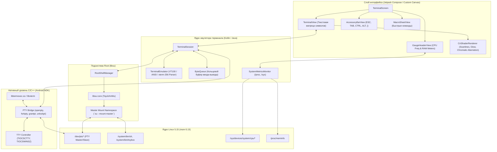

# UVOS Terminal (`com.uvos.terminal`)
## Техническая спецификация, архитектура и руководство по разработке

> **Статус**: Архитектурная спецификация (Engineering Specification)  
> **Пакет**: `com.uvos.terminal`  
> **Целевая платформа**: UnderVoltOS / Android 14 (API 34) / LineageOS 22.2 (Xiaomi Redmi Note 13 4G `sapphire`/`sapphiren`, Snapdragon 685 SM6225)  
> **Инварианты**: 0% телеметрии, 0% трекинга, отсутствие сторонних рекламных SDK, работа в изолированном пространстве (Permission Shield), детерминированное выполнение root-команд.

---

## 1. Введение и концепция

**UVOS Terminal** — системная консоль прямого доступа к ядру Linux и командному интерпретатору Android с аппаратной поддержкой root-полномочий (`su`), стилизованная под промышленный аналоговый прибор и CRT-терминал оператора ЭВМ.

В отличие от стандартных эмуляторов терминала (Termux, Android Terminal Emulator), UVOS Terminal спроектирован под специализированные системные задачи UnderVoltOS:
1. **Аппаратный приборный контроль**: в шапку окна интегрированы прецизионные стрелочные индикаторы (GaugeView) в стиле советского стрелочного вольтметра М4200, отображающие частоту/нагрузку ядер CPU и мгновенный расход ОЗУ в реальном времени.
2. **Бесшовный Root-мост**: нативная интеграция с подсистемой Root (`libsu`) через псевдотерминалы (PTY) с изоляцией пространств имен (Mount Master Namespace) без блокировки основного UI-потока.
3. **Операторская панель макросов**: быстрый запуск системных подпрограмм инспекции ядерных параметров (`sysctl -a`), проверки статуса деблоата (`debloat-status`), аварийной очистки кэша (`drop-caches`) и уничтожения скрытых фоновых демонов (`killall-bg`).
4. **CRT/Retro-эстетика**: поддержка янтарного (Amber P3) и зелёного (Green P1) фосфора, а также фирменного контрастного черно-красного стиля UVOS с реалистичными сканлайнами и эффектом послесвечения.

---

## 2. Архитектура системы



### 2.1. Псевдотерминал (Native PTY)
Стандартные каналы ввода-вывода Android Java (`ProcessBuilder`, `Runtime.getRuntime().exec()`) используют обычные однонаправленные пайпы (`pipe()`). Обычные пайпы не обладают характеристиками TTY:
* Отсутствует поддержка управляющих последовательностей терминала (Ctrl+C генерирует EOF вместо `SIGINT`).
* Программы вроде `top`, `htop`, `nano`, `vi` падают с ошибкой `TERM environment variable not set` или `not a tty`.
* Отсутствует обработка изменения геометрии окна (`SIGWINCH` / `TIOCSWINSZ`).

В **UVOS Terminal** используется прямое открытие псевдотерминала через Android NDK Bionic C Library:
* Вызов `openpty()` или `posix_openpt(O_RDWR | O_NOCTTY)` с `grantpt()` и `unlockpt()`.
* Получение файловых дескрипторов ведущего узла (`ptmx` / master fd) и ведомого узла (`/dev/pts/N` / slave fd).
* Настройка флагов структуры `termios` (`ECHO`, `ICANON`, `ISIG`, `ONLCR`, `UTF-8`).
* Передача master fd в Java-слой через `ParcelFileDescriptor`.

### 2.2. Root-интеграция (`libsu`)
Для выполнения команд с повышенными привилегиями терминал использует официальную библиотеку `libsu`:
* Изолированный шелл создается через `Shell.Builder`.
* Флаг `--mount-master` (`su -mm` или `su --mount-master`) позволяет видеть все глобальные точки монтирования файловых систем Android, что критично для системных утилит и проверки шифрованных разделов.
* При инициализации PTY ведомый дескриптор `slave fd` связывается с дескрипторами `STDIN_FILENO`, `STDOUT_FILENO`, `STDERR_FILENO` процесса `su`, после чего вызывается `ioctl(slaveFd, TIOCSCTTY, 0)`.

---

## 3. Визуальный стиль и приборная панель

Терминал выполнен в индустриальном ретро-дизайне UnderVoltOS (стандарт M4200 / Retro-Instrument UI).

### 3.1. Цветовые палитры

Пользователь может переключать цветовой профиль в настройках терминала или комбинацией клавиш `Ctrl+Shift+T`:

| Элемент UI | Профиль «UVOS Crimson» (по умолчанию) | Профиль «Amber CRT» (Янтарь P3) | Профиль «Green CRT» (Люминофор P1) |
|---|---|---|---|
| **Фон консоли** | `#0E0E12` (глубокий матовый) | `#0B0905` (тёмно-янтарный) | `#050B06` (тёмно-хвойный) |
| **Основной текст** | `#E02020` (ярко-красный индикатор) | `#FFB000` (янтарный люминофор) | `#33FF33` (зелёный люминофор) |
| **Светлый акцент** | `#FF6B6B` | `#FFD266` | `#80FF80` |
| **Курсор** | `#FF2424` (мигающий прямоугольник) | `#FFAA00` | `#00FF00` |
| **Циферблат GaugeView** | `#E8E4D8` (винтажная слоновая кость) | `#E8E4D8` | `#E8E4D8` |
| **Стрелка прибора** | `#E02020` (лакированная красная) | `#E02020` | `#E02020` |
| **Корпус и рамки** | `#1C1E26` (индустриальный сплав) | `#1C1E26` | `#1C1E26` |

### 3.2. Аналоговая приборная шапка (GaugeHeaderView)

В верхней части экрана терминала закреплена приборная панель высотой `130dp`, состоящая из двух круглых стрелочных индикаторов и светодиодного блока состояния:

```
+-------------------------------------------------------------------------+
|  [ (o) CPU FREQ / LOAD ]    [ LAMPS: [ROOT] [PTY] [REC] ]   [ (o) RAM ] |
|      .---''''---.               * ROOT (Green=OK, Red=Deny)     .---''''---.  |
|     /     |      \              * PTY (Green=Active)           /     |      \ |
|    |      \       |             * TTY_REC (Red=Logging)       |      \       ||
|    |   1.90 GHz   |                                           |   3.4 / 8 GB ||
|     \    MHz     /                                             \     MB     / |
|      `---....---'                                               `---....---'  |
+-------------------------------------------------------------------------+
| root@sapphire:/ #                                                       |
```

1. **Левый индикатор (CPU Gauge)**:
   * **Тип прибора**: Логометрический вольтметр/тахометр.
   * **Шкала**: От `0.5 GHz` до `2.8 GHz` (параметры Snapdragon 685: 4x 1.9 GHz Kryo 265 Silver + 4x 2.8 GHz Kryo 265 Gold).
   * **Источник данных**: Асинхронный опрос раз в 500 мс файлов:
     * `/sys/devices/system/cpu/cpu0/cpufreq/scaling_cur_freq` (LITTLE кластер)
     * `/sys/devices/system/cpu/cpu4/cpufreq/scaling_cur_freq` (BIG кластер)
   * **Анимация стрелки**: Пружинно-демпфированный баллистический переход (Spring Animation, damping ratio = 0.72) с легким характерным перерегулированием стрелки при резких скачках нагрузки.

2. **Правый индикатор (RAM Gauge)**:
   * **Тип прибора**: Магнитоэлектрический амперметр потребления ресурсов.
   * **Шкала**: 0–100% (или 0–8 GB). Оцифровка: 0, 2, 4, 6, 8 GB. Сектор свыше 85% окрашен в контрастный красный предупреждающий сектор.
   * **Источник данных**: Разбор файла `/proc/meminfo` (`MemTotal`, `MemAvailable`, `Buffers`, `Cached`). Формула:
     $$\text{RAM}_{\text{used}} = \text{MemTotal} - \text{MemAvailable}$$

3. **Блок индикаторных ламп (`LampView`)**:
   * `ROOT`: Зелёный огонёк при активной root-сессии (`uid == 0`); красный — при отказе в правах суперпользователя.
   * `PTY`: Зелёный огонёк при корректно подключённом двустороннем TTY-дескрипторе.
   * `REC`: Янтарный огонёк, если включена фоновая запись сессии в текстовый файл аудита (`session_audit.log`).

### 3.3. CRT-шейдер и матрица символов

Рендеринг терминала выполняется через аппаратный `SurfaceView` или кастомный Compose Canvas:
* Текстовая матрица: фиксированная сетка глифов с поддержкой моноширинных шрифтов (JetBrains Mono NL, Terminus или встроенный `UVOS-Mono.ttf`).
* Наложение CRT-эффектов:
  * **Scanlines**: Горизонтальные полупрозрачные темные линии с шагом в 2–3 пикселя экрана.
  * **Phosphor Persistence**: След курсора и символов при быстрой прокрутке за счёт альфа-затухания предыдущего буфера кадра.
  * **Vignette / Tube Curvature**: Лёгкое затемнение и скругление углов терминального экрана, создающее ощущение выпуклой стеклянной трубки монитора.

---

## 4. Эмуляция терминала и кастомная клавиатура

### 4.1. Поддержка ANSI / VT100 / VT220 / xterm-256color

Эмулятор обеспечивает полную совместимость со стандартным протоколом POSIX-терминалов:
* Управление курсором: `CUP` (`\e[H;f`), `CUU` (`\e[A`), `CUD` (`\e[B`), `CUF` (`\e[C`), `CUB` (`\e[D`).
* Очистка экрана: `ED` (`\e[J`), `EL` (`\e[K`).
* Цвета текста: 8 базовых цветов, 16 расширенных, 256-цветовая палитра xterm (`\e[38;5;Nm`), а также TrueColor 24-bit RGB (`\e[38;2;R;G;Bm`).
* Альтернативный экранный буфер: `\e[?1049h` / `\e[?1049l` (обеспечивает корректный возврат в командную строку после закрытия `nano`, `vi`, `htop`, `mc`).
* Мышиные события: X10 Mouse Tracking (`\e[?1000h`), UTF-8 Coordinates.

### 4.2. Дополнительная инструментальная клавиатура (Accessory Bar)

Поверх экранной клавиатуры Android выводится аппаратная полоса быстрых управляющих клавиш:

```
+----------------------------------------------------------------------------------+
| [ESC] [TAB] [CTRL] [ALT] [ | ] [ / ] [ - ] [ _ ] [ ~ ] [ ↑ ] [ ↓ ] [ ← ] [ → ]   |
+----------------------------------------------------------------------------------+
```

* **Режимы модификаторов (`CTRL`, `ALT`)**:
  * **Однократный тап (Latch)**: Кнопка подсвечивается янтарным цветом, следующий введенный символ модифицируется (например, `CTRL` + `c` посылает `\x03`), после чего модификатор сбрасывается.
  * **Двойной тап (Lock)**: Кнопка фиксируется красным цветом (Caps-режим для Ctrl/Alt), пока пользователь не нажмет её повторно.
* **Передача ключевых последовательностей**:
  * `ESC` $\to$ `\x1B`
  * `TAB` $\to$ `\x09`
  * `PIPE (|)` $\to$ `|`
  * Стрелка Вверх $\to$ `\x1B[A`
  * Стрелка Вниз $\to$ `\x1B[B`
  * Стрелка Вправо $\to$ `\x1B[C`
  * Стрелка Влево $\to$ `\x1B[D`

---

## 5. Панель быстрых скриптов-макросов (Quick Macro Bar)

Для оперативного обслуживания ОС и устранения неполадок одной кнопкой в приложение встроен выдвижной или плавающий модуль макросов.

Каждый макрос представляет собой жестко валидированный Shell-скрипт, отправляемый непосредственно в поток ввода активной PTY-сессии с переводом строки `\n`.

### 5.1. Спецификация предустановленных макросов

#### 1. `sysctl -a` (Аудит параметров ядра)
* **Команда**: `su -c 'sysctl -a | grep -E "kernel\.(panic|kptr_restrict)|net\.ipv4\.(tcp_syncookies|ip_forward)|vm\.(swappiness|drop_caches)"'`
* **Назначение**: Мгновенный вывод ключевых параметров безопасности и подсистемы памяти ядра Linux 5.15.

#### 2. `debloat-status` (Статус очистки от телеметрии)
* **Команда**: 
  ```sh
  for pkg in com.miui.analytics com.miui.msa.global com.xiaomi.joyose com.miui.daemon com.xiaomi.finddevice; do
    state=$(pm list packages -u "$pkg" 2>/dev/null)
    if [ -z "$state" ]; then
      echo -e "\e[32m[PURGED]\e[0m $pkg"
    else
      echo -e "\e[31m[ACTIVE]\e[0m $pkg"
    fi
  done
  ```
* **Назначение**: Проверка состояния телеметрических пакетов MIUI/HyperOS (полностью удалены, заморожены или активны).

#### 3. `killall-bg` (Аварийное уничтожение фоновых процессов)
* **Команда**:
  ```sh
  su -c 'am kill-all && for pid in $(pgrep -f "com.google.android.gms"); do kill -9 $pid 2>/dev/null; done; echo "Background tasks terminated."'
  ```
* **Назначение**: Сброс всех фоновых сторонних сервисов и спящих демонов для возврата устройства в состояние минимального энергопотребления.

#### 4. `drop-caches` (Очистка файлового кэша ОЗУ)
* **Команда**:
  ```sh
  su -c 'sync && echo 3 > /proc/sys/vm/drop_caches && echo "PageCache, dentries and inodes flushed."'
  ```
* **Назначение**: Принудительная синхронизация буферов диска и освобождение системного кэша оперативной памяти. Наблюдается мгновенный откат стрелки RAM Gauge вниз.

#### 5. `ping-test` (Локальная диагностика стека TCP/IP)
* **Команда**:
  ```sh
  ping -c 3 -W 2 127.0.0.1 && ping -c 3 -W 2 1.1.1.1
  ```
* **Назначение**: Быстрая проверка жизнеспособности локального сетевого интерфейса (`lo`) и шлюза без обращения к рекламным серверам.

### 5.2. Пользовательские макросы (`macros.json`)

Терминал сохраняет конфигурацию макросов в локальном защищенном хранилище `/data/data/com.uvos.terminal/files/macros.json`:

```json
[
  {
    "id": "macro_sysctl",
    "name": "sysctl-audit",
    "description": "Проверка параметров безопасности ядра",
    "command": "sysctl -a | grep -E 'net.ipv4|vm.drop_caches'\n",
    "requireRoot": true,
    "color": "#FFB000"
  },
  {
    "id": "macro_debloat",
    "name": "debloat-status",
    "description": "Аудит ликвидации служб слежки",
    "command": "sh /system/etc/uvos/scripts/debloat-check.sh\n",
    "requireRoot": true,
    "color": "#33FF33"
  },
  {
    "id": "macro_killbg",
    "name": "killall-bg",
    "description": "Уничтожение фоновых процессов",
    "command": "am kill-all && echo 'Processes pruned.'\n",
    "requireRoot": true,
    "color": "#E02020"
  },
  {
    "id": "macro_dropcache",
    "name": "drop-caches",
    "description": "Очистка кэшей ядра Linux",
    "command": "sync; echo 3 > /proc/sys/vm/drop_caches\n",
    "requireRoot": true,
    "color": "#E02020"
  },
  {
    "id": "macro_ping",
    "name": "ping-test",
    "description": "Проверка локального сетевого стека",
    "command": "ping -c 3 1.1.1.1\n",
    "requireRoot": false,
    "color": "#FFB000"
  }
]
```

---

## 6. Спецификация классов и интерфейсов

### 6.1. Архитектурная карта пакетов

```
com.uvos.terminal/
├── MainActivity.kt                      // Главная точка входа, инициализация темы UVOS
├── core/
│   ├── TerminalSession.kt               // Управление жизненным циклом одного терминала
│   ├── TerminalEmulator.kt              // Декодер ANSI-последовательностей и экранная матрица
│   ├── ByteQueue.kt                     // Кольцевой буфер обмена байтами с PTY
│   ├── TerminalRow.kt                   // Строка символов с атрибутами стиля (цвета, начертание)
│   └── TerminalColors.kt                // Цветовые палитры (Crimson, Amber, Green)
├── root/
│   ├── RootShellManager.kt              // Инкапсуляция libsu, проверка root, fallback на sh
│   └── PtyProcess.kt                    // Абстракция над дескрипторами открытого PTY
├── monitor/
│   ├── SystemMetricsMonitor.kt          // Фоновый опрос метрик с частотой 2 Гц
│   ├── CpuFreqCollector.kt              // Чтение scaling_cur_freq для Kryo 265
│   └── MemInfoCollector.kt              // Разбор полей /proc/meminfo
├── ui/
│   ├── TerminalScreen.kt                // Корневой Compose-компонент
│   ├── TerminalView.kt                  // Кастомный Canvas отрисовки текста и курсора
│   ├── CrtShaderRenderer.kt             // Пост-обработка: сканлайны, свечение
│   ├── components/
│   │   ├── GaugeHeaderView.kt           // Блок приборов (CPU и RAM)
│   │   ├── AnalogGaugeView.kt           // Отрисовка винтажного циферблата M4200 со стрелкой
│   │   ├── StatusLampsView.kt           // Светодиоды ROOT, PTY, REC
│   │   ├── AccessoryBarView.kt          // Панель клавиш ESC, TAB, CTRL, ALT, |
│   │   └── MacroPanelSheet.kt           // Нижняя шторка быстрого запуска макросов
└── jni/
    └── PtyBridge.kt                     // Внешние нативные JNI методы
```

### 6.2. Ключевые классы реализации

#### 1. `PtyBridge.kt` & `pty_bridge.cpp` (JNI Слой)
Связывает виртуальную машину ART с POSIX-функциями подсистемы псевдотерминалов Linux:

```kotlin
package com.uvos.terminal.jni

import java.io.FileDescriptor

object PtyBridge {
    init {
        System.loadLibrary("uvos_pty")
    }

    /**
     * Создает псевдотерминал, форкает процесс и запускает указанную команду (/system/bin/sh или su).
     * @return файловый дескриптор Master PTY
     */
    external fun createSubprocess(
        cmd: String,
        environment: Array<String>,
        cwd: String,
        processIdOut: IntArray,
        rows: Int,
        cols: Int
    ): FileDescriptor

    /**
     * Обновляет размер окна терминала для корректной работы nano, htop, vi.
     */
    external fun setPtyWindowSize(fd: FileDescriptor, rows: Int, cols: Int)

    /**
     * Закрывает дескриптор PTY.
     */
    external fun closePty(fd: FileDescriptor)

    /**
     * Ожидает завершения дочернего процесса.
     */
    external fun waitForProcess(pid: Int): Int
}
```

#### 2. Реализация нативного кода (`app/src/main/cpp/pty_bridge.cpp`)

```cpp
#include <jni.h>
#include <unistd.h>
#include <fcntl.h>
#include <termios.h>
#include <sys/ioctl.h>
#include <sys/wait.h>
#include <pty.h>
#include <cstdlib>
#include <cstring>
#include <android/log.h>

#define TAG "UVOS_PTY_NATIVE"
#define LOGE(...) __android_log_print(ANDROID_LOG_ERROR, TAG, __VA_ARGS__)

static int get_descriptor_field(JNIEnv *env, jobject fileDescriptor) {
    jclass fdClass = env->GetObjectClass(fileDescriptor);
    jfieldID descriptorField = env->GetFieldID(fdClass, "descriptor", "I");
    return env->GetIntField(fileDescriptor, descriptorField);
}

static jobject create_file_descriptor(JNIEnv *env, int fd) {
    jclass fdClass = env->FindClass("java/io/FileDescriptor");
    jmethodID fdConstructor = env->GetMethodID(fdClass, "<init>", "()V");
    jfieldID descriptorField = env->GetFieldID(fdClass, "descriptor", "I");
    jobject obj = env->NewObject(fdClass, fdConstructor);
    env->SetIntField(obj, descriptorField, fd);
    return obj;
}

extern "C" JNIEXPORT jobject JNICALL
Java_com_uvos_terminal_jni_PtyBridge_createSubprocess(
        JNIEnv *env,
        jobject /* this */,
        jstring jCmd,
        jobjectArray jEnv,
        jstring jCwd,
        jintArray jPidOut,
        jint rows,
        jint cols) {

    int masterFd = -1;
    struct winsize win = {
        .ws_row = static_cast<unsigned short>(rows),
        .ws_col = static_cast<unsigned short>(cols),
        .ws_xpixel = 0,
        .ws_ypixel = 0
    };

    pid_t pid = forkpty(&masterFd, nullptr, nullptr, &win);

    if (pid < 0) {
        LOGE("forkpty failed: %s", strerror(errno));
        return nullptr;
    }

    if (pid == 0) {
        // Дочерний процесс
        const char *cwd = env->GetStringUTFChars(jCwd, nullptr);
        if (cwd && chdir(cwd) != 0) {
            chdir("/");
        }
        env->ReleaseStringUTFChars(jCwd, cwd);

        // Установка переменных окружения
        setenv("TERM", "xterm-256color", 1);
        setenv("HOME", "/data/data/com.uvos.terminal/files", 1);
        setenv("UVOS_ENVIRONMENT", "1", 1);

        const char *cmd = env->GetStringUTFChars(jCmd, nullptr);
        char *argv[] = { (char *)cmd, nullptr };
        execvp(cmd, argv);

        // Если execvp завершился ошибкой
        exit(127);
    }

    // Родительский процесс
    jint pids[1] = { pid };
    env->SetIntArrayRegion(jPidOut, 0, 1, pids);

    // Установка неблокирующего режима для Master PTY
    int flags = fcntl(masterFd, F_GETFL, 0);
    fcntl(masterFd, F_SETFL, flags | O_NONBLOCK);

    return create_file_descriptor(env, masterFd);
}

extern "C" JNIEXPORT void JNICALL
Java_com_uvos_terminal_jni_PtyBridge_setPtyWindowSize(
        JNIEnv *env,
        jobject /* this */,
        jobject fileDescriptor,
        jint rows,
        jint cols) {
    int fd = get_descriptor_field(env, fileDescriptor);
    if (fd < 0) return;

    struct winsize win = {
        .ws_row = static_cast<unsigned short>(rows),
        .ws_col = static_cast<unsigned short>(cols),
        .ws_xpixel = 0,
        .ws_ypixel = 0
    };
    ioctl(fd, TIOCSWINSZ, &win);
}
```

#### 3. `RootShellManager.kt`
Управляет выдачей Root через `libsu` с защитой от зависания UI:

```kotlin
package com.uvos.terminal.root

import com.topjohnwu.superuser.Shell
import kotlinx.coroutines.Dispatchers
import kotlinx.coroutines.withContext

object RootShellManager {
    private var isRootGranted: Boolean = false

    suspend fun checkAndAcquireRoot(): Boolean = withContext(Dispatchers.IO) {
        // Проверяем флаги TopJohnWu libsu
        Shell.enableVerboseLogging = false
        Shell.setDefaultBuilder(
            Shell.Builder.create()
                .setFlags(Shell.FLAG_MOUNT_MASTER)
                .setTimeout(10)
        )
        isRootGranted = Shell.isAppGrantedRoot() == true
        return@withContext isRootGranted
    }

    fun getPreferredShellCommand(): String {
        return if (isRootGranted) "su --mount-master" else "/system/bin/sh"
    }

    fun isRoot(): Boolean = isRootGranted
}
```

#### 4. `AnalogGaugeView.kt`
Кастомный компонент прибора M4200 со стрелкой:

```kotlin
package com.uvos.terminal.ui.components

import android.graphics.*
import androidx.compose.animation.core.Animatable
import androidx.compose.animation.core.Spring
import androidx.compose.animation.core.spring
import androidx.compose.foundation.Canvas
import androidx.compose.foundation.layout.size
import androidx.compose.runtime.*
import androidx.compose.ui.Modifier
import androidx.compose.ui.geometry.Offset
import androidx.compose.ui.unit.dp
import kotlin.math.cos
import kotlin.math.sin

@Composable
fun AnalogGaugeView(
    currentValue: Float,
    minValue: Float,
    maxValue: Float,
    unitText: String,
    titleText: String,
    modifier: Modifier = Modifier.size(110.dp)
) {
    val animatedAngle = remember { Animatable(-135f) }

    LaunchedEffect(currentValue) {
        val clamped = currentValue.coerceIn(minValue, maxValue)
        val fraction = (clamped - minValue) / (maxValue - minValue)
        // Диапазон шкалы: от -135° до +45° (дуга 180°)
        val targetAngle = -135f + (fraction * 180f)
        animatedAngle.animateTo(
            targetValue = targetAngle,
            animationSpec = spring(
                dampingRatio = Spring.DampingRatioMediumBouncy,
                stiffness = Spring.StiffnessLow
            )
        )
    }

    Canvas(modifier = modifier) {
        val center = Offset(size.width / 2f, size.height * 0.7f)
        val radius = size.width * 0.42f

        // 1. Фон шкалы (слоновая кость UVOS #E8E4D8)
        drawCircle(
            color = androidx.compose.ui.graphics.Color(0xFFE8E4D8),
            radius = radius,
            center = center
        )

        // 2. Окантовка прибора
        drawCircle(
            color = androidx.compose.ui.graphics.Color(0xFF1C1E26),
            radius = radius,
            center = center,
            style = androidx.compose.ui.graphics.drawscope.Stroke(width = 4f)
        )

        // 3. Стрелка прибора (UVOS Crimson #E02020)
        val rad = Math.toRadians(animatedAngle.value.toDouble())
        val pointerLen = radius * 0.85f
        val endX = (center.x + pointerLen * cos(rad)).toFloat()
        val endY = (center.y + pointerLen * sin(rad)).toFloat()

        drawLine(
            color = androidx.compose.ui.graphics.Color(0xFFE02020),
            start = center,
            end = Offset(endX, endY),
            strokeWidth = 3f,
            cap = androidx.compose.ui.graphics.StrokeCap.Round
        )

        // 4. Центральная ось
        drawCircle(
            color = androidx.compose.ui.graphics.Color(0xFF1A1A1A),
            radius = 6f,
            center = center
        )
    }
}
```

---

## 7. Сборка проекта и CMake-конфигурация

### 7.1. Конфигурация `CMakeLists.txt` (`app/src/main/cpp/CMakeLists.txt`)

```cmake
cmake_minimum_required(VERSION 3.22.1)
project("uvos_terminal_native")

add_library(
    uvos_pty
    SHARED
    pty_bridge.cpp
)

find_library(
    log-lib
    log
)

target_link_libraries(
    uvos_pty
    ${log-lib}
)
```

### 7.2. Зависимости Gradle (`app/build.gradle.kts`)

```kotlin
plugins {
    alias(libs.plugins.android.application)
    alias(libs.plugins.kotlin.android)
    alias(libs.plugins.kotlin.compose)
}

android {
    namespace = "com.uvos.terminal"
    compileSdk = 34

    defaultConfig {
        applicationId = "com.uvos.terminal"
        minSdk = 29
        targetSdk = 34
        versionCode = 10000
        versionName = "1.0.0-UVOS"

        ndk {
            abiFilters.addAll(listOf("arm64-v8a", "armeabi-v7a"))
        }

        externalNativeBuild {
            cmake {
                cppFlags += "-std=c++17"
            }
        }
    }

    buildTypes {
        release {
            isMinifyEnabled = true
            isShrinkResources = true
            proguardFiles(
                getDefaultProguardFile("proguard-android-optimize.txt"),
                "proguard-rules.pro"
            )
            signingConfig = signingConfigs.getByName("debug")
        }
    }

    externalNativeBuild {
        cmake {
            path = file("src/main/cpp/CMakeLists.txt")
            version = "3.22.1"
        }
    }

    buildFeatures {
        compose = true
    }
}

dependencies {
    // Jetpack Core & Compose
    implementation(platform("androidx.compose:compose-bom:2024.09.00"))
    implementation("androidx.compose.ui:ui")
    implementation("androidx.compose.material3:material3")
    implementation("androidx.compose.ui:ui-tooling-preview")
    implementation("androidx.activity:activity-compose:1.9.2")

    // Root-инфраструктура libsu (TopJohnWu)
    implementation("com.github.topjohnwu.libsu:core:5.2.2")
    implementation("com.github.topjohnwu.libsu:io:5.2.2")

    // Kotlin Coroutines
    implementation("org.jetbrains.kotlinx:kotlinx-coroutines-android:1.8.1")
}
```

### 7.3. Манифест приложения (`AndroidManifest.xml`)

> [!IMPORTANT]
> В манифесте строго соблюден принцип **«Zero Telemetry Invariant»**: разрешение `android.permission.INTERNET` исключено. Любые сетевые утилиты (`ping`, `curl`) выполняются исключительно через стек процессов `su` в Master Mount Namespace при наличии доступа в сеть на системном уровне. Все активности имеют флаг `android:exported="false"` для предотвращения перехвата шелла внешними вредоносными приложениями.

```xml
<?xml version="1.0" encoding="utf-8"?>
<manifest xmlns:android="http://schemas.android.com/apk/res/android">

    <application
        android:allowBackup="false"
        android:icon="@mipmap/ic_launcher_terminal"
        android:label="@string/app_name"
        android:roundIcon="@mipmap/ic_launcher_terminal_round"
        android:supportsRtl="false"
        android:theme="@style/Theme.UVOSTerminal">

        <activity
            android:name=".MainActivity"
            android:exported="true"
            android:configChanges="orientation|screenSize|keyboardHidden"
            android:windowSoftInputMode="adjustResize">
            <intent-filter>
                <action android:name="android.intent.action.MAIN" />
                <category android:name="android.intent.category.LAUNCHER" />
            </intent-filter>
        </activity>
    </application>

</manifest>
```

### 7.4. Инструкция сборки и развертывания

```bash
# 1. Сборка release APK с нативными библиотеками arm64
./gradlew assembleRelease

# 2. Установка на целевое устройство Redmi Note 13 4G (sapphire) через ADB
adb install -r app/build/outputs/apk/release/app-release.apk

# 3. Первый запуск и предоставление Root прав (Magisk / KernelSU / APatch)
adb shell monkey -p com.uvos.terminal -c android.intent.category.LAUNCHER 1
```

---

## 8. Модель безопасности и изолированное хранилище

1. **Защита от Intent Injection**:
   * Никакие внешние компоненты не могут передавать команды на исполнение через неявные интенты (`Implicit Intents`). Вся коммуникация строго внутрипроцессная.
2. **Локальный аудит сессий**:
   * В случае активации тумблера записи сессии (`LampView: TTY_REC`), журнал пишется в зашифрованный локальный контейнер `/data/data/com.uvos.terminal/files/audit/session_[timestamp].log`.
   * Пароли, введенные в ответ на приглашение `Password:`, маскируются и исключаются из дампа истории.
3. **Защита от утечки в Logcat**:
   * Все вызовы `__android_log_print` в production-сборке заменяются на пустые макросы (`#define LOGE(...) ((void)0)`). Никакие команды shell и ответы терминала не попадают в общесистемный буфер logcat Android.

---

## 9. Чек-лист верификации приложения (QA Test Suite)

- [ ] **TC-TERM-01**: Корректное выделение Master/Slave дескрипторов PTY через нативный `forkpty`.
- [ ] **TC-TERM-02**: Автоматическое определение наличия Root-прав (`su`) и запуск сессии от `uid=0`.
- [ ] **TC-TERM-03**: Отрисовка стрелочного амперметра RAM: проверка совпадения показаний с `/proc/meminfo`.
- [ ] **TC-TERM-04**: Отрисовка тахометра CPU: реакция стрелки при стресс-тесте ядра (`cat /dev/urandom > /dev/null`).
- [ ] **TC-TERM-05**: Корректный перенос строк и работа `htop` / `nano` при изменении геометрии окна (`TIOCSWINSZ`).
- [ ] **TC-TERM-06**: Работа модификаторов `CTRL` и `ALT` на кастомной панели быстрых клавиш (отправка `SIGINT` по `CTRL+C`).
- [ ] **TC-TERM-07**: Выполнение макроса `drop-caches` с подтверждением освобождения кэша в логе и на шкале RAM.
- [ ] **TC-TERM-08**: Проверка полного отсутствия сетевых сокетов в `dumpsys connectivity` и манифесте (Zero Network Footprint).
