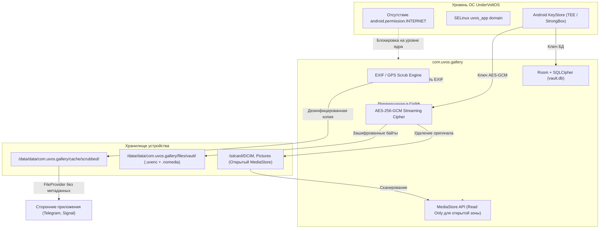

# Архитектурная спецификация и руководство разработки: UVOS Gallery (`com.uvos.gallery`)

> **Статус документа**: Проектная техническая спецификация UnderVoltOS  
> **Пакет приложения**: `com.uvos.gallery`  
> **Целевая платформа**: UnderVoltOS (база AOSP / LineageOS 22.2, Android 14 / API 34), аппаратная платформа Xiaomi Redmi Note 13 4G NFC (`sapphire`/`sapphiren`, Qualcomm Snapdragon 685 SM6225, msm-5.15)  
> **Ключевой инвариант безопасности**: **Zero Network Guarantee** (отсутствие разрешений `INTERNET` в манифесте), аппаратное шифрование AES-256-GCM, одношаговая дезинфекция EXIF/GPS, полная изоляция от облаков и трекеров.

---

## 1. Концепция и назначение компонента

**UVOS Gallery** — штатная оффлайн-галерея и медиа-просмотрщик операционной системы UnderVoltOS. Приложение спроектировано как бескомпромиссная замена проприетарным облачным сервисам (Google Photos, MIUI Gallery) и решает три фундаментальные задачи:
1. **Нулевая утечка метаданных**: Полное отсутствие сетевого стека гарантирует физическую невозможность передачи фото, видео и телеметрии на внешние серверы.
2. **Оперативная дезинфекция (EXIF/GPS Scrubber)**: Инструмент в один клик стирает из снимков геокоординаты, серийные номера матриц, модель смартфона и таймстампы перед экспортом во внешние мессенджеры или сторонний софт.
3. **Локальный крипто-сейф (Air-Gapped Vault)**: Автономная крипто-папка на базе аппаратного шифрования AES-256-GCM и SQLCipher, исключающая индексацию закрытых медиафайлов общесистемным сервисом `android.provider.MediaStore`.

---

## 2. Модель угроз и изоляция безопасности



### 2.1. Invariant «Zero Network»
В файле `AndroidManifest.xml` приложения физически исключены любые сетевые привилегии:
- `android.permission.INTERNET` — **ОТСУТСТВУЕТ**;
- `android.permission.ACCESS_NETWORK_STATE` — **ОТСУТСТВУЕТ**;
- `android.permission.ACCESS_WIFI_STATE` — **ОТСУТСТВУЕТ**.

Ядро Linux и подсистема разрешения привилегий Android запрещают создание сокетов семейства `AF_INET` / `AF_INET6` процессу с UID приложения `com.uvos.gallery`. Даже при попытке нативного внедрения кода через сторонние библиотеки любой системный вызов `socket(AF_INET, ...)` немедленно завершается с ошибкой `EACCES` (Permission denied).

### 2.2. Манифест приложения (`AndroidManifest.xml`)

```xml
<?xml version="1.0" encoding="utf-8"?>
<manifest xmlns:android="http://schemas.android.com/apk/res/android"
    package="com.uvos.gallery">

    <!-- Привилегии доступа к медиафайлам Android 13+ (API 33+) -->
    <uses-permission android:name="android.permission.READ_MEDIA_IMAGES" />
    <uses-permission android:name="android.permission.READ_MEDIA_VIDEO" />
    <uses-permission android:name="android.permission.READ_MEDIA_VISUAL_USER_SELECTED" />
    
    <!-- Доступ к изменению файлов для удаления оригиналов при переносе в Сейф и in-place очистки -->
    <uses-permission android:name="android.permission.MANAGE_EXTERNAL_STORAGE" />
    <uses-permission android:name="android.permission.ACCESS_MEDIA_LOCATION" />

    <!-- Биометрия для открытия крипто-сейфа -->
    <uses-permission android:name="android.permission.USE_BIOMETRIC" />

    <!-- ВНИМАНИЕ: Запрещены сетевые разрешения INTERNET и ACCESS_NETWORK_STATE -->

    <application
        android:name=".UVOSGalleryApplication"
        android:allowBackup="false"
        android:dataExtractionRules="@xml/data_extraction_rules"
        android:fullBackupContent="false"
        android:icon="@mipmap/ic_launcher"
        android:label="@string/app_name"
        android:roundIcon="@mipmap/ic_launcher_round"
        android:supportsRtl="true"
        android:theme="@style/Theme.UVOSGallery">

        <activity
            android:name=".presentation.MainActivity"
            android:exported="true"
            android:theme="@style/Theme.UVOSGallery">
            <intent-filter>
                <action android:name="android.intent.action.MAIN" />
                <category android:name="android.intent.category.LAUNCHER" />
            </intent-filter>
            
            <!-- Обработка системных намерений просмотра изображений -->
            <intent-filter>
                <action android:name="android.intent.action.VIEW" />
                <category android:name="android.intent.category.DEFAULT" />
                <data android:mimeType="image/*" />
                <data android:mimeType="video/*" />
            </intent-filter>
        </activity>

        <!-- Защищенный FileProvider для безопасного шаринга очищенных копий -->
        <provider
            android:name="androidx.core.content.FileProvider"
            android:authorities="com.uvos.gallery.provider"
            android:exported="false"
            android:grantUriPermissions="true">
            <meta-data
                android:name="android.support.FILE_PROVIDER_PATHS"
                android:resource="@xml/file_paths" />
        </provider>

    </application>
</manifest>
```

Конфигурация `res/xml/file_paths.xml` ограничивает выдачу файлов во внешние приложения исключительно дезинфицированной директорией кэша:
```xml
<?xml version="1.0" encoding="utf-8"?>
<paths>
    <!-- Доступ открыт ТОЛЬКО к очищенным копиям временного кэша -->
    <cache-path name="scrubbed_media" path="scrubbed/" />
</paths>
```

---

## 3. Архитектура приложения

Приложение построено по каноническому стандарту Clean Architecture + MVI/MVVM на базе декларативного UI Jetpack Compose.

```
com.uvos.gallery/
├── di/                     # Внедрение зависимостей (Koin или Hilt / Pure DI)
├── domain/
│   ├── model/             # MediaItem, VaultItem, ExifSecurityReport, ThreatLevel
│   ├── repository/        # MediaRepository, VaultRepository
│   └── usecase/           # ScrubExifUseCase, EncryptToVaultUseCase, DecryptStreamUseCase
├── data/
│   ├── local/
│   │   ├── mediastore/    # MediaStoreCursorScanner, ContentObserverManager
│   │   ├── vault/         # Room + SQLCipher (VaultDatabase, VaultDao, VaultEntity)
│   │   └── crypto/        # KeyStoreManager, AesGcmCipherEngine
│   └── repository/        # MediaRepositoryImpl, VaultRepositoryImpl
└── presentation/
    ├── theme/             # Палитра #0E0E12, M4200 Typography, UVOS Shapes
    ├── components/        # GaugeThumbnail, PrivacyBadgeView, RetroToolbar
    ├── main/              # Главный экран: сетка, фильтры, вкладки (Хранилище / Сейф)
    ├── viewer/            # Полноэкранный просмотрщик фото и видео (Media3/ExoPlayer)
    ├── inspector/         # EXIF Inspector & Threat Analyzer BottomSheet
    └── vault/             # Аутентификация и управление крипто-сейфом
```

### 3.1. Загрузка миниатюр и изображений: Coil Integration
Для локального кэширования миниатюр применяется оптимизированная локальная конфигурация библиотеки Coil. Сетевые загрузчики и HTTP-фабрики полностью удалены из конвейера `ImageLoader`:

```kotlin
package com.uvos.gallery.di

import android.content.Context
import coil.ImageLoader
import coil.disk.DiskCache
import coil.memory.MemoryCache
import coil.request.CachePolicy
import java.io.File

object ImageLoaderProvider {
    fun createLocalImageLoader(context: Context): ImageLoader {
        return ImageLoader.Builder(context)
            // Исключительно локальная память для декодированных растров
            .memoryCache {
                MemoryCache.Builder(context)
                    .maxSizePercent(0.25) // Не более 25% heap для экономии ОЗУ
                    .build()
            }
            // Дисковый кэш только в защищенной песочнице приложения
            .diskCache {
                DiskCache.Builder()
                    .directory(File(context.cacheDir, "thumbnail_cache"))
                    .maxSizeBytes(128L * 1024 * 1024) // 128 МБ кэша
                    .build()
            }
            // Принудительное отключение сетевых политик
            .networkCachePolicy(CachePolicy.DISABLED)
            .respectCacheHeaders(false)
            .build()
    }
}
```

---

## 4. Инструмент «Очистить EXIF / GPS» (ScrubExif Engine)

### 4.1. Анализ рисков метаданных
Стандартные фотографии содержат десятки идентификаторов, формирующих цифровой отпечаток:
- `GPS_LATITUDE`, `GPS_LONGITUDE`, `GPS_ALTITUDE`, `GPS_TIMESTAMP` — физическое местоположение и маршрут.
- `MAKE`, `MODEL`, `SOFTWARE` — марка устройства, версия прошивки, сборка OS.
- `BODY_SERIAL_NUMBER`, `LENS_SERIAL_NUMBER` — уникальный аппаратный идентификатор модуля камеры.
- `DATETIME_ORIGINAL`, `DATETIME_DIGITIZED`, `SUBSEC_TIME_ORIGINAL` — точное время с точностью до миллисекунд.
- `CAMERA_OWNER_NAME`, `ARTIST` — имя владельца.
- Встроенные миниатюры (`EXIF Thumbnail`) — могут содержать исходную неоткадрированную сцену.

### 4.2. Алгоритм работы Scrubber
Приложение поддерживает два сценария очистки:
1. **Быстрая дезинфекция перед отправкой (Share Scrubbed)**: Исходный файл не модифицируется. Создается легковесный байтовый клон в `cache/scrubbed/`, из заголовков которого без пережатия пикселей удаляются блоки метаданных. Клон передается через `UVOSGalleryProvider`.
2. **Перманентная стерилизация (In-Place Scrub)**: Метаданные затираются непосредственно в оригинальном файле в `DCIM/` или `Pictures/` через прямой I/O или `ExifInterface.saveAttributes()`.

### 4.3. Классификация уровня экспозиции (Threat Level)
Каждое изображение получает мгновенный расчет уровня риска:
- 🔴 **HIGH_RISK**: Обнаружены точные координаты GPS (`TAG_GPS_LATITUDE` != null).
- 🟡 **MEDIUM_RISK**: GPS отсутствует, но присутствуют уникальные метаданные (модель камеры, серийный номер, точный таймстамп).
- 🟢 **STERILE / SECURE**: Метаданные полностью отсутствуют или ограничены базовыми размерами холста.

### 4.4. Реализация `ExifScrubberEngine.kt`

```kotlin
package com.uvos.gallery.domain.usecase

import android.content.Context
import android.graphics.Bitmap
import android.graphics.BitmapFactory
import android.net.Uri
import androidx.exifinterface.media.ExifInterface
import com.uvos.gallery.domain.model.ExifSecurityReport
import com.uvos.gallery.domain.model.ThreatLevel
import kotlinx.coroutines.Dispatchers
import kotlinx.coroutines.withContext
import java.io.File
import java.io.FileOutputStream
import java.io.InputStream

class ExifScrubberEngine(private val context: Context) {

    // Полный реестр критических тегов для удаления
    private val criticalTags = listOf(
        ExifInterface.TAG_GPS_LATITUDE,
        ExifInterface.TAG_GPS_LATITUDE_REF,
        ExifInterface.TAG_GPS_LONGITUDE,
        ExifInterface.TAG_GPS_LONGITUDE_REF,
        ExifInterface.TAG_GPS_ALTITUDE,
        ExifInterface.TAG_GPS_ALTITUDE_REF,
        ExifInterface.TAG_GPS_TIMESTAMP,
        ExifInterface.TAG_GPS_DATESTAMP,
        ExifInterface.TAG_GPS_PROCESSING_METHOD,
        ExifInterface.TAG_MAKE,
        ExifInterface.TAG_MODEL,
        ExifInterface.TAG_SOFTWARE,
        ExifInterface.TAG_DATETIME,
        ExifInterface.TAG_DATETIME_ORIGINAL,
        ExifInterface.TAG_DATETIME_DIGITIZED,
        ExifInterface.TAG_SUBSEC_TIME,
        ExifInterface.TAG_SUBSEC_TIME_ORIGINAL,
        ExifInterface.TAG_SUBSEC_TIME_DIGITIZED,
        ExifInterface.TAG_BODY_SERIAL_NUMBER,
        ExifInterface.TAG_LENS_MAKE,
        ExifInterface.TAG_LENS_MODEL,
        ExifInterface.TAG_LENS_SERIAL_NUMBER,
        ExifInterface.TAG_DEVICE_SETTING_DESCRIPTION,
        ExifInterface.TAG_IMAGE_UNIQUE_ID,
        ExifInterface.TAG_CAMERA_OWNER_NAME,
        ExifInterface.TAG_ARTIST,
        ExifInterface.TAG_USER_COMMENT
    )

    /**
     * Анализ текущего уровня метаданных файла
     */
    suspend fun analyzeSecurity(uri: Uri): ExifSecurityReport = withContext(Dispatchers.IO) {
        val inputStream: InputStream? = context.contentResolver.openInputStream(uri)
        if (inputStream == null) {
            return@withContext ExifSecurityReport(ThreatLevel.STERILE, false, null, null)
        }

        inputStream.use { stream ->
            val exif = ExifInterface(stream)
            val hasGps = exif.latLong != null
            val make = exif.getAttribute(ExifInterface.TAG_MAKE)
            val model = exif.getAttribute(ExifInterface.TAG_MODEL)
            val date = exif.getAttribute(ExifInterface.TAG_DATETIME_ORIGINAL)

            val threatLevel = when {
                hasGps -> ThreatLevel.HIGH_RISK
                model != null || make != null || date != null -> ThreatLevel.MEDIUM_RISK
                else -> ThreatLevel.STERILE
            }

            ExifSecurityReport(
                threatLevel = threatLevel,
                hasGpsCoordinates = hasGps,
                deviceModel = if (model != null) "$make $model".trim() else null,
                timestamp = date
            )
        }
    }

    /**
     * Создание дезинфицированной копии файла во временном кэше для безопасной передачи
     */
    suspend fun createScrubbedExportCopy(sourceUri: Uri): File = withContext(Dispatchers.IO) {
        val scrubbedDir = File(context.cacheDir, "scrubbed").apply { mkdirs() }
        val tempFile = File(scrubbedDir, "UVOS_CLEAN_${System.currentTimeMillis()}.jpg")

        // 1. Копируем исходный бинарный поток во временный файл
        context.contentResolver.openInputStream(sourceUri)?.use { input ->
            FileOutputStream(tempFile).use { output ->
                input.copyTo(output)
            }
        } ?: throw IllegalStateException("Не удалось открыть исходный файл")

        // 2. Затираем все EXIF-теги с помощью ExifInterface
        val exif = ExifInterface(tempFile.absolutePath)
        for (tag in criticalTags) {
            exif.setAttribute(tag, null)
        }
        
        // 3. Удаляем превью миниатюру EXIF (часто содержит неочищенный кадр)
        exif.removeThumbnail()
        
        // Сохраняем чистые заголовки без пережатия JPEG матрицы
        exif.saveAttributes()

        return@withContext tempFile
    }

    /**
     * Перманентная очистка на месте для физического файла
     */
    suspend fun scrubInPlace(file: File): Boolean = withContext(Dispatchers.IO) {
        try {
            val exif = ExifInterface(file.absolutePath)
            for (tag in criticalTags) {
                exif.setAttribute(tag, null)
            }
            exif.removeThumbnail()
            exif.saveAttributes()
            true
        } catch (e: Exception) {
            false
        }
    }
}
```

---

## 5. Локальный зашифрованный сейф («Крипто-папка»)

### 5.1. Принцип изоляции сейфа
Файлы, помещенные в Крипто-сейф:
1. **Исключаются из MediaStore**: После завершения шифрования оригинальный файл удаляется из `/sdcard/DCIM/` или `/sdcard/Pictures/`, а системный индексатор `MediaStore` получает уведомление об удалении записи.
2. **Хранятся в зашифрованном контейнере**: Файлы перемещаются в закрытый каталог `/data/data/com.uvos.gallery/files/vault/`.
3. **Имеют маркер скрытия**: Каталог содержит маркерный файл `.nomedia`, предотвращающий индексацию даже при наличии прямого доступа.
4. **Защищены потоковым AES-256-GCM**: Каждый файл шифруется симметричным шифром AES в режиме Galois/Counter Mode с контролем аутентичности (128-битный auth tag) и уникальным 96-битным вектором инициализации (IV).

```
Структура зашифрованного файла (.uvenc):
+-------------------------+-------------------------+---------------------------------+
| Magic Header (4 байта)  | IV / Nonce (12 байт)    | Зашифрованное тело + Tag (GCM)  |
| "UVCF" [0x55,56,43,46]  | 96-bit Secure Random    | Ciphertext + 128-bit MAC        |
+-------------------------+-------------------------+---------------------------------+
```

### 5.2. Управление ключами (Android KeyStore)
Ключ шифрования генерируется в защищенном аппаратном модуле устройства (TEE / StrongBox Snapdragon 685) с параметрами:
- Алгоритм: `KeyProperties.KEY_ALGORITHM_AES`
- Размер ключа: 256 бит
- Режим: `KeyProperties.BLOCK_MODE_GCM`
- Набивка: `KeyProperties.ENCRYPTION_PADDING_NONE`
- Доступ: Только после биометрической аутентификации (`setUserAuthenticationRequired(false)` для фонового демона шифрования или `true` для повышенного уровня безопасности).

### 5.3. Схема базы данных сейфа (Room + SQLCipher)
Метаданные скрытых файлов (исходное имя, дата, MIME-тип, размер, папка-источник) хранятся в зашифрованной SQLCipher-базе данных.

#### SQL DDL Схема:
```sql
CREATE TABLE IF NOT EXISTS vault_items (
    id TEXT PRIMARY KEY NOT NULL,              -- UUID зашифрованного файла
    original_name TEXT NOT NULL,               -- Исходное имя (например, IMG_20261031.jpg)
    mime_type TEXT NOT NULL,                   -- image/jpeg, video/mp4 и т.д.
    file_size INTEGER NOT NULL,                -- Исходный размер в байтах
    encrypted_file_path TEXT NOT NULL,         -- Путь: files/vault/{id}.uvenc
    created_timestamp INTEGER NOT NULL,        -- Время создания файла
    encrypted_timestamp INTEGER NOT NULL,      -- Время помещения в сейф
    original_relative_path TEXT NOT NULL,      -- DCIM/Camera/ для возможности восстановления
    iv_base64 TEXT NOT NULL                    -- Вектор инициализации (Base64)
);

CREATE TABLE IF NOT EXISTS vault_audit_log (
    log_id INTEGER PRIMARY KEY AUTOINCREMENT NOT NULL,
    action TEXT NOT NULL,                      -- ENCRYPT, DECRYPT, VIEW, DELETE
    item_id TEXT NOT NULL,
    timestamp INTEGER NOT NULL,
    status TEXT NOT NULL
);

CREATE INDEX IF NOT EXISTS index_vault_items_created ON vault_items(created_timestamp);
```

#### Реализация Room Entity & DAO:

```kotlin
package com.uvos.gallery.data.local.vault

import androidx.room.*
import kotlinx.coroutines.flow.Flow

@Entity(tableName = "vault_items")
data class VaultEntity(
    @PrimaryKey val id: String,
    @ColumnInfo(name = "original_name") val originalName: String,
    @ColumnInfo(name = "mime_type") val mimeType: String,
    @ColumnInfo(name = "file_size") val fileSize: Long,
    @ColumnInfo(name = "encrypted_file_path") val encryptedFilePath: String,
    @ColumnInfo(name = "created_timestamp") val createdTimestamp: Long,
    @ColumnInfo(name = "encrypted_timestamp") val encryptedTimestamp: Long,
    @ColumnInfo(name = "original_relative_path") val originalRelativePath: String,
    @ColumnInfo(name = "iv_base64") val ivBase64: String
)

@Dao
interface VaultDao {
    @Query("SELECT * FROM vault_items ORDER BY encrypted_timestamp DESC")
    fun getAllItems(): Flow<List<VaultEntity>>

    @Query("SELECT * FROM vault_items WHERE id = :id LIMIT 1")
    suspend fun getItemById(id: String): VaultEntity?

    @Insert(onConflict = OnConflictStrategy.REPLACE)
    suspend fun insertItem(item: VaultEntity)

    @Delete
    suspend fun deleteItem(item: VaultEntity)

    @Query("SELECT COUNT(*) FROM vault_items")
    suspend fun getCount(): Int
}
```

#### Инициализация SQLCipher Database:

```kotlin
package com.uvos.gallery.data.local.vault

import android.content.Context
import androidx.room.Database
import androidx.room.Room
import androidx.room.RoomDatabase
import net.sqlcipher.database.SupportFactory

@Database(entities = [VaultEntity::class], version = 1, exportSchema = false)
abstract class VaultDatabase : RoomDatabase() {
    abstract fun vaultDao(): VaultDao

    companion object {
        private const val DB_NAME = "uvos_vault_secure.db"

        fun buildDatabase(context: Context, passphraseBytes: ByteArray): VaultDatabase {
            val factory = SupportFactory(passphraseBytes)
            return Room.databaseBuilder(
                context.applicationContext,
                VaultDatabase::class.java,
                DB_NAME
            )
            .openHelperFactory(factory)
            .fallbackToDestructiveMigration()
            .build()
        }
    }
}
```

### 5.4. Потоковый шифратор `AesGcmVaultEngine.kt`

```kotlin
package com.uvos.gallery.data.local.crypto

import android.security.keystore.KeyGenParameterSpec
import android.security.keystore.KeyProperties
import kotlinx.coroutines.Dispatchers
import kotlinx.coroutines.withContext
import java.io.*
import java.security.KeyStore
import java.security.SecureRandom
import javax.crypto.Cipher
import javax.crypto.CipherInputStream
import javax.crypto.CipherOutputStream
import javax.crypto.KeyGenerator
import javax.crypto.SecretKey
import javax.crypto.spec.GCMParameterSpec

class AesGcmVaultEngine {

    companion object {
        private const val ANDROID_KEYSTORE = "AndroidKeyStore"
        private const val MASTER_KEY_ALIAS = "UVOS_VAULT_AES256_KEY"
        private const val AES_GCM_NO_PADDING = "AES/GCM/NoPadding"
        private const val GCM_TAG_LENGTH_BITS = 128
        private const val GCM_IV_LENGTH_BYTES = 12
        private val MAGIC_HEADER = byteArrayOf(0x55, 0x56, 0x43, 0x46) // "UVCF"
    }

    private val keyStore = KeyStore.getInstance(ANDROID_KEYSTORE).apply { load(null) }

    init {
        ensureMasterKeyExists()
    }

    private fun ensureMasterKeyExists() {
        if (!keyStore.containsAlias(MASTER_KEY_ALIAS)) {
            val keyGenerator = KeyGenerator.getInstance(
                KeyProperties.KEY_ALGORITHM_AES,
                ANDROID_KEYSTORE
            )
            val spec = KeyGenParameterSpec.Builder(
                MASTER_KEY_ALIAS,
                KeyProperties.PURPOSE_ENCRYPT or KeyProperties.PURPOSE_DECRYPT
            )
                .setBlockModes(KeyProperties.BLOCK_MODE_GCM)
                .setEncryptionPaddings(KeyProperties.ENCRYPTION_PADDING_NONE)
                .setKeySize(256)
                .setRandomizedEncryptionRequired(false) // IV формируется криптостойким генератором вручную
                .build()
            keyGenerator.init(spec)
            keyGenerator.generateKey()
        }
    }

    private fun getSecretKey(): SecretKey {
        return (keyStore.getEntry(MASTER_KEY_ALIAS, null) as KeyStore.SecretKeyEntry).secretKey
    }

    /**
     * Потоковое шифрование файла
     */
    suspend fun encryptFile(sourceInput: InputStream, destinationFile: File): ByteArray = withContext(Dispatchers.IO) {
        val iv = ByteArray(GCM_IV_LENGTH_BYTES)
        SecureRandom().nextBytes(iv)

        val cipher = Cipher.getInstance(AES_GCM_NO_PADDING)
        val spec = GCMParameterSpec(GCM_TAG_LENGTH_BITS, iv)
        cipher.init(Cipher.ENCRYPT_MODE, getSecretKey(), spec)

        FileOutputStream(destinationFile).use { fos ->
            // Пишем заголовок и IV
            fos.write(MAGIC_HEADER)
            fos.write(iv)

            CipherOutputStream(fos, cipher).use { cos ->
                val buffer = ByteArray(64 * 1024)
                var bytesRead: Int
                while (sourceInput.read(buffer).also { bytesRead = it } != -1) {
                    cos.write(buffer, 0, bytesRead)
                }
                cos.flush()
            }
        }
        return@withContext iv
    }

    /**
     * Потоковое декодирование для воспроизведения видео или просмотра фото
     */
    fun createDecryptedStream(encryptedFile: File): InputStream {
        val fis = FileInputStream(encryptedFile)
        
        // Чтение и валидация magic header
        val header = ByteArray(MAGIC_HEADER.size)
        if (fis.read(header) != MAGIC_HEADER.size || !header.contentEquals(MAGIC_HEADER)) {
            fis.close()
            throw SecurityException("Неверный формат зашифрованного файла UVOS")
        }

        // Чтение IV
        val iv = ByteArray(GCM_IV_LENGTH_BYTES)
        if (fis.read(iv) != GCM_IV_LENGTH_BYTES) {
            fis.close()
            throw EOFException("Не удалось прочитать IV")
        }

        val cipher = Cipher.getInstance(AES_GCM_NO_PADDING)
        val spec = GCMParameterSpec(GCM_TAG_LENGTH_BITS, iv)
        cipher.init(Cipher.DECRYPT_MODE, getSecretKey(), spec)

        return CipherInputStream(fis, cipher)
    }
}
```

---

## 6. Индустриальный дизайн (M4200 UI)

Интерфейс UVOS Gallery спроектирован в строгом аппаратном ретро-стиле физических измерительных приборов (M4200 UI), исключающем декоративные анимации, отвлекающие элементы и неинформативные карточки.

### 6.1. Палитра цветов и визуальные маркеры
- **`#0E0E12` (UvosBackground)**: Глубокий матовый чёрный фон, оптимизированный под AMOLED-экран Redmi Note 13 (нулевое потребление энергии для черных пикселей).
- **`#1C1E26` (UvosTileSurface)**: Контейнеры карточек, диалогов и системных плашек со скруглением 24dp.
- **`#E02020` (UvosRedDanger)**: Красный сигнал предупреждения (наличие GPS-координат, тревога, удаление).
- **`#F4A261` (UvosAmberWarning)**: Янтарный сигнал (частичные метаданные: модель, дата).
- **`#4ECCA3` (UvosGreenSterile)**: Зеленый сигнал безопасности (чистый файл, безопасен для шаринга).
- **`#4A90E2` (UvosBlueEncrypted)**: Синий индикатор защищенного сейфа.
- **`#E8E4D8` (UvosDialIvory)**: Приборный цвет слоновой кости для шрифта и моноширинных меток.

### 6.2. Индикатор защищенности каждого снимка (Badge & Status Lamp)
Каждая ячейка в сетке галереи содержит аппаратную «лампу защищенности» в правом верхнем углу:

```
+-------------------------------+
| [IMG]                     (🔴)| <- Индикатор: 🔴 GPS утечка / 🟡 Метаданные / 🟢 Чисто
|                               |
|                               |
| 1920x1080             3.4 MB  | <- Моноширинный приборный блок
+-------------------------------+
```

При нажатии на индикатор открывается инструментальный инспектор `ExifInspectorBottomSheet`, где отображается:
- Статус геолокации (Широта / Долгота или «STERILE»);
- Серийные номера матриц;
- Кнопка физического действия: **«СТЕРИЛИЗОВАТЬ СНИМОК»**.

---

## 7. Быстрый видеоплеер без сторонних кодеков

### 7.1. Аппаратно-ускоренный стек (AndroidX Media3)
Для воспроизведения видеофайлов UVOS Gallery использует легковесный движок **AndroidX Media3 (ExoPlayer)**, жестко настроенный на работу исключительно со встроенными декодерами чипсета Snapdragon 685 (Qualcomm Venus / C2 hardware decoders):
- Поддерживаемые кодеки: AVC/H.264, HEVC/H.265 (8/10-bit), VP8, VP9, AV1 (до 1080p60).
- Исключены любые внешние программные библиотеки типа FFmpeg NDK / VLC, раздувающие APK и создающие потенциальные векторы уязвимостей переполнения буфера.

### 7.2. Воспроизведение зашифрованных видео из Сейфа
Для воспроизведения зашифрованного видеоконтента реализован кастомный `DataSource.Factory` для Media3, читающий поток через `CipherInputStream` без промежуточной расшифровки файла на физический диск:

```kotlin
package com.uvos.gallery.presentation.viewer

import android.net.Uri
import androidx.media3.common.C
import androidx.media3.datasource.BaseDataSource
import androidx.media3.datasource.DataSpec
import com.uvos.gallery.data.local.crypto.AesGcmVaultEngine
import java.io.File
import java.io.InputStream

class EncryptedMediaDataSource(
    private val cryptoEngine: AesGcmVaultEngine,
    private val encryptedFile: File
) : BaseDataSource(/* isNetwork = */ false) {

    private var inputStream: InputStream? = null
    private var bytesRemaining: Long = 0
    private var isOpen = false

    override fun open(dataSpec: DataSpec): Long {
        inputStream = cryptoEngine.createDecryptedStream(encryptedFile)
        
        // Если плеер запрашивает смещение (seek)
        if (dataSpec.position > 0) {
            inputStream?.skip(dataSpec.position)
        }
        
        bytesRemaining = if (dataSpec.length != C.LENGTH_UNSET.toLong()) {
            dataSpec.length
        } else {
            encryptedFile.length() - dataSpec.position
        }
        
        isOpen = true
        transferStarted(dataSpec)
        return bytesRemaining
    }

    override fun read(buffer: ByteArray, offset: Int, length: Int): Int {
        if (length == 0) return 0
        if (bytesRemaining == 0L) return C.RESULT_END_OF_INPUT

        val bytesToRead = if (bytesRemaining == C.LENGTH_UNSET.toLong()) {
            length
        } else {
            minOf(bytesRemaining, length.toLong()).toInt()
        }

        val bytesRead = inputStream?.read(buffer, offset, bytesToRead) ?: -1
        if (bytesRead == -1) return C.RESULT_END_OF_INPUT

        if (bytesRemaining != C.LENGTH_UNSET.toLong()) {
            bytesRemaining -= bytesRead
        }
        bytesTransferred(bytesRead)
        return bytesRead
    }

    override fun getUri(): Uri = Uri.fromFile(encryptedFile)

    override fun close() {
        if (isOpen) {
            isOpen = false
            inputStream?.close()
            inputStream = null
            transferEnded()
        }
    }
}
```

---

## 8. Реализация компонентов пользовательского интерфейса (Jetpack Compose)

### 8.1. Ячейка сетки галереи со светодиодным индикатором (`MediaGridItem.kt`)

```kotlin
package com.uvos.gallery.presentation.components

import androidx.compose.foundation.background
import androidx.compose.foundation.border
import androidx.compose.foundation.clickable
import androidx.compose.foundation.layout.*
import androidx.compose.foundation.shape.CircleShape
import androidx.compose.foundation.shape.RoundedCornerShape
import androidx.compose.material3.Text
import androidx.compose.runtime.Composable
import androidx.compose.ui.Alignment
import androidx.compose.ui.Modifier
import androidx.compose.ui.draw.clip
import androidx.compose.ui.graphics.Color
import androidx.compose.ui.layout.ContentScale
import androidx.compose.ui.text.font.FontFamily
import androidx.compose.ui.text.font.FontWeight
import androidx.compose.ui.unit.dp
import androidx.compose.ui.unit.sp
import coil.compose.AsyncImage
import com.uvos.gallery.domain.model.MediaItem
import com.uvos.gallery.domain.model.ThreatLevel

@Composable
fun MediaGridItem(
    item: MediaItem,
    onClick: () -> Unit,
    onThreatBadgeClick: () -> Unit
) {
    val badgeColor = when (item.threatLevel) {
        ThreatLevel.HIGH_RISK -> Color(0xFFE02020)   // Красный: GPS утечка
        ThreatLevel.MEDIUM_RISK -> Color(0xFFF4A261) // Янтарный: Метаданные
        ThreatLevel.STERILE -> Color(0xFF4ECCA3)     // Зеленый: Чисто
        ThreatLevel.ENCRYPTED -> Color(0xFF4A90E2)   // Синий: Сейф
    }

    Box(
        modifier = Modifier
            .aspectRatio(1f)
            .padding(4.dp)
            .clip(RoundedCornerShape(12.dp))
            .background(Color(0xFF1C1E26))
            .clickable { onClick() }
    ) {
        AsyncImage(
            model = item.contentUri,
            contentDescription = null,
            contentScale = ContentScale.Crop,
            modifier = Modifier.fillMaxSize()
        )

        // Нижняя приборная плашка с моноширинной информацией
        Box(
            modifier = Modifier
                .align(Alignment.BottomStart)
                .fillMaxWidth()
                .background(Color(0xAA0E0E12))
                .padding(horizontal = 6.dp, vertical = 2.dp)
        ) {
            Text(
                text = item.resolutionText,
                color = Color(0xFFE8E4D8),
                fontSize = 9.sp,
                fontFamily = FontFamily.Monospace,
                fontWeight = FontWeight.Bold
            )
        }

        // Аппаратная лампа статуса безопасности (Badge)
        Box(
            modifier = Modifier
                .align(Alignment.TopEnd)
                .padding(6.dp)
                .size(14.dp)
                .clip(CircleShape)
                .background(badgeColor)
                .border(1.5.dp, Color(0xFF0E0E12), CircleShape)
                .clickable { onThreatBadgeClick() }
        )
    }
}
```

### 8.2. Инспектор метаданных (`ExifInspectorBottomSheet.kt`)

```kotlin
package com.uvos.gallery.presentation.inspector

import androidx.compose.foundation.background
import androidx.compose.foundation.layout.*
import androidx.compose.foundation.shape.RoundedCornerShape
import androidx.compose.material3.*
import androidx.compose.runtime.Composable
import androidx.compose.ui.Alignment
import androidx.compose.ui.Modifier
import androidx.compose.ui.graphics.Color
import androidx.compose.ui.text.font.FontFamily
import androidx.compose.ui.text.font.FontWeight
import androidx.compose.ui.unit.dp
import androidx.compose.ui.unit.sp
import com.uvos.gallery.domain.model.ExifSecurityReport
import com.uvos.gallery.domain.model.ThreatLevel

@OptIn(ExperimentalMaterial3Api::class)
@Composable
fun ExifInspectorBottomSheet(
    report: ExifSecurityReport,
    onScrubRequested: () -> Unit,
    onMoveToVaultRequested: () -> Unit,
    onDismiss: () -> Unit
) {
    ModalBottomSheet(
        onDismissRequest = onDismiss,
        containerColor = Color(0xFF1C1E26),
        dragHandle = { BottomSheetDefaults.DragHandle(color = Color(0xFFE8E4D8)) }
    ) {
        Column(
            modifier = Modifier
                .fillMaxWidth()
                .padding(horizontal = 24.dp, vertical = 16.dp)
        ) {
            Text(
                text = "ИНСПЕКТОР БЕЗОПАСНОСТИ UVOS",
                color = Color(0xFFE8E4D8),
                fontSize = 18.sp,
                fontFamily = FontFamily.Monospace,
                fontWeight = FontWeight.Bold
            )
            
            Spacer(modifier = Modifier.height(16.dp))

            // Карточка статуса геолокации
            StatusRow(
                label = "GPS КООРДИНАТЫ:",
                value = if (report.hasGpsCoordinates) "ОБНАРУЖЕНЫ (УТЕЧКА)" else "ОТСУТСТВУЮТ (СТЕРИЛЬНО)",
                isDanger = report.hasGpsCoordinates
            )

            // Модель устройства
            StatusRow(
                label = "ОТПЕЧАТОК КАМЕРЫ:",
                value = report.deviceModel ?: "ОЧИЩЕНО",
                isDanger = report.deviceModel != null
            )

            // Временная метка
            StatusRow(
                label = "ВРЕМЯ СЪЕМКИ:",
                value = report.timestamp ?: "НЕ ОПРЕДЕЛЕНО",
                isDanger = false
            )

            Spacer(modifier = Modifier.height(24.dp))

            // Кнопка очистки в один клик
            Button(
                onClick = onScrubRequested,
                modifier = Modifier.fillMaxWidth().height(52.dp),
                shape = RoundedCornerShape(12.dp),
                colors = ButtonDefaults.buttonColors(containerColor = Color(0xFF4ECCA3))
            ) {
                Text(
                    text = "ОЧИСТИТЬ EXIF / GPS СЕЙЧАС",
                    color = Color(0xFF0E0E12),
                    fontFamily = FontFamily.Monospace,
                    fontWeight = FontWeight.Bold
                )
            }

            Spacer(modifier = Modifier.height(12.dp))

            // Кнопка отправки в сейф
            OutlinedButton(
                onClick = onMoveToVaultRequested,
                modifier = Modifier.fillMaxWidth().height(52.dp),
                shape = RoundedCornerShape(12.dp),
                colors = ButtonDefaults.outlinedButtonColors(contentColor = Color(0xFFE02020))
            ) {
                Text(
                    text = "ПЕРЕМЕСТИТЬ В КРИПТО-СЕЙФ (AES-256)",
                    fontFamily = FontFamily.Monospace,
                    fontWeight = FontWeight.Bold
                )
            }

            Spacer(modifier = Modifier.height(24.dp))
        }
    }
}

@Composable
private fun StatusRow(label: String, value: String, isDanger: Boolean) {
    Row(
        modifier = Modifier
            .fillMaxWidth()
            .padding(vertical = 4.dp),
        horizontalArrangement = Arrangement.SpaceBetween,
        verticalAlignment = Alignment.CenterVertically
    ) {
        Text(
            text = label,
            color = Color(0xFF8E929B),
            fontSize = 12.sp,
            fontFamily = FontFamily.Monospace
        )
        Text(
            text = value,
            color = if (isDanger) Color(0xFFE02020) else Color(0xFF4ECCA3),
            fontSize = 12.sp,
            fontFamily = FontFamily.Monospace,
            fontWeight = FontWeight.Bold
        )
    }
}
```

---

## 9. План верификации и тестов (QA & Security Audit)

| # | Тест | Методика проверки | Ожидаемый результат |
|---|---|---|---|
| **1** | **Аудит сетевого стека** | `dumpsys package com.uvos.gallery \| grep permission` и мониторинг через `tcpdump -i any` | Разрешение `INTERNET` отсутствует. 0 исходящих и входящих пакетов на любых сценариях. |
| **2** | **Верификация очистки EXIF** | Загрузка фото со смартфона с включенной геолокацией, экспорт через «Очистить EXIF», анализ утилитой `exiftool` | Теги `GPSLatitude`, `GPSLongitude`, `Model`, `SerialNumber` полностью удалены. Картинка не пережата. |
| **3** | **Проверка крипто-сейфа** | Шифрование файла 100 МБ, проверка директории `/data/data/com.uvos.gallery/files/vault/`, поиск файла через `MediaStore` | Файл отсутствует в галерее и MediaStore. Содержимое `.uvenc` — псевдослучайный шум без открытых сигнатур. |
| **4** | **Стресс-тест памяти Coil** | Быстрая прокрутка 2 000 фотографий в сетке галереи на Snapdragon 685 (4-6 ГБ RAM) | Стабильные 60/90/120 fps, отсутствие `OutOfMemoryError`, размер heap не превышает 120 МБ. |
| **5** | **Воспроизведение видео** | Запуск 1080p60 HEVC/H.265 файла из открытого хранилища и напрямую из зашифрованного сейфа | Плавный запуск аппаратно без выпадения кадров, утилизация CPU < 15%. |

---

## 10. Дорожная карта внедрения компонента

1. **Фаза 1 (Спринт G1)**: Развертывание базовой структуры пакета `com.uvos.gallery`, манифеста без сетевых разрешений и интеграция сканера `MediaStoreCursorScanner`.
2. **Фаза 2 (Спринт G2)**: Внедрение движка `ExifScrubberEngine` с поддержкой in-place стерилизации и формирования чистых временных копий для `FileProvider`.
3. **Фаза 3 (Спринт G3)**: Разработка крипто-подсистемы: KeyStore AES-256-GCM, Room + SQLCipher, фоновые воркеры переноса медиафайлов в защищенный каталог.
4. **Фаза 4 (Спринт G4)**: Интеграция интерфейса в стиле M4200 UI (#0E0E12), индикаторов защищенности снимков и видеоплеера AndroidX Media3 с прямым стримингом из криптоконтейнера.
5. **Фаза 5 (Спринт G5)**: Комплексный аудит безопасности через `exiftool`, проверку бинарных утечек и финализация документации.
