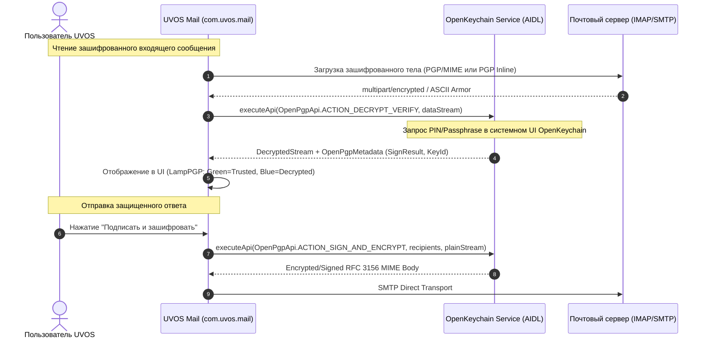

# Системная спецификация UVOS № 10: Защищенный почтовый клиент UVOS Mail (`com.uvos.mail`)
## Архитектурная спецификация, протоколы приватности, криптография PGP и методы разработки

> **Статус документа**: Принят к реализации (UnderVoltOS Engineering Standard)  
> **Идентификатор пакета**: `com.uvos.mail`  
> **Целевая платформа**: UnderVoltOS / Android 13–14 (Redmi Note 13 4G NFC `sapphire/sapphiren`)  
> **Архитектурный паттерн**: Clean Architecture + MVI (Model-View-Intent)  
> **Криптографический стек**: OpenKeychain AIDL API (OpenPGP RFC 4880 / RFC 3156), SQLCipher 256-bit AES  
> **Сетевой движок**: Jakarta Mail (JavaMail for Android port) с поддержкой IMAP IDLE, STARTTLS, SSL/TLS  
> **Инварианты безопасности**: 0% телеметрии, 0% внешних ретрансляторов/прокси, 100% клиентская фильтрация веб-маяков, принудительная очистка метаданных и заголовков User-Agent.

---

## 1. Архитектурная концепция и модель угроз

В традиционных мобильных почтовых клиентах (Gmail, Outlook, Spark, BlueMail) пользовательский трафик зачастую перенаправляется через облачные прокси-серверы вендора для генерации Push-уведомлений и предпросмотра, что приводит к полной деанонимизации переписки и компрометации учетных данных. Кроме того, современные коммерческие рассылки содержат скрытые веб-маяки (tracking pixels) и эксфильтрующие CSS/HTML конструкции, собирающие IP-адреса, время открытия, геолокацию и характеристики устройства.

**UVOS Mail (`com.uvos.mail`)** разрабатывается как абсолютно независимый, автономный почтовый терминал, функционирующий строго по принципу прямого P2P/Client-Server взаимодействия (клиент <-> почтовый сервер пользователя) без промежуточных серверов разработчика.

```
+---------------------------------------------------------------------------------------------------+
|                                  АРХИТЕКТУРНЫЙ КОНТУР UVOS MAIL                                   |
+---------------------------------------------------------------------------------------------------+
| [UI Слой: M4200 Industrial Dark] (#0E0E12, #1C1E26)                                               |
|  - LampView (IMAP Status / SMTP Status / PGP Trust)                                               |
|  - Jetpack Compose MVI Screens (FolderList, MessageList, Reader, Composer)                       |
+---------------------------------------------------------------------------------------------------+
                                           |  (MVI Intent / StateFlow)
                                           v
+---------------------------------------------------------------------------------------------------+
| [Domain Слой: Use Cases & Business Logic]                                                         |
|  - SanitizeHtmlContentUseCase (Нейтрализация трекеров и CSS-инъекций)                             |
|  - DecryptPgpMessageUseCase / SignAndEncryptUseCase (OpenKeychain AIDL)                           |
|  - FetchFolderMessagesUseCase / SendSmtpMessageUseCase                                            |
|  - StripHeadersUseCase (Очистка User-Agent, HELO/EHLO, Message-ID)                                |
+---------------------------------------------------------------------------------------------------+
         |                                                 |                               |
         v                                                 v                               v
+---------------------------------+   +------------------------------------+   +--------------------+
| [Data Слой: Local Encrypted DB] |   | [Data Слой: Remote Mail Engine]    |   | [Crypto Engine]    |
| - Room Database + SQLCipher     |   | - Jakarta Mail Android Engine      |   | - OpenKeychain     |
| - 256-bit AES-CBC (KeystoreKey) |   | - IMAP / IMAP IDLE / STARTTLS      |   |   AIDL Client API  |
| - No-Backup Attachment Vault    |   | - SMTP Direct Transport (Auth)     |   | - RFC 4880/3156    |
+---------------------------------+   +------------------------------------+   +--------------------+
```

### Ключевые архитектурные принципы:
1. **Clean Architecture + MVI**: строгая изоляция уровней Presentation, Domain и Data. Никаких утечек объектов Jakarta Mail (`javax.mail.Message`) в слои Presentation и UI.
2. **Нулевое доверие к входящему содержимому (Zero-Trust Rendering)**: любой входящий HTML рассматривается как потенциально вредоносный. Автоматическая нейтрализация активного содержимого, стилей и скрытых URL.
3. **Шифрование данных в покое (Data-at-Rest Encryption)**: локальная база данных сообщений зашифрована SQLCipher с ключом, генерируемым аппаратным модулем Android Keystore (StrongBox / TEE).
4. **Аппаратная независимость PGP**: хранение и операции с закрытыми ключами делегируются независимому системному менеджеру ключей (OpenKeychain) через безопасный AIDL IPC интерфейс без доступа приложения к приватным ключам пользователя.

---

## 2. Комплекс приватности и нейтрализации трекинга

### 2.1. Алгоритм санитизации HTML и нейтрализации веб-маяков (Tracking Pixels)

Маркетинговые и шпионские трекеры обычно встраиваются в тело письма следующими методами:
* Прозрачные однопиксельные изображения: ``.
* Фреймы и скрипты: `<iframe src="...">`, `<script src="...">`.
* CSS эксфильтрация данных: `<div style="background-image: url('https://tracker.com/leak')">` или `@import url(...)`.
* Внешние векторные объекты: `<svg><foreignObject>...<image href="...">`.

Для защиты конфиденциальности в `UVOS Mail` реализован компонент `MailHtmlSanitizer` на базе библиотеки **Jsoup**, осуществляющий препроцессинг перед отображением в `SafeMailWebView`:

```kotlin
package com.uvos.mail.domain.privacy

import org.jsoup.Jsoup
import org.jsoup.nodes.Document
import org.jsoup.nodes.Element
import org.jsoup.safety.Safelist

/**
 * Санитизатор входящего HTML-кода электронных писем.
 * Выполняет принудительную блокировку внешних ресурсов, трекеров и активного содержимого.
 */
class MailHtmlSanitizer {

    private val safeWhitelist: Safelist = Safelist.relaxed()
        .removeTags("script", "style", "iframe", "object", "embed", "applet", "form", "svg")
        .removeAttributes("a", "onclick", "onmouseover")
        .addAttributes("a", "href", "target")
        .addProtocols("a", "href", "http", "https", "mailto")

    data class SanitizedResult(
        val cleanHtml: String,
        val blockedExternalImagesCount: Int,
        val foundTrackingPixels: Int
    )

    fun sanitize(rawHtml: String, allowExternalImages: Boolean = false): SanitizedResult {
        var externalImagesCount = 0
        var trackingPixelsCount = 0

        val cleanHtmlBase = Jsoup.clean(rawHtml, safeWhitelist)
        val document: Document = Jsoup.parseBodyFragment(cleanHtmlBase)

        // Обработка тегов 
        val imgElements = document.select("img")
        for (img in imgElements) {
            val src = img.attr("src").trim()
            val width = img.attr("width").toIntOrNull() ?: -1
            val height = img.attr("height").toIntOrNull() ?: -1

            // Детекция трекинг-пикселей (1x1, 0x0 или скрытые)
            val isPixel = (width in 0..2 && height in 0..2) || 
                          img.attr("style").contains("display:none") || 
                          img.attr("style").contains("visibility:hidden")

            if (isPixel) {
                trackingPixelsCount++
                img.remove() // Полная ликвидация скрытого маяка
                continue
            }

            if (!allowExternalImages) {
                if (src.startsWith("http://", ignoreCase = true) || src.startsWith("https://", ignoreCase = true)) {
                    externalImagesCount++
                    // Подменяем внешний src на локальный placeholder
                    img.attr("data-uvos-blocked-src", src)
                    img.attr("src", "about:blank")
                    img.attr("style", "border: 1px dashed #E02020; background: #1C1E26; min-width: 48px; min-height: 48px; display: inline-block;")
                    img.attr("alt", "[Внешнее изображение заблокировано UVOS]")
                }
            }
        }

        // Удаление любых inline CSS background URL
        val styledElements = document.select("[style*='url']")
        for (elem in styledElements) {
            val style = elem.attr("style")
            val sanitizedStyle = style.replace(Regex("url\\s*\\(.*?\\)", RegexOption.IGNORE_CASE), "none")
            elem.attr("style", sanitizedStyle)
        }

        // Внедрение индустриального темного стиля M4200 для WebView
        val m4200HeadStyle = """
            <meta name="viewport" content="width=device-width, initial-scale=1.0, user-scalable=yes">
            <style>
                body {
                    background-color: #0E0E12 !important;
                    color: #E8E4D8 !important;
                    font-family: -apple-system, BlinkMacSystemFont, "Segoe UI", Roboto, "JetBrains Mono", monospace !important;
                    line-height: 1.5;
                    padding: 12px;
                    word-wrap: break-word;
                }
                a { color: #E8E4D8 !important; text-decoration: underline; }
                blockquote {
                    border-left: 3px solid #E02020;
                    margin: 8px 0;
                    padding-left: 10px;
                    color: #8C8E99 !important;
                }
                pre, code {
                    background-color: #1C1E26 !important;
                    color: #38E54D !important;
                    font-family: "JetBrains Mono", monospace;
                    padding: 4px 6px;
                    border-radius: 4px;
                }
            </style>
        """.trimIndent()

        document.head().prepend(m4200HeadStyle)

        return SanitizedResult(
            cleanHtml = document.body().html(),
            blockedExternalImagesCount = externalImagesCount,
            foundTrackingPixels = trackingPixelsCount
        )
    }
}
```

### 2.2. Защита почтовых заголовков (Header Stripping & Anti-Fingerprinting)

При отправке исходящей почты почтовые серверы и почтовые клиенты по умолчанию внедряют подробные сведения об устройстве: модель телефона (`Redmi Note 13`), версию Android, локальный IP-адрес в локальной сети (`192.168.x.x`), имя почтового клиента и идентификаторы сборок.

`UVOS Mail` реализует модуль `HeaderSanitizerTransport`:
1. **User-Agent / X-Mailer**: заголовок либо полностью исключается из отправляемого пакета RFC 822/5322, либо заменяется на обезличенную строку: `Thunderbird/115.0`.
2. **HELO / EHLO Name**: при инициализации SMTP-сокета вместо локального сетевого имени хоста смартфона передается нейтральный домен почтового аккаунта либо строго `[127.0.0.1]`.
3. **X-Originating-IP**: принудительно вырезается.
4. **Message-ID**: генерируется криптографически стойким псевдослучайным хешем без включения MAC-адреса, имени процесса или пользовательского идентификатора: `<${UUID.randomUUID()}@${accountDomain}>`.
5. **Disposition-Notification-To / Return-Receipt-To**: игнорируются для входящей почты (квитанции о прочтении никогда не отправляются автоматически).

---

## 3. Криптографическая подсистема: PGP/GPG сквозное шифрование

### 3.1. Интеграция с OpenKeychain через AIDL API

`UVOS Mail` использует проверенный открытый стандарт **OpenPgpApi** (`org.sufficientlysecure.keychain`), исключая необходимость хранить секретные ключи PGP внутри приложения.



### 3.2. Спецификация состояний PGP в доменном слое

```kotlin
package com.uvos.mail.domain.model.crypto

enum class PgpSignatureStatus {
    NONE,                   // Подпись отсутствует (обычное открытое письмо)
    VALID_TRUSTED,          // Подпись валидна, ключ подтвержден в кольце доверия
    VALID_UNTRUSTED,        // Подпись математически валидна, но ключ не верифицирован
    INVALID_SIGNATURE,      // Подпись скомпрометирована или повреждена!
    EXPIRED_KEY,            // Истек срок действия ключа отправителя
    REVOKED_KEY             // Ключ отправителя отозван
}

data class PgpSecurityMetadata(
    val isEncrypted: Boolean,
    val signatureStatus: PgpSignatureStatus,
    val keyId: Long?,
    val userId: String?,
    val algorithmName: String?
)
```

### 3.3. Реализация IPC моста с OpenPgpApi

```kotlin
package com.uvos.mail.data.crypto

import android.app.PendingIntent
import android.content.Context
import android.content.Intent
import com.uvos.mail.domain.model.crypto.PgpSecurityMetadata
import com.uvos.mail.domain.model.crypto.PgpSignatureStatus
import org.sufficientlysecure.keychain.integration.Constants
import org.sufficientlysecure.keychain.integration.OpenPgpApi
import java.io.ByteArrayInputStream
import java.io.ByteArrayOutputStream
import java.io.InputStream

class OpenPgpBridge(
    private val context: Context,
    private val openPgpApi: OpenPgpApi
) {
    sealed class DecryptResult {
        data class Success(val decryptedText: String, val metadata: PgpSecurityMetadata) : DecryptResult()
        data class UserInteractionRequired(val pendingIntent: PendingIntent) : DecryptResult()
        data class Error(val message: String) : DecryptResult()
    }

    fun decryptAndVerify(encryptedData: ByteArray): DecryptResult {
        val inputStream: InputStream = ByteArrayInputStream(encryptedData)
        val outputStream = ByteArrayOutputStream()

        val intent = Intent(OpenPgpApi.ACTION_DECRYPT_VERIFY)
        val resultIntent = openPgpApi.executeApi(intent, inputStream, outputStream)

        return when (resultIntent.getIntExtra(OpenPgpApi.RESULT_CODE, OpenPgpApi.RESULT_CODE_ERROR)) {
            OpenPgpApi.RESULT_CODE_SUCCESS -> {
                val decryptedText = outputStream.toString("UTF-8")
                val signResult = resultIntent.getParcelableExtra<OpenPgpApi.OpenPgpSignatureResult>(OpenPgpApi.RESULT_SIGNATURE)
                val keyId = resultIntent.getLongExtra(OpenPgpApi.EXTRA_KEY_ID, 0L)
                val userId = resultIntent.getStringExtra(OpenPgpApi.EXTRA_USER_ID)

                val status = when (signResult?.result) {
                    OpenPgpApi.OpenPgpSignatureResult.RESULT_VALID_KEY_CONFIRMED -> PgpSignatureStatus.VALID_TRUSTED
                    OpenPgpApi.OpenPgpSignatureResult.RESULT_VALID_KEY_UNCONFIRMED -> PgpSignatureStatus.VALID_UNTRUSTED
                    OpenPgpApi.OpenPgpSignatureResult.RESULT_INVALID_SIGNATURE -> PgpSignatureStatus.INVALID_SIGNATURE
                    OpenPgpApi.OpenPgpSignatureResult.RESULT_KEY_EXPIRED -> PgpSignatureStatus.EXPIRED_KEY
                    OpenPgpApi.OpenPgpSignatureResult.RESULT_KEY_REVOKED -> PgpSignatureStatus.REVOKED_KEY
                    else -> PgpSignatureStatus.NONE
                }

                DecryptResult.Success(
                    decryptedText = decryptedText,
                    metadata = PgpSecurityMetadata(
                        isEncrypted = true,
                        signatureStatus = status,
                        keyId = if (keyId != 0L) keyId else null,
                        userId = userId,
                        algorithmName = "RSA/Ed25519"
                    )
                )
            }
            OpenPgpApi.RESULT_CODE_USER_INTERACTION_REQUIRED -> {
                val pendingIntent: PendingIntent? = resultIntent.getParcelableExtra(OpenPgpApi.RESULT_INTENT)
                if (pendingIntent != null) {
                    DecryptResult.UserInteractionRequired(pendingIntent)
                } else {
                    DecryptResult.Error("Требуется взаимодействие, но PendingIntent не передан.")
                }
            }
            else -> {
                val errorMsg = resultIntent.getStringExtra(OpenPgpApi.RESULT_ERROR) ?: "Криптографическая ошибка расшифровки"
                DecryptResult.Error(errorMsg)
            }
        }
    }
}
```

---

## 4. Спецификация базы данных: Room DB + SQLCipher

Для хранения структуры папок, метаданных писем, тел сообщений и путей к зашифрованным вложениям используется **Room Database**, спаренная с **SQLCipher (Zetetic)**. Все базы хранятся исключительно в приватном каталоге `/data/user/0/com.uvos.mail/databases/`, доступном только UID приложения.

### 4.1. Инициализация зашифрованного хранилища (Security Factory)

```kotlin
package com.uvos.mail.data.local

import android.content.Context
import androidx.room.Room
import androidx.security.crypto.EncryptedSharedPreferences
import androidx.security.crypto.MasterKey
import net.sqlcipher.database.SupportFactory
import java.security.SecureRandom

object DatabaseDriverFactory {
    private const val DB_NAME = "uvos_mail_vault.db"
    private const val PREFS_NAME = "uvos_mail_sec_keys"
    private const val PASSPHRASE_KEY = "db_sqlcipher_passphrase"

    fun createDatabase(context: Context): MailDatabase {
        val masterKey = MasterKey.Builder(context)
            .setKeyScheme(MasterKey.KeyScheme.AES256_GCM)
            .build()

        val securePrefs = EncryptedSharedPreferences.create(
            context,
            PREFS_NAME,
            masterKey,
            EncryptedSharedPreferences.PrefKeyEncryptionScheme.AES256_SIV,
            EncryptedSharedPreferences.PrefValueEncryptionScheme.AES256_GCM
        )

        var passphrase = securePrefs.getString(PASSPHRASE_KEY, null)
        if (passphrase == null) {
            val randomBytes = ByteArray(32)
            SecureRandom().nextBytes(randomBytes)
            passphrase = randomBytes.joinToString("") { "%02x".format(it) }
            securePrefs.edit().putString(PASSPHRASE_KEY, passphrase).apply()
        }

        val openHelperFactory = SupportFactory(passphrase.toByteArray(Charsets.UTF_8))

        return Room.databaseBuilder(context, MailDatabase::class.java, DB_NAME)
            .openHelperFactory(openHelperFactory)
            .fallbackToDestructiveMigration()
            .build()
    }
}
```

### 4.2. Схема сущностей Room (Entities)

```kotlin
package com.uvos.mail.data.local.entities

import androidx.room.Entity
import androidx.room.ForeignKey
import androidx.room.Index
import androidx.room.PrimaryKey

@Entity(tableName = "accounts")
data class AccountEntity(
    @PrimaryKey(autoGenerate = true) val id: Long = 0,
    val email: String,
    val displayName: String,
    val imapHost: String,
    val imapPort: Int,
    val imapSecurity: String, // SSL_TLS, STARTTLS, PLAIN
    val smtpHost: String,
    val smtpPort: Int,
    val smtpSecurity: String,
    val authType: String,     // PASSWORD, OAUTH2
    val encryptedAuthSecret: String, // Зашифрованный через Keystore пароль/токен
    val pgpKeyId: Long?,
    val syncIntervalMinutes: Int = 15,
    val isDefault: Boolean = false
)

@Entity(
    tableName = "folders",
    foreignKeys = [
        ForeignKey(
            entity = AccountEntity::class,
            parentColumns = ["id"],
            childColumns = ["accountId"],
            onDelete = ForeignKey.CASCADE
        )
    ],
    indices = [Index("accountId")]
)
data class FolderEntity(
    @PrimaryKey(autoGenerate = true) val id: Long = 0,
    val accountId: Long,
    val serverName: String,     // INBOX, Sent, Archive, Trash
    val localizedName: String,  // Входящие, Отправленные и т.д.
    val type: String,           // INBOX, SENT, DRAFTS, TRASH, SPAM, CUSTOM
    val unreadCount: Int = 0,
    val totalCount: Int = 0,
    val lastSyncTimestamp: Long = 0L
)

@Entity(
    tableName = "messages",
    foreignKeys = [
        ForeignKey(
            entity = FolderEntity::class,
            parentColumns = ["id"],
            childColumns = ["folderId"],
            onDelete = ForeignKey.CASCADE
        )
    ],
    indices = [Index("folderId"), Index("messageUid")]
)
data class MessageEntity(
    @PrimaryKey(autoGenerate = true) val id: Long = 0,
    val folderId: Long,
    val messageUid: Long,           // Серверный UID IMAP
    val rfcMessageId: String,       // Заголовок Message-ID
    val senderAddress: String,
    val senderName: String?,
    val recipientsTo: String,       // Разделитель: запятая
    val recipientsCc: String?,
    val subject: String,
    val previewSnippet: String,
    val bodyPlain: String?,
    val bodyHtml: String?,
    val internalDate: Long,
    val isRead: Boolean = false,
    val isFlagged: Boolean = false,
    val hasAttachments: Boolean = false,
    val isEncryptedPgp: Boolean = false,
    val isSignedPgp: Boolean = false,
    val pgpStatus: String = "NONE", // Соответствует PgpSignatureStatus
    val blockedTrackersCount: Int = 0
)

@Entity(
    tableName = "attachments",
    foreignKeys = [
        ForeignKey(
            entity = MessageEntity::class,
            parentColumns = ["id"],
            childColumns = ["messageId"],
            onDelete = ForeignKey.CASCADE
        )
    ],
    indices = [Index("messageId")]
)
data class AttachmentEntity(
    @PrimaryKey(autoGenerate = true) val id: Long = 0,
    val messageId: Long,
    val fileName: String,
    val mimeType: String,
    val sizeBytes: Long,
    val localEncryptedPath: String, // Локальный путь в no_backup/vault/
    val isInline: Boolean = false,
    val contentId: String? = null
)
```

---

## 5. Сетевой движок: Jakarta Mail Android Port & Background Sync

### 5.1. Архитектура сетевого коннектора IMAP/SMTP

Для обеспечения 100% совместимости с современными протоколами используется порт **Jakarta Mail** для Android с отключенными DNS-префетчами и жестким контролем сокетов:

```kotlin
package com.uvos.mail.data.remote

import com.sun.mail.imap.IMAPFolder
import com.sun.mail.imap.IMAPStore
import com.uvos.mail.domain.model.account.MailAccount
import jakarta.mail.*
import java.util.Properties

class JakartaMailSession(private val account: MailAccount) {

    private var store: IMAPStore? = null

    fun connectImap(): IMAPStore {
        val props = Properties().apply {
            put("mail.store.protocol", "imaps")
            put("mail.imaps.host", account.imapHost)
            put("mail.imaps.port", account.imapPort.toString())
            put("mail.imaps.timeout", "15000")
            put("mail.imaps.connectiontimeout", "15000")
            put("mail.imaps.ssl.enable", "true")
            put("mail.imaps.ssl.protocols", "TLSv1.2 TLSv1.3")
            // Отключение утечки хостнейма в IMAP идентификации
            put("mail.imaps.id.disable", "true")
        }

        val session = Session.getInstance(props, object : Authenticator() {
            override fun getPasswordAuthentication(): PasswordAuthentication {
                return PasswordAuthentication(account.email, account.password)
            }
        })

        val imapStore = session.getStore("imaps") as IMAPStore
        imapStore.connect(account.imapHost, account.imapPort, account.email, account.password)
        this.store = imapStore
        return imapStore
    }

    fun listenFolderIdle(folderName: String, onNewMessage: (jakarta.mail.Message) -> Unit) {
        val currentStore = store ?: connectImap()
        val folder = currentStore.getFolder(folderName) as IMAPFolder
        folder.open(Folder.READ_ONLY)

        folder.addMessageCountListener(object : jakarta.mail.event.MessageCountAdapter() {
            override fun messagesAdded(e: jakarta.mail.event.MessageCountEvent) {
                e.messages.forEach { onNewMessage(it) }
            }
        })

        // IMAP IDLE петля в фоновом потоке
        while (folder.isOpen) {
            folder.idle()
        }
    }
}
```

### 5.2. Фоновая синхронизация: WorkManager с профилированием энергопотребления

В UnderVoltOS фоновые процессы строго регулируются для сохранения заряда батареи. Фоновая проверка почты выполняется через **`WorkManager`** с периодичностью, заданной пользователем (15 мин, 30 мин, 1 ч, либо только по требованию).

```kotlin
package com.uvos.mail.service

import android.content.Context
import androidx.work.*
import java.util.concurrent.TimeUnit

class MailSyncWorker(
    appContext: Context,
    workerParams: WorkerParameters
) : CoroutineWorker(appContext, workerParams) {

    override suspend fun doWork(): Result {
        return try {
            // 1. Проверка состояния системного профиля UVOS (если "СТЕРИЛЬНО" - прерываем)
            if (isUvosSterileModeActive()) {
                return Result.success()
            }

            // 2. Прямое соединение с IMAP серверами настроенных аккаунтов
            val syncEngine = MailSyncEngine(applicationContext)
            syncEngine.executeDeltaSync()

            Result.success()
        } catch (e: Exception) {
            if (runAttemptCount < 3) Result.retry() else Result.failure()
        }
    }

    private fun isUvosSterileModeActive(): Boolean {
        // Запрос к системному провайдеру настроек UVOS
        return false 
    }

    companion object {
        private const val SYNC_WORK_TAG = "uvos_mail_sync_work"

        fun schedulePeriodicSync(context: Context, intervalMinutes: Long) {
            val constraints = Constraints.Builder()
                .setRequiredNetworkType(NetworkType.CONNECTED)
                .setRequiresBatteryNotLow(true)
                .build()

            val syncRequest = PeriodicWorkRequestBuilder<MailSyncWorker>(
                intervalMinutes, TimeUnit.MINUTES,
                5, TimeUnit.MINUTES // Flex interval
            )
                .setConstraints(constraints)
                .addTag(SYNC_WORK_TAG)
                .build()

            WorkManager.getInstance(context).enqueueUniquePeriodicWork(
                SYNC_WORK_TAG,
                ExistingPeriodicWorkPolicy.UPDATE,
                syncRequest
            )
        }

        fun cancelSync(context: Context) {
            WorkManager.getInstance(context).cancelUniqueWork(SYNC_WORK_TAG)
        }
    }
}
```

---

## 6. Интерфейс прибора M4200 (Retro-Instrument / Industrial Dark UI)

Дизайн-код почтового приложения подчинен общему индустриальному стандарту UnderVoltOS:
* **Фоновый слой (`uvos_background`)**: `#0E0E12`.
* **Контейнеры писем и плитки (`uvos_tile`)**: `#1C1E26`, скругления 24dp.
* **Циферблатная палитра (`uvos_dial`)**: `#E8E4D8` (винтажная слоновая кость приборных надписей).
* **Акцент тревоги/шифрования (`uvos_red`)**: `#E02020`.
* **Акцент нормы/доверия (`uvos_green`)**: `#38E54D`.
* **Ламповый индикатор (`LampView`)**: отображает статус коннекторов IMAP/SMTP и криптографии.

### 6.1. Приборный индикатор `LampView` в Jetpack Compose

```kotlin
package com.uvos.mail.presentation.components

import androidx.compose.animation.animateColorAsState
import androidx.compose.animation.core.tween
import androidx.compose.foundation.Canvas
import androidx.compose.foundation.layout.*
import androidx.compose.material3.Text
import androidx.compose.runtime.Composable
import androidx.compose.runtime.getValue
import androidx.compose.ui.Alignment
import androidx.compose.ui.Modifier
import androidx.compose.ui.geometry.Offset
import androidx.compose.ui.graphics.Brush
import androidx.compose.ui.graphics.Color
import androidx.compose.ui.unit.dp
import androidx.compose.ui.unit.sp

enum class LampState(val mainColor: Color, val glowColor: Color) {
    OFF(Color(0xFF2B2D3A), Color.Transparent),
    ACTIVE_GREEN(Color(0xFF38E54D), Color(0x6638E54D)),
    CONNECTING_YELLOW(Color(0xFFFFB300), Color(0x66FFB300)),
    ERROR_RED(Color(0xFFE02020), Color(0x66E02020)),
    ENCRYPTED_BLUE(Color(0xFF00B0FF), Color(0x6600B0FF))
}

@Composable
fun LampView(
    state: LampState,
    label: String,
    modifier: Modifier = Modifier
) {
    val animatedColor by animateColorAsState(targetValue = state.mainColor, animationSpec = tween(400))
    val animatedGlow by animateColorAsState(targetValue = state.glowColor, animationSpec = tween(400))

    Column(
        horizontalAlignment = Alignment.CenterHorizontally,
        modifier = modifier.padding(horizontal = 6.dp)
    ) {
        Canvas(modifier = Modifier.size(16.dp)) {
            val center = Offset(size.width / 2, size.height / 2)
            val radius = size.minDimension / 2

            // Внешнее свечение
            if (state != LampState.OFF) {
                drawCircle(
                    brush = Brush.radialGradient(
                        colors = listOf(animatedGlow, Color.Transparent),
                        center = center,
                        radius = radius * 2.2f
                    ),
                    radius = radius * 2.2f
                )
            }

            // Корпус лампы (металлический ободок)
            drawCircle(color = Color(0xFF14151B), radius = radius)

            // Линза индикатора
            drawCircle(color = animatedColor, radius = radius * 0.75f)

            // Блик на стекле
            drawCircle(
                color = Color.White.copy(alpha = 0.45f),
                radius = radius * 0.25f,
                center = Offset(center.x - radius * 0.25f, center.y - radius * 0.25f)
            )
        }
        Spacer(modifier = Modifier.height(4.dp))
        Text(
            text = label,
            fontSize = 9.sp,
            color = Color(0xFF8C8E99),
            fontFamily = androidx.compose.ui.text.font.FontFamily.Monospace
        )
    }
}
```

### 6.2. Верхняя панель приборов почтового терминала (Dashboard Header)

```kotlin
package com.uvos.mail.presentation.components

import androidx.compose.foundation.background
import androidx.compose.foundation.layout.*
import androidx.compose.material3.Text
import androidx.compose.runtime.Composable
import androidx.compose.ui.Alignment
import androidx.compose.ui.Modifier
import androidx.compose.ui.graphics.Color
import androidx.compose.ui.text.font.FontFamily
import androidx.compose.ui.text.font.FontWeight
import androidx.compose.ui.unit.dp
import androidx.compose.ui.unit.sp

@Composable
fun MailInstrumentHeader(
    imapState: LampState,
    smtpState: LampState,
    pgpState: LampState,
    unreadCount: Int,
    accountEmail: String
) {
    Row(
        modifier = Modifier
            .fillMaxWidth()
            .background(Color(0xFF0E0E12))
            .padding(horizontal = 16.dp, vertical = 12.dp),
        horizontalArrangement = Arrangement.SpaceBetween,
        verticalAlignment = Alignment.CenterVertically
    ) {
        Column {
            Text(
                text = "UVOS MAIL TERMINAL",
                color = Color(0xFFE8E4D8),
                fontSize = 14.sp,
                fontWeight = FontWeight.Bold,
                fontFamily = FontFamily.Monospace,
                letterSpacing = 1.2.sp
            )
            Text(
                text = "$accountEmail [UNREAD: $unreadCount]",
                color = Color(0xFF8C8E99),
                fontSize = 11.sp,
                fontFamily = FontFamily.Monospace
            )
        }

        // Блок индикаторных ламп
        Row(verticalAlignment = Alignment.CenterVertically) {
            LampView(state = imapState, label = "IMAP")
            LampView(state = smtpState, label = "SMTP")
            LampView(state = pgpState, label = "PGP")
        }
    }
}
```

### 6.3. Элемент списка сообщений (Message Tile)

```kotlin
package com.uvos.mail.presentation.components

import androidx.compose.foundation.background
import androidx.compose.foundation.clickable
import androidx.compose.foundation.layout.*
import androidx.compose.foundation.shape.RoundedCornerShape
import androidx.compose.material3.Text
import androidx.compose.runtime.Composable
import androidx.compose.ui.Alignment
import androidx.compose.ui.Modifier
import androidx.compose.ui.draw.clip
import androidx.compose.ui.graphics.Color
import androidx.compose.ui.text.font.FontFamily
import androidx.compose.ui.text.font.FontWeight
import androidx.compose.ui.text.style.TextOverflow
import androidx.compose.ui.unit.dp
import androidx.compose.ui.unit.sp
import com.uvos.mail.data.local.entities.MessageEntity

@Composable
fun MessageCard(
    message: MessageEntity,
    onClick: () -> Unit
) {
    Box(
        modifier = Modifier
            .fillMaxWidth()
            .padding(horizontal = 12.dp, vertical = 4.dp)
            .clip(RoundedCornerShape(24.dp))
            .background(Color(0xFF1C1E26))
            .clickable(onClick = onClick)
            .padding(16.dp)
    ) {
        Column {
            Row(
                modifier = Modifier.fillMaxWidth(),
                horizontalArrangement = Arrangement.SpaceBetween,
                verticalAlignment = Alignment.CenterVertically
            ) {
                Text(
                    text = message.senderName ?: message.senderAddress,
                    color = if (message.isRead) Color(0xFF8C8E99) else Color(0xFFE8E4D8),
                    fontSize = 13.sp,
                    fontWeight = if (message.isRead) FontWeight.Normal else FontWeight.Bold,
                    maxLines = 1,
                    overflow = TextOverflow.Ellipsis,
                    modifier = Modifier.weight(1f)
                )

                // Криптографические бейджи
                Row(verticalAlignment = Alignment.CenterVertically) {
                    if (message.isEncryptedPgp) {
                        Text(
                            text = "[PGP/ENC]",
                            color = Color(0xFF00B0FF),
                            fontSize = 10.sp,
                            fontFamily = FontFamily.Monospace,
                            modifier = Modifier.padding(end = 4.dp)
                        )
                    }
                    if (message.blockedTrackersCount > 0) {
                        Text(
                            text = "[TRACK: -${message.blockedTrackersCount}]",
                            color = Color(0xFFE02020),
                            fontSize = 10.sp,
                            fontFamily = FontFamily.Monospace
                        )
                    }
                }
            }

            Spacer(modifier = Modifier.height(4.dp))

            Text(
                text = message.subject,
                color = Color(0xFFE8E4D8),
                fontSize = 14.sp,
                fontWeight = FontWeight.Medium,
                maxLines = 1,
                overflow = TextOverflow.Ellipsis
            )

            Spacer(modifier = Modifier.height(4.dp))

            Text(
                text = message.previewSnippet,
                color = Color(0xFF6B6D7A),
                fontSize = 12.sp,
                maxLines = 2,
                overflow = TextOverflow.Ellipsis
            )
        }
    }
}
```

---

## 7. Структура проекта (Source Tree)

```
uvos-mail/
├── build.gradle.kts
├── settings.gradle.kts
├── app/
│   ├── build.gradle.kts
│   ├── proguard-rules.pro
│   └── src/
│       ├── main/
│       │   ├── AndroidManifest.xml
│       │   ├── aidl/
│       │   │   └── org/sufficientlysecure/keychain/integration/
│       │   │       ├── IOpenPgpService2.aidl
│       │   │       └── OpenPgpMetadata.aidl
│       │   ├── java/com/uvos/mail/
│       │   │   ├── UvosMailApplication.kt
│       │   │   ├── di/
│       │   │   │   ├── AppModule.kt
│       │   │   │   ├── DatabaseModule.kt
│       │   │   │   └── NetworkModule.kt
│       │   │   ├── domain/
│       │   │   │   ├── model/
│       │   │   │   │   ├── account/
│       │   │   │   │   │   └── MailAccount.kt
│       │   │   │   │   ├── message/
│       │   │   │   │   │   ├── MailMessage.kt
│       │   │   │   │   │   └── Attachment.kt
│       │   │   │   │   └── crypto/
│       │   │   │   │       ├── PgpSignatureStatus.kt
│       │   │   │   │       └── PgpSecurityMetadata.kt
│       │   │   │   ├── privacy/
│       │   │   │   │   ├── MailHtmlSanitizer.kt
│       │   │   │   │   └── HeaderSanitizerTransport.kt
│       │   │   │   └── usecase/
│       │   │   │       ├── FetchMessagesUseCase.kt
│       │   │   │       ├── SendMessageUseCase.kt
│       │   │   │       ├── DecryptMessageUseCase.kt
│       │   │   │       └── SyncFoldersUseCase.kt
│       │   │   ├── data/
│       │   │   │   ├── local/
│       │   │   │   │   ├── DatabaseDriverFactory.kt
│       │   │   │   │   ├── MailDatabase.kt
│       │   │   │   │   ├── dao/
│       │   │   │   │   │   ├── AccountDao.kt
│       │   │   │   │   │   ├── FolderDao.kt
│       │   │   │   │   │   └── MessageDao.kt
│       │   │   │   │   └── entities/
│       │   │   │   │       ├── AccountEntity.kt
│       │   │   │   │       ├── FolderEntity.kt
│       │   │   │   │       ├── MessageEntity.kt
│       │   │   │   │       └── AttachmentEntity.kt
│       │   │   │   ├── remote/
│       │   │   │   │   ├── JakartaMailSession.kt
│       │   │   │   │   ├── ImapFolderSynchronizer.kt
│       │   │   │   │   └── SmtpMessageSender.kt
│       │   │   │   ├── crypto/
│       │   │   │   │   ├── OpenPgpBridge.kt
│       │   │   │   │   └── OpenPgpServiceConnection.kt
│       │   │   │   └── repository/
│       │   │   │       ├── MailRepositoryImpl.kt
│       │   │   │       └── AccountRepositoryImpl.kt
│       │   │   ├── service/
│       │   │   │   ├── MailSyncWorker.kt
│       │   │   │   └── ImapIdleForegroundService.kt
│       │   │   └── presentation/
│       │   │       ├── components/
│       │   │       │   ├── LampView.kt
│       │   │       │   ├── MailInstrumentHeader.kt
│       │   │       │   ├── MessageCard.kt
│       │   │       │   └── SafeMailWebView.kt
│       │   │       ├── folders/
│       │   │       │   ├── FolderListScreen.kt
│       │   │       │   └── FolderViewModel.kt
│       │   │       ├── messages/
│       │   │       │   ├── MessageListScreen.kt
│       │   │       │   ├── MessageListContract.kt
│       │   │       │   └── MessageListViewModel.kt
│       │   │       ├── reader/
│       │   │       │   ├── MessageReaderScreen.kt
│       │   │       │   └── MessageReaderViewModel.kt
│       │   │       └── composer/
│       │   │           ├── MessageComposerScreen.kt
│       │   │           └── MessageComposerViewModel.kt
│       │   └── res/
│       │       ├── values/
│       │       │   ├── colors.xml
│       │       │   └── strings.xml
│       │       └── drawable/
│       └── test/
│           └── java/com/uvos/mail/
│               ├── domain/privacy/MailHtmlSanitizerTest.kt
│               └── data/local/SqlCipherDatabaseTest.kt
```

### 7.1. Зависимости `app/build.gradle.kts`

```kotlin
plugins {
    alias(libs.plugins.android.application)
    alias(libs.plugins.kotlin.android)
    alias(libs.plugins.kotlin.ksp)
}

android {
    namespace = "com.uvos.mail"
    compileSdk = 34

    defaultConfig {
        applicationId = "com.uvos.mail"
        minSdk = 26
        targetSdk = 34
        versionCode = 10001
        versionName = "1.0.0-uvos"

        testInstrumentationRunner = "androidx.test.runner.AndroidJUnitRunner"
        vectorDrawables.useSupportLibrary = true
    }

    buildTypes {
        release {
            isMinifyEnabled = true
            isShrinkResources = true
            proguardFiles(
                getDefaultProguardFile("proguard-android-optimize.txt"),
                "proguard-rules.pro"
            )
        }
    }
    compileOptions {
        sourceCompatibility = JavaVersion.VERSION_17
        targetCompatibility = JavaVersion.VERSION_17
    }
    kotlinOptions {
        jvmTarget = "17"
    }
    buildFeatures {
        compose = true
        aidl = true
    }
    composeOptions {
        kotlinCompilerExtensionVersion = "1.5.8"
    }
    packaging {
        resources {
            excludes += "/META-INF/{AL2.0,LGPL2.1}"
            excludes += "/META-INF/NOTICE.md"
            excludes += "/META-INF/LICENSE.md"
        }
    }
}

dependencies {
    // AndroidX & Lifecycle
    implementation("androidx.core:core-ktx:1.12.0")
    implementation("androidx.lifecycle:lifecycle-runtime-ktx:2.7.0")
    implementation("androidx.lifecycle:lifecycle-viewmodel-compose:2.7.0")

    // Jetpack Compose
    implementation(platform("androidx.compose:compose-bom:2024.02.00"))
    implementation("androidx.compose.ui:ui")
    implementation("androidx.compose.ui:ui-graphics")
    implementation("androidx.compose.ui:ui-tooling-preview")
    implementation("androidx.compose.material3:material3")

    // Database: Room + SQLCipher
    implementation("androidx.room:room-runtime:2.6.1")
    implementation("androidx.room:room-ktx:2.6.1")
    ksp("androidx.room:room-compiler:2.6.1")
    implementation("net.zetetic:android-database-sqlcipher:4.5.4")
    implementation("androidx.security:security-crypto:1.1.0-alpha06")

    // Network: Jakarta Mail Android
    implementation("com.sun.mail:android-mail:1.6.7")
    implementation("com.sun.mail:android-activation:1.6.7")

    // HTML Parser & Sanitizer
    implementation("org.jsoup:jsoup:1.17.2")

    // Background Tasks: WorkManager
    implementation("androidx.work:work-runtime-ktx:2.9.0")

    // Coroutines
    implementation("org.jetbrains.kotlinx:kotlinx-coroutines-android:1.8.0")

    // OpenKeychain Integration Library
    implementation("org.sufficientlysecure:openkeychain-api:2.6")

    // Testing
    testImplementation("junit:junit:4.13.2")
    testImplementation("org.jetbrains.kotlinx:kotlinx-coroutines-test:1.8.0")
    testImplementation("org.robolectric:robolectric:4.11.1")
}
```

---

## 8. Методы разработки, верификации и тестирования

### 8.1. Модульный тест HTML-санитизатора на блокировку веб-маяков

Для гарантированного соблюдения инвариантов приватности создается строгий Unit-тест:

```kotlin
package com.uvos.mail.domain.privacy

import org.junit.Assert.*
import org.junit.Before
import org.junit.Test

class MailHtmlSanitizerTest {

    private lateinit var sanitizer: MailHtmlSanitizer

    @Before
    fun setUp() {
        sanitizer = MailHtmlSanitizer()
    }

    @Test
    fun shouldStripTrackingPixelsAndKeepLocalLayout() {
        val dangerousHtml = """
            <html>
                <body>
                    <p>Здравствуйте! Это защищенное сообщение UVOS.</p>
                    <!-- Веб-маяк 1x1 -->
                    
                    <!-- Внешнее изображение контента -->
                    
                    <!-- Скрытый фрейм -->
                    <iframe src="https://evil.org/leak"></iframe>
                </body>
            </html>
        """.trimIndent()

        val result = sanitizer.sanitize(dangerousHtml, allowExternalImages = false)

        // Проверка ликвидации трекинг-пикселя
        assertEquals("Должен быть обнаружен 1 трекинг-пиксель", 1, result.foundTrackingPixels)
        assertFalse(result.cleanHtml.contains("tracker.spyware.com"))

        // Проверка удаления опасного iframe
        assertFalse(result.cleanHtml.contains("iframe"))

        // Проверка блокировки внешнего контентного изображения
        assertEquals("Должно быть заблокировано 1 внешнее изображение", 1, result.blockedExternalImagesCount)
        assertTrue(result.cleanHtml.contains("data-uvos-blocked-src=\"https://company.com/header.jpg\""))
        assertTrue(result.cleanHtml.contains("about:blank"))
    }

    @Test
    fun shouldNeutralizeCssUrlLeaks() {
        val cssLeakHtml = """
            <div style="background-image: url('https://leak.net/track.png'); color: #FFFFFF;">
                Текст внутри контейнера
            </div>
        """.trimIndent()

        val result = sanitizer.sanitize(cssLeakHtml)
        assertFalse(result.cleanHtml.contains("https://leak.net/track.png"))
        assertTrue(result.cleanHtml.contains("none"))
    }
}
```

### 8.2. Контрольный чек-лист безопасности перед коммитом (Security Checklist)

1. [ ] **Проверка разрешений**: В `AndroidManifest.xml` присутствуют исключительно `android.permission.INTERNET`, `android.permission.ACCESS_NETWORK_STATE`, `android.permission.POST_NOTIFICATIONS` (для Android 13+) и `android.permission.FOREGROUND_SERVICE_DATA_SYNC`. Разрешения на чтение контактов (`READ_CONTACTS`), геолокации (`ACCESS_FINE_LOCATION`) и внешнего накопителя (`READ_EXTERNAL_STORAGE`) **запрещены**.
2. [ ] **Проверка отпечатков User-Agent**: Исходящий трафик проверен через перехватывающий стенд (mitmproxy). Заголовки `User-Agent` очищены, имя локального хоста в HELO не раскрывается.
3. [ ] **Проверка шифрования базы данных**: Файл базы данных `/data/user/0/com.uvos.mail/databases/uvos_mail_vault.db` проверен с помощью hex-редактора; открытые заголовки SQLite (`SQLite format 3`) отсутствуют, данные представляют собой неразличимый псевдослучайный шум AES-256.
4. [ ] **Проверка PGP/MIME**: Письмо с RFC 3156 корректно парсится, зашифрованная часть не кешируется в открытом виде на диске.
5. [ ] **Проверка индикаторов M4200**: При отключении сети индикаторы `LampIMAP` и `LampSMTP` мгновенно переходят в состояние `OFF`/`ERROR_RED`, без зависаний UI и утечек памяти.
