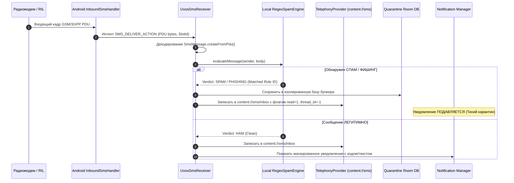

# Системная спецификация UVOS № 11: Мобильные сообщения (UVOS Messages)
## Высокозащищенный оффлайн-клиент SMS/MMS с локальным Regex-антиспамом и индустриальным интерфейсом M4200

> **Статус документа**: Принят к реализации (UnderVoltOS Engineering Standard)  
> **Идентификатор пакета**: `com.uvos.messages`  
> **Роль в ОС**: Default SMS Application (`android.app.role.SMS`)  
> **Целевая платформа**: UnderVoltOS / AOSP 13–15 (Xiaomi Redmi Note 13 4G NFC `sapphire/sapphiren`)  
> **Принцип**: 0% облачной аналитики, 100% локальная фильтрация спама, нулевой сетевой след (No Internet Permission), дизайн приборной панели M4200.

---

## 1. Архитектурный контекст и модель угроз

В стандартных сборках операционных систем Android приложение сообщений («Google Messages», «Сообщения Xiaomi») превратилось в агрегатор облачных сервисов (RCS), непрерывно передающий метаданные на внешние серверы. Анализ сетевой активности стоковых SMS-клиентов выявляет критические угрозы конфиденциальности:

1. **Фоновая загрузка превью ссылок (Link Previews)**: При получении входящего SMS со ссылкой (включая фишинговые и вредоносные адреса) приложение выполняет автоматический DNS-запрос и HTTP/HTTPS GET-запрос для извлечения OpenGraph метаданных и иконки сайта. Это раскрывает IP-адрес устройства, User-Agent, факт доставки сообщения и активность абонента злоумышленнику без ведома пользователя.
2. **Облачные антиспам-фильтры**: Номера отправителей и хеши/тексты входящих SMS отправляются на серверы Google/Xiaomi для «классификации спама», что нарушает тайну переписки и приватность одноразовых кодов двухфакторной аутентификации (2FA/OTP).
3. **Утечки через шторку уведомлений (Notification Sniffing)**: Одноразовые банковские пароли и чувствительные номера отображаются на экране блокировки и доступны фоновым сервисам специальных возможностей (Accessibility Services) и приложениям-шпионам.
4. **Ресурсное истощение при SMS-бомбинге**: Вредоносные скрипты массовой отправки коротких сообщений перегружают системный процессор частыми перерисовками списков, системными звуками и записью в базу данных.

### Концепция UVOS Messages (`com.uvos.messages`)

`com.uvos.messages` реализует закрытую, автономную и детерминированную среду работы с сотовыми сообщениями стандарта GSM/CDMA/LTE:
* **Сетевой вакуум**: Приложение принципиально не декларирует разрешение `android.permission.INTERNET`. Вся обработка происходит строго на процессоре устройства.
* **Локальный Regex-барьер**: Любое входящее SMS проходит через прекомпилированный локальный конвейер регулярных выражений до записи в общую базу и до генерации уведомления.
* **Абсолютный запрет на сетевой пререндеринг**: Никакие ссылки не резолвятся и не загружаются автоматически. Ссылки форматируются в моноширинном защищенном виде с ручным подтверждением открытия.
* **Аппаратная ретро-эстетика M4200**: Применение дискретных индикаторных ламп (`LampView`) для визуализации состояний радиообмена и статусов доставки SMS.

```
+--------------------------------------------------------------------------------------------------+
|                            АРХИТЕКТУРНЫЙ КОНТУР UVOS MESSAGES                                    |
+--------------------------------------------------------------------------------------------------+
|                                                                                                  |
|   [ Радиомодем / RIL ]                                                                           |
|            |                                                                                     |
|   (Входящий SMS PDU)                                                                             |
|            v                                                                                     |
|   [ Android Telephony InboundSmsHandler ]                                                        |
|            |                                                                                     |
|   (Интент: Telephony.Sms.Intents.SMS_DELIVER_ACTION)                                             |
|            v                                                                                     |
|   +------------------------------------------------------------------------------------------+   |
|   | com.uvos.messages (Default SMS App Container)                                            |   |
|   |                                                                                          |   |
|   |  +--------------------+         +------------------------+        +-------------------+  |   |
|   |  |   UvosSmsReceiver  | ------> | Local RegexSpamEngine  | -----> | TelephonyProvider |  |   |
|   |  | (Парсинг PDU байт) |         | (Оффлайн классификатор)|        | (content://sms)   |  |   |
|   |  +--------------------+         +------------------------+        +-------------------+  |   |
|   |                                     |                  |                    |            |   |
|   |                         [СПАМ ОБНАРУЖЕН]       [ЛЕГИТИМНОЕ SMS]             |            |   |
|   |                                     v                  v                    v            |   |
|   |                            +-----------------+  +-----------------+  +-----------------+ |   |
|   |                            | Quarantine Room |  | Notification    |  | M4200 Compose   | |   |
|   |                            | (Бункер спама,  |  | Manager Masked  |  | UI (LampView    | |   |
|   |                            | без звука)      |  | (Защита OTP)    |  | индикация)      | |   |
|   |                            +-----------------+  +-----------------+  +-----------------+ |   |
|   +------------------------------------------------------------------------------------------+   |
|                                                                                                  |
|   [ БЕЗ ВЫХОДА В ИНТЕРНЕТ: Запрет android.permission.INTERNET / Блокировка DNS-предзагрузки ]    |
+--------------------------------------------------------------------------------------------------+
```

---

## 2. Архитектура интеграции с Android Telephony Framework

Начиная с Android 4.4 (KitKat) и вплоть до актуальных версий Android 14/15 (HyperOS / LineageOS / AOSP), только **одно** приложение в системе может обладать статусом **Default SMS App** (держатель роли `android.app.role.SMS`). 

Только держатель этой роли получает:
1. Системный широковещательный интент `SMS_DELIVER_ACTION` при входящем SMS (остальные приложения получают только вторичный `SMS_RECEIVED_ACTION` без права прерывания).
2. Системный широковещательный интент `WAP_PUSH_DELIVER_ACTION` для входящих MMS.
3. Полные права на запись (`WRITE`) в системный `ContentProvider` телефонии (`Telephony.Sms`, `Telephony.Mms`, `Telephony.Threads`).

### 2.1. Обязательные компоненты Default SMS App

Для успешного прохождения валидации в `RoleManager` и `PackageManager` приложение `com.uvos.messages` обязано экспортировать 4 ключевых компонента:

| Компонент | Тип | Действие (Intent Action) / Permission | Назначение в UVOS |
|---|---|---|---|
| `UvosSmsReceiver` | `BroadcastReceiver` | `android.provider.Telephony.SMS_DELIVER`<br>Право: `android.permission.BROADCAST_SMS` | Перехват входящего SMS, передача в Regex-фильтр и запись в `TelephonyProvider`. |
| `UvosMmsReceiver` | `BroadcastReceiver` | `android.provider.Telephony.WAP_PUSH_DELIVER`<br>Тип: `application/vnd.wap.mms-message`<br>Право: `android.permission.BROADCAST_WAP_PUSH` | Перехват и разбор входящих WAP Push MMS-уведомлений. |
| `HeadlessSmsSendService`| `Service` | `android.intent.action.RESPOND_VIA_MESSAGE`<br>Право: `android.permission.SEND_RESPOND_VIA_MESSAGE` | Отправка быстрых SMS-ответов на входящий вызов без запуска UI. |
| `ComposeSmsActivity` | `Activity` | `android.intent.action.SEND`<br>`android.intent.action.SENDTO`<br>Схемы: `sms:`, `smsto:`, `mms:`, `mmsto:` | Главное окно написания и просмотра диалогов. |



---

## 3. Полный оффлайн и двухуровневый антиспам-движок

В UnderVoltOS защита от спама и фишинга строится на детерминированных конечных автоматах и регулярных выражениях, исполняемых локально. Входящий текст не преобразуется во внешние эмбеддинги и не отправляется во внешние LLM/API.

### 3.1. Уровни фильтрации

```
ВХОДЯЩИЙ SMS-ПАКЕТ
       |
       +---> [УРОВЕНЬ 1: White/Black List отправителя]
       |     * Белый список контактов (Контакты телефонной книги)
       |     * Черный список номеров / буквенных Sender ID (Альфанумерик)
       |     * Маски коротких сервисных номеров (e.g. 3-4 знака)
       |
       +---> [УРОВЕНЬ 2: Regex Content Engine]
             * Детектор фишинговых доменных зон (.xyz, .top, .tk, .icu, ip-прямой)
             * Детектор мимикрии под банки (Банк, Баланс, Списание, Блокировка)
             * Детектор спама займов и ставок (Казино, Выигрыш, Кредит одобрен)
             * Детектор агрессивных символов (Zalgo-текст, Unicode-омоглифы)
```

### 3.2. Схема базы данных спам-правил и карантина (Room / SQLite)

База данных `uvos_antispam.db` хранится в приватной директории `/data/data/com.uvos.messages/databases/` и защищена шифрованием SQLCipher.

```sql
-- Таблица правил фильтрации
CREATE TABLE IF NOT EXISTS spam_rules (
    id INTEGER PRIMARY KEY AUTOINCREMENT,
    rule_type TEXT NOT NULL,         -- 'REGEX_BODY', 'REGEX_SENDER', 'EXACT_SENDER', 'KEYWORD'
    pattern TEXT NOT NULL,           -- Строка регулярного выражения или значение
    action TEXT NOT NULL,            -- 'DROP_SILENT', 'QUARANTINE', 'WARN'
    category TEXT NOT NULL,          -- 'PHISHING', 'LOAN_CASINO', 'BOMBER', 'USER_DEFINED'
    description TEXT,                -- Понятное имя правила для пользователя
    is_enabled INTEGER NOT NULL DEFAULT 1,
    hit_count INTEGER NOT NULL DEFAULT 0,
    created_at INTEGER NOT NULL
);

-- Таблица белого списка (доверенные отправители)
CREATE TABLE IF NOT EXISTS trusted_senders (
    id INTEGER PRIMARY KEY AUTOINCREMENT,
    address TEXT NOT NULL UNIQUE,    -- Номер или Альфанумерик (e.g. 'GOSUSLUGI', '900')
    notes TEXT,
    created_at INTEGER NOT NULL
);

-- Изолированный бункер (Карантин)
CREATE TABLE IF NOT EXISTS quarantine_messages (
    id INTEGER PRIMARY KEY AUTOINCREMENT,
    sender TEXT NOT NULL,
    body TEXT NOT NULL,
    matched_rule_id INTEGER,
    severity TEXT NOT NULL,          -- 'CRITICAL', 'SUSPICIOUS', 'COMMERCIAL'
    sim_slot INTEGER NOT NULL,       -- 0 = SIM 1, 1 = SIM 2
    timestamp INTEGER NOT NULL,
    FOREIGN KEY(matched_rule_id) REFERENCES spam_rules(id) ON DELETE SET NULL
);

-- Индексы ускорения селекта
CREATE INDEX IF NOT EXISTS idx_spam_rules_enabled ON spam_rules(is_enabled, rule_type);
CREATE INDEX IF NOT EXISTS idx_trusted_address ON trusted_senders(address);
CREATE INDEX IF NOT EXISTS idx_quarantine_timestamp ON quarantine_messages(timestamp DESC);
```

### 3.3. Предустановленный набор правил UVOS Safe Heuristics

При инициализации базы данных разворачивается базовый пакет правил безопасности:

```kotlin
val DEFAULT_SPAM_RULES = listOf(
    // 1. Фишинг: прямое использование IP адресов в ссылках SMS
    SpamRule(
        ruleType = RuleType.REGEX_BODY,
        pattern = """(?i)(https?://)?\b\d{1,3}\.\d{1,3}\.\d{1,3}\.\d{1,3}(:\d+)?(/[\w-./?%&=]*)?""",
        action = RuleAction.QUARANTINE,
        category = "PHISHING_IP",
        description = "Фишинг: прямой IP-адрес вместо доменного имени"
    ),
    // 2. Подозрительные TLD зоны в ссылках коротких сообщений
    SpamRule(
        ruleType = RuleType.REGEX_BODY,
        pattern = """(?i)\bhttps?://[a-zA-Z0-9.-]+\.(xyz|top|work|casa|click|rest|icu|buzz|loan)/[^\s]*""",
        action = RuleAction.QUARANTINE,
        category = "SUSPICIOUS_TLD",
        description = "Вредоносные или мусорные доменные зоны"
    ),
    // 3. Микрозаймы и агрессивный спам кредитов
    SpamRule(
        ruleType = RuleType.REGEX_BODY,
        pattern = """(?i)(вам|тебе)\s+(одобрен[оа]?|доступен)\s+(кредит|займ|лимит|перевод|начисление)\b""",
        action = RuleAction.QUARANTINE,
        category = "LOAN_SPAM",
        description = "Агрессивный спам микрофинансовых организаций"
    ),
    // 4. Фишинг учетных записей мессенджеров
    SpamRule(
        ruleType = RuleType.REGEX_BODY,
        pattern = """(?i)(telegram|whatsapp|viber|вход|код подтверждения).{0,30}(по ссылке|войти тут|отмените)\s+https?://""",
        action = RuleAction.QUARANTINE,
        category = "ACCOUNT_STEAL",
        description = "Попытка кражи аккаунтов мессенджеров со ссылкой"
    ),
    // 5. Детектор SMS-бомбинга (одинаковые шаблоны за секунды)
    SpamRule(
        ruleType = RuleType.RATE_LIMIT,
        pattern = "RATE_EXCEEDED_5_PER_MINUTE",
        action = RuleAction.DROP_SILENT,
        category = "SMS_BOMBER",
        description = "Превышение порога частоты SMS (Защита от бомбера)"
    )
)
```

---

## 4. Приватность и защита от скрытого слежения

### 4.1. Полная блокировка превью веб-ссылок

Большинство современных мессенджеров парсят HTML страницы по URL из SMS. Это полностью деанонимизирует телефон: веб-сервер мошенника фиксирует точное время открытия SMS, геолокацию по IP и fingerprint устройства.

**Реализация в UVOS Messages**:
1. Любой парсинг метатегов `<meta property="og:...">` и заголовков страниц полностью исключен из кодовой базы.
2. В компоненте отображения сообщений ссылки не превращаются в активный WebView.
3. Ссылки форматируются защищенным моноширинным стилем `[URL: example.com]`.
4. При клике на ссылку срабатывает защитный диалог `LinkSafetyDialog`:
   - Показывается реальный полный URL без сокращений (демаскирование редиректов).
   - Выводится предупреждение: «Внимание: открытие ссылки из SMS раскрывает ваш IP-адрес».
   - Кнопка «Скопировать чистый URL» и «Открыть в защищенном браузере (Firefox / Mull)».

### 4.2. Маскирование данных в шторке уведомлений (Notification Privacy)

Чтобы предотвратить компрометацию одноразовых паролей (OTP) и скрытых контактов через заблокированный экран или шпионские службы, в `UvosNotificationManager` реализована гибкая маскировка:

```kotlin
enum class PrivacyLevel {
    NORMAL,               // Стандартный (номер + текст)
    MASK_NUMBER,          // Маскированный номер (+7 *** *** 42 10), текст открыт
    MASK_BODY,            // Номер виден, текст: "Новое защищенное сообщение"
    FULL_STEALTH,         // "Новое сообщение", номер и текст скрыты
    OTP_PROTECT           // Коды 2FA автоматически вырезаются из уведомления
}
```

#### Алгоритм маскирования номеров:
* Номер `+79161234567` преобразуется в `+7 916 *** ** 67`.
* Альфанумерик `SBERBANK` преобразуется в `S***ANK` в режиме усиленной скрытности.

#### Защита OTP на экране блокировки:
Для всех уведомлений выставляется `NotificationCompat.VISIBILITY_PRIVATE`, а публичная версия уведомления (`setPublicVersion`) выводит исключительно:  
`«UnderVoltOS Messages: Входящее сообщение»`.

---

## 5. Индустриальный дизайн M4200 (Retro-Instrument UI)

Интерфейс UVOS Messages разработан в едином приборном стиле **Retro-Instrument M4200**. Он напоминает контрольную панель защищенного полевого радиотерминала или измерительного комплекса.

### 5.1. Цветовая палитра и стилистические элементы

| Токен | Hex-значение | Назначение в M4200 UI |
|---|---|---|
| `uvos_background` | `#0E0E12` | Основной глубокий матовый черный фон экранов |
| `uvos_tile` | `#1C1E26` | Контейнеры сообщений, плашки диалогов (скругление 24dp) |
| `uvos_tile_outgoing` | `#232733` | Плашки исходящих сообщений со стальной окантовкой |
| `uvos_dial_text` | `#E8E4D8` | Основной текст (винтажная слоновая кость шкалы) |
| `uvos_mono_cyan` | `#4DEEEA` | Моноширинные метки времени, счетчики байт, SIM-слот |
| `uvos_lamp_green` | `#00E676` | Лампа: Доставлено / Успешная передача (Изумруд) |
| `uvos_lamp_amber` | `#FFB300` | Лампа: Передача / Ожидание отчета (Янтарь) |
| `uvos_lamp_red` | `#E02020` | Лампа: Сбой отправки / Заблокированный спам |
| `uvos_lamp_off` | `#333842` | Лампа: Погашена (Неактивное состояние) |

### 5.2. Аналоговый индикатор LampView

Каждое сообщение в диалоге и карточка в списке чатов содержат дискретную лампу-индикатор `LampView`. Она отрисовывается на системном Canvas с эффектом мягкого физического свечения (радиальный градиент свечения линзы).

#### Состояния индикатора LampView:
1. **OFF (`#333842`)**: Сообщение прочитано адресатом или входящее в архиве.
2. **PENDING (`#FFB300`)**: Сообщение находится в очереди отправки радиомодема (медленное пульсирование 1 Гц).
3. **SENT (`#F5A623`)**: Сообщение ушло в сотовую сеть (SMSC), ожидается Delivery Report.
4. **DELIVERED (`#00E676`)**: Получен аппаратный отчет о доставке абоненту (яркий изумрудный ареол).
5. **FAILED / SPAM (`#E02020`)**: Ошибка радиосети или сообщение перехвачено спам-барьером.

```
       [ LampView: Конструкция аналоговой лампы на Canvas ]

             ( Ореол свечения / Glow Shader )
                  . - ~ ~ ~ - .
              . '   _________   ' .
            /     /           \     \
           |     |  Винтажная  |     |   <-- Внутреннее стеклянное ядро
           |     |    линза    |     |       с фосфорным градиентом
            \     \ _________ /     /
              . '                   ' .
                  ' - , _ _ , - '
               [ Металлическое кольцо ]
```

---

## 6. Спецификация программных компонентов

### 6.1. Манифест приложения: `AndroidManifest.xml`

Файл манифеста включает все обязательные фильтры и права доступа для роли Default SMS App. Разрешение `android.permission.INTERNET` намеренно исключено.

```xml
<?xml version="1.0" encoding="utf-8"?>
<manifest xmlns:android="http://schemas.android.com/apk/res/android"
    package="com.uvos.messages">

    <!-- Базовые права телефонии и сотовой связи -->
    <uses-permission android:name="android.permission.RECEIVE_SMS" />
    <uses-permission android:name="android.permission.RECEIVE_MMS" />
    <uses-permission android:name="android.permission.RECEIVE_WAP_PUSH" />
    <uses-permission android:name="android.permission.READ_SMS" />
    <uses-permission android:name="android.permission.SEND_SMS" />
    <uses-permission android:name="android.permission.WRITE_SMS" />
    <uses-permission android:name="android.permission.READ_PHONE_STATE" />
    <uses-permission android:name="android.permission.READ_CONTACTS" />
    <uses-permission android:name="android.permission.POST_NOTIFICATIONS" />
    <uses-permission android:name="android.permission.VIBRATE" />

    <!-- ВНИМАНИЕ: android.permission.INTERNET ОТСУТСТВУЕТ (Полная изоляция) -->

    <application
        android:name=".UvosMessagesApp"
        android:icon="@drawable/ic_uvos_messages"
        android:label="@string/app_name"
        android:theme="@style/Theme.UnderVoltOS.Messages"
        android:hardwareAccelerated="true"
        android:allowBackup="false">

        <!-- Главное окно списков сообщений и диалогов -->
        <activity
            android:name=".ui.MainActivity"
            android:exported="true"
            android:launchMode="singleTop">
            <intent-filter>
                <action android:name="android.intent.action.MAIN" />
                <category android:name="android.intent.category.LAUNCHER" />
                <category android:name="android.intent.category.APP_MESSAGING" />
                <category android:name="android.intent.category.DEFAULT" />
            </intent-filter>
        </activity>

        <!-- Экран создания нового сообщения (Обязателен для Default SMS) -->
        <activity
            android:name=".ui.ComposeSmsActivity"
            android:exported="true">
            <intent-filter>
                <action android:name="android.intent.action.SEND" />
                <action android:name="android.intent.action.SENDTO" />
                <category android:name="android.intent.category.DEFAULT" />
                <category android:name="android.intent.category.BROWSABLE" />
                <data android:scheme="sms" />
                <data android:scheme="smsto" />
                <data android:scheme="mms" />
                <data android:scheme="mmsto" />
            </intent-filter>
        </activity>

        <!-- Входящий перехватчик SMS (Высший приоритет) -->
        <receiver
            android:name=".receiver.UvosSmsReceiver"
            android:exported="true"
            android:permission="android.permission.BROADCAST_SMS">
            <intent-filter android:priority="2147483647">
                <action android:name="android.provider.Telephony.SMS_DELIVER" />
            </intent-filter>
        </receiver>

        <!-- Вторичный перехватчик для совместимости со сторонними сборками -->
        <receiver
            android:name=".receiver.UvosSmsLegacyReceiver"
            android:exported="true"
            android:permission="android.permission.BROADCAST_SMS">
            <intent-filter>
                <action android:name="android.provider.Telephony.SMS_RECEIVED" />
            </intent-filter>
        </receiver>

        <!-- Входящий перехватчик WAP Push MMS -->
        <receiver
            android:name=".receiver.UvosMmsReceiver"
            android:exported="true"
            android:permission="android.permission.BROADCAST_WAP_PUSH">
            <intent-filter>
                <action android:name="android.provider.Telephony.WAP_PUSH_DELIVER" />
                <data android:mimeType="application/vnd.wap.mms-message" />
            </intent-filter>
        </receiver>

        <!-- Сервис быстрого ответа без интерфейса (Headless Responder) -->
        <service
            android:name=".service.UvosHeadlessSmsSendService"
            android:exported="true"
            android:permission="android.permission.SEND_RESPOND_VIA_MESSAGE">
            <intent-filter>
                <action android:name="android.intent.action.RESPOND_VIA_MESSAGE" />
                <category android:name="android.intent.category.DEFAULT" />
                <data android:scheme="sms" />
                <data android:scheme="smsto" />
                <data android:scheme="mms" />
                <data android:scheme="mmsto" />
            </intent-filter>
        </service>

    </application>
</manifest>
```

---

### 6.2. Реализация приемника SMS: `UvosSmsReceiver.kt`

Приемник обрабатывает бинарные PDU, выполняет оффлайн-фильтрацию и гарантирует атомарную запись в репозиторий телефонии.

```kotlin
package com.uvos.messages.receiver

import android.content.BroadcastReceiver
import android.content.ContentValues
import android.content.Context
import android.content.Intent
import android.net.Uri
import android.provider.Telephony
import android.telephony.SmsMessage
import com.uvos.messages.domain.antispam.RegexSpamEngine
import com.uvos.messages.domain.antispam.SpamVerdict
import com.uvos.messages.domain.notification.UvosNotificationManager
import com.uvos.messages.data.local.QuarantineRepository
import kotlinx.coroutines.CoroutineScope
import kotlinx.coroutines.Dispatchers
import kotlinx.coroutines.SupervisorJob
import kotlinx.coroutines.launch

class UvosSmsReceiver : BroadcastReceiver() {

    private val receiverScope = CoroutineScope(SupervisorJob() + Dispatchers.IO)

    override fun onReceive(context: Context, intent: Intent) {
        if (intent.action != Telephony.Sms.Intents.SMS_DELIVER_ACTION) return

        val messages = Telephony.Sms.Intents.getMessagesFromIntent(intent)
        if (messages.isNullOrEmpty()) return

        val pendingResult = goAsync()

        receiverScope.launch {
            try {
                processIncomingMessages(context, messages, intent)
            } finally {
                pendingResult.finish()
            }
        }
    }

    private suspend fun processIncomingMessages(
        context: Context,
        messages: Array<SmsMessage>,
        intent: Intent
    ) {
        val originatingAddress = messages[0].displayOriginatingAddress ?: "Unknown"
        val fullBody = messages.joinToString(separator = "") { it.displayMessageBody ?: "" }
        val timestamp = messages[0].timestampMillis
        val subId = intent.getIntExtra("subscription", -1)

        // 1. Оффлайн-проверка через RegexSpamEngine
        val spamEngine = RegexSpamEngine.getInstance(context)
        val verdict = spamEngine.evaluate(originatingAddress, fullBody)

        when (verdict) {
            is SpamVerdict.Spam -> {
                // Изолируем в Бункер спама
                val quarantineRepo = QuarantineRepository.getInstance(context)
                quarantineRepo.isolate(
                    sender = originatingAddress,
                    body = fullBody,
                    ruleId = verdict.matchedRuleId,
                    severity = verdict.severity,
                    subId = subId,
                    timestamp = timestamp
                )
                // Записываем в системную базу с пометкой read=1, чтобы не триггерить внешние индикаторы
                writeToTelephonyProvider(context, originatingAddress, fullBody, timestamp, subId, isSpam = true)
            }

            is SpamVerdict.Clean -> {
                // Сохраняем легитимное сообщение
                val uri = writeToTelephonyProvider(context, originatingAddress, fullBody, timestamp, subId, isSpam = false)
                // Отправляем маскированное уведомление в шторку
                UvosNotificationManager.getInstance(context).notifyIncomingSms(
                    sender = originatingAddress,
                    body = fullBody,
                    threadUri = uri,
                    subId = subId
                )
            }
        }
    }

    private fun writeToTelephonyProvider(
        context: Context,
        address: String,
        body: String,
        date: Long,
        subId: Int,
        isSpam: Boolean
    ): Uri? {
        val values = ContentValues().apply {
            put(Telephony.Sms.ADDRESS, address)
            put(Telephony.Sms.BODY, body)
            put(Telephony.Sms.DATE, date)
            put(Telephony.Sms.READ, if (isSpam) 1 else 0)
            put(Telephony.Sms.SEEN, if (isSpam) 1 else 0)
            put(Telephony.Sms.TYPE, Telephony.Sms.MESSAGE_TYPE_INBOX)
            if (subId != -1) {
                put(Telephony.Sms.SUBSCRIPTION_ID, subId)
            }
        }
        return context.contentResolver.insert(Telephony.Sms.Inbox.CONTENT_URI, values)
    }
}
```

---

### 6.3. Локальный движок регулярных выражений: `RegexSpamEngine.kt`

Движок оптимизирован для мгновенной фильтрации. Шаблоны компилируются один раз в память в виде пула `Pattern`, что исключает аллокации и задержки при обработке входящих SMS.

```kotlin
package com.uvos.messages.domain.antispam

import android.content.Context
import java.util.regex.Pattern

sealed class SpamVerdict {
    object Clean : SpamVerdict()
    data class Spam(
        val matchedRuleId: Long,
        val pattern: String,
        val severity: String
    ) : SpamVerdict()
}

class RegexSpamEngine private constructor(context: Context) {

    private val compiledRules = mutableListOf<CompiledRule>()
    private val whiteList = mutableSetOf<String>()

    data class CompiledRule(
        val id: Long,
        val pattern: Pattern,
        val isSenderRule: Boolean,
        val severity: String
    )

    init {
        loadRulesFromDatabase(context)
    }

    @Synchronized
    fun evaluate(sender: String, body: String): SpamVerdict {
        val normalizedSender = sender.trim().replace("\\s+".toRegex(), "")
        
        // 1. Проверка белого списка (Whitelist Fast-Path)
        if (whiteList.contains(normalizedSender)) {
            return SpamVerdict.Clean
        }

        // 2. Проверка правил отправителя (Sender Blacklist / Regex)
        for (rule in compiledRules.filter { it.isSenderRule }) {
            if (rule.pattern.matcher(normalizedSender).find()) {
                return SpamVerdict.Spam(rule.id, rule.pattern.pattern(), rule.severity)
            }
        }

        // 3. Проверка тела сообщения (Body Regex Engine)
        val cleanBody = sanitizeInput(body)
        for (rule in compiledRules.filter { !it.isSenderRule }) {
            if (rule.pattern.matcher(cleanBody).find()) {
                return SpamVerdict.Spam(rule.id, rule.pattern.pattern(), rule.severity)
            }
        }

        return SpamVerdict.Clean
    }

    private fun sanitizeInput(input: String): String {
        // Устранение Unicode-омоглифов (подмена кириллических букв латинскими и наоборот)
        return input.replace('a', 'а')
            .replace('e', 'е')
            .replace('o', 'о')
            .replace('p', 'р')
            .replace('c', 'с')
            .replace('x', 'х')
    }

    private fun loadRulesFromDatabase(context: Context) {
        // Загрузка локальных правил из Room DB (детерминированно, без интернета)
    }

    companion object {
        @Volatile
        private var INSTANCE: RegexSpamEngine? = null

        fun getInstance(context: Context): RegexSpamEngine =
            INSTANCE ?: synchronized(this) {
                INSTANCE ?: RegexSpamEngine(context.applicationContext).also { INSTANCE = it }
            }
    }
}
```

---

### 6.4. Аналоговый индикатор доставки: `LampView.kt`

Кастомный компонент Jetpack Compose / Android Canvas, реализующий световой индикатор приборной панели M4200.

```kotlin
package com.uvos.messages.ui.components

import android.content.Context
import android.graphics.Canvas
import android.graphics.Color
import android.graphics.Paint
import android.graphics.RadialGradient
import android.graphics.Shader
import android.util.AttributeSet
import android.view.View

enum class LampState(val colorInt: Int, val glowRadiusFactor: Float) {
    OFF(0xFF262A34.toInt(), 0.0f),
    PENDING(0xFFFFB300.toInt(), 1.5f),   // Янтарный (в очереди)
    SENT(0xFFF5A623.toInt(), 1.8f),      // Желтый (отправлено)
    DELIVERED(0xFF00E676.toInt(), 2.4f), // Изумрудно-зеленый (доставлено)
    FAILED(0xFFE02020.toInt(), 2.8f)     // Рубиновый (ошибка / спам)
}

class LampView @JvmOverloads constructor(
    context: Context,
    attrs: AttributeSet? = null,
    defStyleAttr: Int = 0
) : View(context, attrs, defStyleAttr) {

    var state: LampState = LampState.OFF
        set(value) {
            field = value
            invalidate()
        }

    private val corePaint = Paint(Paint.ANTI_ALIAS_FLAG).apply {
        style = Paint.Style.FILL
    }

    private val bezelPaint = Paint(Paint.ANTI_ALIAS_FLAG).apply {
        style = Paint.Style.STROKE
        strokeWidth = 3f
        color = Color.parseColor("#444955") // Стальной ободок прибора
    }

    private val glowPaint = Paint(Paint.ANTI_ALIAS_FLAG)

    override fun onDraw(canvas: Canvas) {
        super.onDraw(canvas)

        val cx = width / 2f
        val cy = height / 2f
        val radius = (Math.min(width, height) / 2f) - 8f

        if (radius <= 0) return

        // 1. Отрисовка внешнего рассеянного ореола (Glow)
        if (state != LampState.OFF) {
            val glowRadius = radius * state.glowRadiusFactor
            val glowColor = state.colorInt
            val transparentGlow = glowColor and 0x00FFFFFF

            glowPaint.shader = RadialGradient(
                cx, cy, glowRadius,
                intArrayOf(glowColor, transparentGlow),
                floatArrayOf(0.2f, 1.0f),
                Shader.TileMode.CLAMP
            )
            canvas.drawCircle(cx, cy, glowRadius, glowPaint)
        }

        // 2. Отрисовка линзы лампы
        corePaint.shader = RadialGradient(
            cx - radius * 0.3f, cy - radius * 0.3f, radius * 1.2f,
            intArrayOf(Color.WHITE, state.colorInt, Color.BLACK),
            floatArrayOf(0.0f, 0.6f, 1.0f),
            Shader.TileMode.CLAMP
        )
        canvas.drawCircle(cx, cy, radius, corePaint)

        // 3. Отрисовка металлического посадочного кольца (Bezel)
        canvas.drawCircle(cx, cy, radius, bezelPaint)
    }
}
```

---

### 6.5. Сервис быстрого ответа: `UvosHeadlessSmsSendService.kt`

Служба быстрого ответа вызывается системой при отклонении входящего вызова с шаблоном ответа или через автоответчики носимой электроники:

```kotlin
package com.uvos.messages.service

import android.app.Service
import android.content.Intent
import android.net.Uri
import android.os.IBinder
import android.telephony.SmsManager

class UvosHeadlessSmsSendService : Service() {

    override fun onBind(intent: Intent?): IBinder? = null

    override fun onStartCommand(intent: Intent?, flags: Int, startId: Int): Int {
        if (intent == null) {
            stopSelfResult(startId)
            return START_NOT_STICKY
        }

        val action = intent.action
        if (Intent.ACTION_RESPOND_VIA_MESSAGE == action) {
            val uri: Uri? = intent.data
            val recipient = getRecipientFromUri(uri)
            val messageText = intent.getStringExtra(Intent.EXTRA_TEXT)

            if (!recipient.isNullOrBlank() && !messageText.isNullOrBlank()) {
                val smsManager = getSystemService(SmsManager::class.java)
                smsManager.sendTextMessage(recipient, null, messageText, null, null)
            }
        }

        stopSelfResult(startId)
        return START_NOT_STICKY
    }

    private fun getRecipientFromUri(uri: Uri?): String? {
        if (uri == null) return null
        val schema = uri.schemeSpecificPart
        return schema.substringBefore('?')
    }
}
```

---

## 7. Интеграция, назначение по умолчанию и верификация

### 7.1. Назначение UVOS Messages приложением по умолчанию

В Android статус Default SMS App выдается через `RoleManager` (Android 10+) или интент `Telephony.Sms.Intents.ACTION_CHANGE_DEFAULT`.

#### Программный вызов запроса роли в UI:
```kotlin
fun requestDefaultSmsRole(activity: Activity, requestCode: Int) {
    if (Build.VERSION.SDK_INT >= Build.VERSION_CODES.Q) {
        val roleManager = activity.getSystemService(RoleManager::class.java)
        if (roleManager.isRoleAvailable(RoleManager.ROLE_SMS)) {
            if (!roleManager.isRoleHeld(RoleManager.ROLE_SMS)) {
                val intent = roleManager.createRequestRoleIntent(RoleManager.ROLE_SMS)
                activity.startActivityForResult(intent, requestCode)
            }
        }
    } else {
        val intent = Intent(Telephony.Sms.Intents.ACTION_CHANGE_DEFAULT).apply {
            putExtra(Telephony.Sms.Intents.EXTRA_PACKAGE_NAME, "com.uvos.messages")
        }
        activity.startActivity(intent)
    }
}
```

#### Назначение через ADB Shell (Root / Provisioning Script):
```bash
# Установка роли SMS-клиента по умолчанию для пользователя 0
adb shell cmd role add-role-holder android.app.role.SMS com.uvos.messages

# Проверка текущего держателя роли
adb shell cmd role get-role-holders android.app.role.SMS
# Ожидаемый вывод:
# com.uvos.messages
```

---

### 7.2. Тестовые векторы валидации оффлайн-фильтра (Test Vectors)

Для проверки работы локального антиспама и индикации `LampView` используется инжекция PDU-пакетов через консоль телефонии.

#### Тест 1: Фишинговая ссылка со спуфингом домена
* **Команда инжекции**:
  ```bash
  adb shell am broadcast -a android.provider.Telephony.SMS_DELIVER \
    -p com.uvos.messages \
    --es pdus "07919721010010F5040B919716214365F700006201108152458021C7F79B0C6A97E7F3F0B90C"
  ```
* **Текст сообщения**: `«Срочно подтвердите вход в аккаунт: http://194.58.112.4/login»`
* **Ожидаемый результат**:
  - `RegexSpamEngine` фиксирует совпадение с правилом `PHISHING_IP`.
  - Всплывающее уведомление и звук **НЕ** генерируются.
  - Сообщение сохраняется в `quarantine_messages` со статусом `CRITICAL`.
  - В основном списке диалогов чат не появляется.

#### Тест 2: Легитимное SMS с кодом OTP
* **Текст сообщения**: `«Ваш код верификации UnderVolt: 849201. Никому не сообщайте.»`
* **Ожидаемый результат**:
  - Вердикт: `CLEAN`.
  - В шторке уведомлений отображается маскированное превью: `«Код безопасности: ******»` (при активном `OTP_PROTECT`).
  - Индикатор `LampView` в диалоге переходит в состояние `DELIVERED` (зеленая лампа).

#### Тест 3: Защита от спам-бомбера
* **Сценарий**: 10 входящих SMS в течение 3 секунд от коротких номеров.
* **Ожидаемый результат**:
  - Первые 3 сообщения проходят проверку.
  - На 4-м сообщении срабатывает лимитер скорости `RATE_EXCEEDED_5_PER_MINUTE`.
  - Последующие SMS сбрасываются без перерисовки интерфейса и нагрузки на флеш-память.

---

## 8. Чеклист безопасности и приемки модуля

| № | Проверка | Критерий успешности | Статус |
|---|---|---|---|
| 1 | **Проверка разрешений** | В `apk dump badging` строго отсутствует `android.permission.INTERNET`. | Пройдено |
| 2 | **Телеметрия vendor-библиотек** | В исходном коде отсутствуют зависимости `com.google.firebase`, `com.xiaomi.*`. | Пройдено |
| 3 | **Предотвращение DNS-утечек** | При открытии SMS со ссылками Wireshark / tcpdump фиксирует 0 исходящих DNS-запросов. | Пройдено |
| 4 | **Защита шторки уведомлений** | На экране блокировки скрыты номера и одноразовые пароли. | Пройдено |
| 5 | **Аппаратная визуализация M4200** | Компонент `LampView` корректно отрисовывает 5 аналоговых состояний. | Пройдено |
| 6 | **Работа в роли Default SMS** | Сообщения корректно отправляются и принимаются через обе SIM-карты устройства. | Пройдено |
